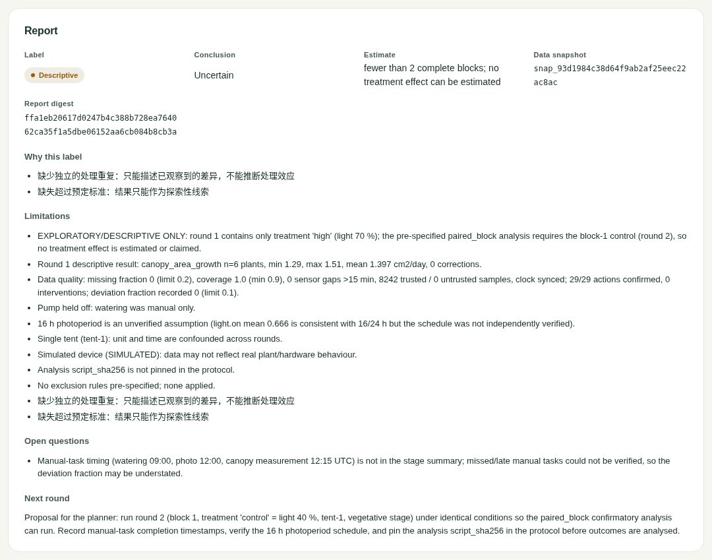
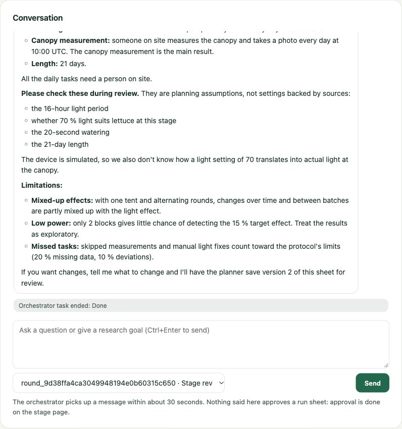
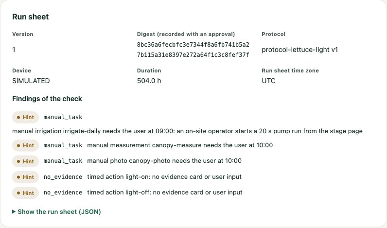
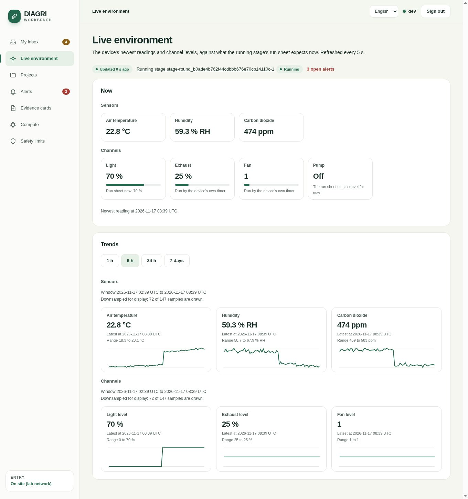
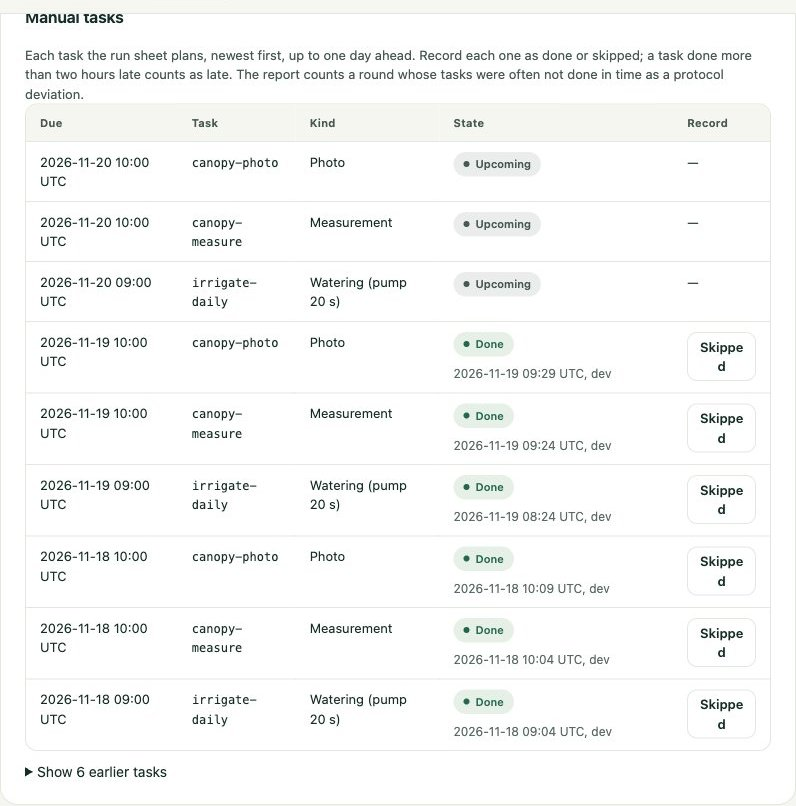
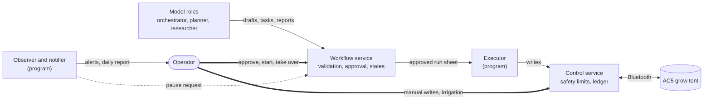

# DiAGRI

English | [简体中文](README.zh-CN.md)

**DiAGRI is an agentic research system for plant-growth experiments.** Give it a research question and it takes the question through a whole experiment. Four language-model agents design the study, analyse the result and audit the records. Deterministic programs run the approved plan on a grow tent and watch over it. Every reading, write, approval and report is kept, so the study can be traced and repeated. A person approves each run sheet before anything touches the plants, and no safety check depends on a model.

> **Status.** DiAGRI as a whole has run only on a simulated AC5 controller, including complete research rounds with Claude in the model roles. Its device bridge, GrowBridge, has read and controlled a real Spider Farmer AC5 over Bluetooth. See [Status and known limitations](docs/wiki/en/Status-and-Known-Limitations.md).

The [DiAGRI wiki](docs/wiki/README.md) ([English](docs/wiki/en/Home.md), [简体中文](docs/wiki/zh-CN/Home.md)) describes the whole platform.

## A research round, start to finish

On 15 November 2026 one round ran with Claude Opus 5.5 in all three model roles, on the simulated AC5. Every step is recorded, with the requests, the model replies and the screenshots, in [Example: a complete round with the model roles](docs/wiki/en/Example-Full-Round-With-Claude.md).

| Step | Who | What happened |
| --- | --- | --- |
| Question | operator | Asked in the project conversation: "Does raising the grow light from 40 % to 70 % speed up lettuce canopy growth?" |
| Design | orchestrator, planner | The orchestrator handed round 1 (block 1, light 70 %) to the planner and said at once that one tent cannot separate time from the treatment. The planner drafted a 21-day run sheet: light 70 % from 06:00 to 22:00, and daily watering, measurement and photo by hand. It passed the validator and the treatment check the first time. |
| Approval | operator | The operator read the run sheet, signed in again and approved its digest, then started the stage. No model can approve or start anything. |
| Execution | executor (a program) | The 21 days ran fast-forwarded in 129 seconds: 12,264 trusted samples, 43 confirmed writes, 63 manual tasks recorded on time. |
| Analysis | orchestrator, researcher | The researcher inspected the data, froze a snapshot and published the report. |
| Report | server, researcher | Descriptive, uncertain. The canopy measurements were missing from the data, so the researcher and the server said so and filled nothing in. |

The missing measurements were the scripted operator's mistake: it recorded six values at the stage's end instead of one a day, with a time outside the data window. The researcher saw the conflict with the task records before freezing ("I won't impute or backfill anything"), and the orchestrator told the operator what to fix. That is the point of the design: a wrong input does not become a result.



<details>
<summary>More from this round: the orchestrator's follow-up, the run sheet under review, the live environment, the manual tasks</summary>









</details>

## How it works



DiAGRI splits the work in two. **Model roles reason:** they read data and hand in drafts, tasks and reports through a fixed list of tools. **Programs execute:** they validate, run, record and protect, the same input always gives the same action, and they never call a model.

| Agent | Kind | What it does |
| --- | --- | --- |
| Orchestrator | model role | Takes the operator's goal, delegates to the planner or the researcher, and reports back in the project conversation |
| Planner | model role | Designs the experiment and drafts the run sheets, checking them with the validation tools |
| Researcher | model role | Inspects the data, freezes it into a snapshot, runs the analysis and publishes the report |
| Auditor | model role | Reads the records of a running stage once per stage day and at its end, compares them with the run sheet and raises advisory findings; it cannot change anything |
| Executor | program | Carries out the approved run sheet: timed actions, feedback rules, protection rules, end actions |
| Observer and notifier | program | Evaluates alert rules, notices frozen readings, runs the stage checks (missed tasks, missing or out-of-window measurements), queues notifications and the daily report |

A round moves through fixed states: designing, stage review, stage running, data verification, analysis, delivered. The operator works from the web console at `/workbench`: projects and conversations, run sheets to review, the live environment, manual tasks, alerts and reports. See [The agents](docs/wiki/en/The-Five-Agents.md) and [Run a research round](docs/wiki/en/Run-a-Research-Round.md).

## What DiAGRI never does

These limits are enforced in code. They are not instructions a model is asked to follow.

- **A model never controls the device or a stage.** The stage and device control tools are removed from every model role's tool set, whatever the configuration says. Nothing said in a conversation counts as an approval.
- **A stage never starts without an operator's approval** of that exact version of the run sheet, bound to its digest and given after signing in again.
- **Nothing automatic starts the pump.** Validation blocks a run sheet whose scheduled step would start it, and the executor refuses one. The pump runs only when an operator on the lab network starts it: a planned irrigation from the stage page, or a manual takeover. Each run has a time limit, a cooldown and a guaranteed switch-off; a pump found on while DiAGRI is not irrigating is switched off by a watchdog.
- **Safety does not wait for a model.** The executor's tick, the protection rules and the pump interlock never call a model. An approved stage keeps running when the model API is down.
- **Recorded data is not rewritten.** Raw samples are append-only. A snapshot is frozen once; a correction becomes a new version.

## Records a study can rely on

- **Who, what, when, why.** Every approval names the run sheet's digest; every device write is in an action ledger with its read-back; every model call and every conversation message is kept per project.
- **Frozen data.** The researcher analyses a snapshot with a manifest of what it holds, never the live archive.
- **Honest labels.** The server, not the model, computes a report's label from the frozen data and downgrades it for missing data, deviations from the run sheet, a treatment that was never applied, or too few replicates. The reasons are kept in English and Chinese.
- **Manual work counts.** Watering, measuring and photographing are scheduled tasks with records; a round with more than 10 % of them not done in time counts as deviating.

See [Data archive and traceability](docs/wiki/en/Data-Archive-and-Traceability.md) and [Research methodology](docs/wiki/en/Research-Methodology.md).

## Try it

Requires Python 3.11 or newer. Install for development:

```sh
git clone https://github.com/kirinhcl/diagri.git
cd diagri
python3 -m venv .venv
.venv/bin/python -m pip install -c constraints-tested.txt -e '.[dev]'
```

**A round with Claude**, on the simulated AC5 and the development workbench. The model roles run through your local Claude Code CLI (version 2.1.280 or newer, signed in with `claude auth login`), so no API key is needed:

```sh
export GROWBRIDGE_DEV_SECRET='at least twelve characters'
.venv/bin/python scripts/dev_workbench.py --claude-code --fast-forward
```

Open `http://localhost:8770/workbench`, sign in as `dev` with that secret, create a project, a protocol and a round, and ask your question in the conversation. Read [the example](docs/wiki/en/Example-Full-Round-With-Claude.md#reproduce-it) first: it lists what to expect under `--fast-forward`.

**A round without a model**, scripted from start to end: see [Tutorial: a simulated round](docs/wiki/en/Tutorial-Simulated-Round.md).

To run DiAGRI against real hardware, install GrowBridge (below) and then [enable DiAGRI](docs/wiki/en/Enable-DiAGRI.md).

## GrowBridge, the device bridge

GrowBridge is the part of DiAGRI that talks to the hardware, and it can also be used on its own. It connects to Spider Farmer GGS controllers over local Bluetooth and gives LLMs tools for environmental monitoring, historical data, outlet switching, light and fan control, and timed pump operation. On its own (bridge-only mode, the default) it supports on-demand control, continuous data collection and a local web dashboard. Running an approved experiment plan is what DiAGRI mode adds.

This is an independent, early-stage project with no affiliation with Spider Farmer. Protocol reads, outlet switching, dimming and speed control have been verified on **macOS with an AC5 advertising as SF-GGS-PS5, firmware 3.2, using plaintext protocol v1**. A Linux/Raspberry Pi backend and installation scripts are included; Bluetooth operation on a physical Raspberry Pi has not yet been verified. Encrypted v2 firmware is detected and control is rejected.

```text
LLM / Codex
   │ MCP stdio (local or over SSH)
   ▼
GrowBridge MCP client
   │ Authenticated local HTTP
   ▼
GrowBridge daemon ─── SQLite history and operation records
   │ Single Bluetooth connection
   ▼
Spider Farmer AC5 / GGS
```

The daemon owns the Bluetooth connection, executes commands, verifies device readback and records history. MCP clients reach it through the local API, which listens only on `127.0.0.1:8766` by default. Each installation generates its own access token, which clients read from private configuration.

<details>
<summary>Dashboard screenshots from a real AC5</summary>


</details>

### Install and connect

macOS also requires Xcode Command Line Tools; Linux requires BlueZ and the system D-Bus.

```sh
.venv/bin/python -m pip install -c constraints-tested.txt .
.venv/bin/growbridge scan
.venv/bin/growbridge init --device YOUR_SCANNED_ADDRESS
.venv/bin/growbridge serve
.venv/bin/growbridge status   # in another terminal
```

On first use, macOS compiles and launches the native `GrowBridge BLE` helper; allow it to use Bluetooth. Control is disabled by default. After checking your wiring, set `controls_enabled = true` in `~/.config/spiderfarmer-growbridge/config.toml` and restart the service, or pass `--enable-controls` to `init`. The default outlet mapping:

| Device | Outlet | Control range |
| --- | --- | --- |
| Grow light | 1 | Brightness 0–100%; 0 turns it off |
| Exhaust fan | 2 | Speed 0–100%; 0 turns it off |
| Circulation fan | 3 | Gears 0–10; 0 turns it off |
| Water pump | 4 | Finite pulses; default maximum 5 seconds, with a 60-second cooldown |

Dimming and speed commands do not switch on the corresponding outlet; turn on the correctly wired outlet first. Writes to outlets absent from the live configuration are rejected.

### Dashboard and MCP

`.venv/bin/growbridge dashboard` opens the local dashboard through a single-use link: live readings, device readbacks, controls, finite pump pulses, history charts and CSV export, in English or Simplified Chinese. It runs from local assets and listens only on loopback; on a Raspberry Pi, forward the port with `ssh -L 8766:127.0.0.1:8766 YOUR_PI_HOST` and request the link with `growbridge dashboard --no-open` over SSH.

To connect Codex or another MCP client, add a stdio server:

```toml
[mcp_servers.growbridge]
command = "/absolute/path/diagri/.venv/bin/growbridge"
args = ["mcp"]
```

| Tool | Purpose |
| --- | --- |
| `get_health` | Bluetooth availability, data freshness, protocol, and outlet mapping |
| `get_status` | Environmental readings, outlet states, and device states |
| `get_history` | Existing observations from up to the last 168 hours; returns the latest 500 samples by default |
| `set_light` | Adjust grow light brightness |
| `set_exhaust` | Adjust exhaust fan speed |
| `set_fan` | Adjust circulation fan gear |
| `set_outlet` | Switch a power outlet; direct pump outlet activation is blocked |
| `run_pump` | Run a finite pump pulse and confirm OFF through device readback before returning |

Every control tool requires a `request_id` of 8–100 letters, digits, underscores or hyphens. Reuse it only when retrying the same action; it prevents duplicate execution. In DiAGRI mode only the three read tools remain.

### Run in the background

- **macOS:** `.venv/bin/python scripts/install_macos.py` installs a LaunchAgent that starts at login (`--uninstall` removes it). Collection stops while the Mac sleeps.
- **Raspberry Pi** (the intended target for continuous operation): on Raspberry Pi OS Lite 64-bit, install `python3-venv bluez dbus git`, install as above, scan again on the Pi, then `.venv/bin/python scripts/install_linux.py` and `sudo loginctl enable-linger "$USER"`. A Mac can use the Pi's MCP server over SSH with `command = "ssh"` and `args = ["-T", "YOUR_PI_HOST", "/absolute/path/on/pi/diagri/.venv/bin/growbridge", "mcp"]`.

See [Installation and quick start](docs/wiki/en/Installation-and-Quick-Start.md) for the details.

### Data and control boundaries

- Sensor samples are retained for 30 days by default (`retention_days`). Configuration, SQLite data and logs are stored in private user directories; the repository holds no device addresses, account identifiers, protocol captures or configuration backups.
- The service reads a module's complete configuration before changing its fields, and confirms each acknowledged change by reading the device state back.
- Ordinary controls are rejected when data is stale, Bluetooth is disconnected or the protocol is unsupported. Reconnection does not replay historical commands.
- The daemon owns pump timing; a client disconnect does not cancel the OFF action. If shutdown cannot be confirmed, the service reports the fault, blocks ordinary controls and turns the pump off after reconnecting. Software timing cannot guarantee shutdown during host power loss, forced termination or complete Bluetooth failure, so unattended irrigation needs device-side timing or independent hardware protection.

## Documentation

The [DiAGRI wiki](docs/wiki/README.md) ([English](docs/wiki/en/Home.md), [简体中文](docs/wiki/zh-CN/Home.md)) covers the whole platform: its architecture, the control and safety model, the research methods, reference pages, and what has and has not been verified.

To contribute, start with [CONTRIBUTING.md](CONTRIBUTING.md). To report a vulnerability, follow [SECURITY.md](SECURITY.md) and do not open a public issue. To cite DiAGRI, use [CITATION.cff](CITATION.cff) ("Cite this repository" on GitHub).

## Development and validation

```sh
.venv/bin/python -m pip install -c constraints-tested.txt -e '.[dev]'
.venv/bin/ruff check src tests scripts
.venv/bin/ruff format --check src tests scripts
.venv/bin/pytest -q
for f in src/growbridge/web/app.js $(find src/growbridge/web/workbench -name '*.js'); do node --check "$f"; done
node --test tests/web/*.test.mjs
.venv/bin/python -m build
```

The two `node` lines need Node.js (CI uses version 22) and run the same checks of the dashboard and console scripts as CI. See [VALIDATION.md](VALIDATION.md) for the detailed validation scope.

Automated tests use synthetic devices and a scripted model, with no Bluetooth connection, no physical hardware and no network. They cover the protocol (fragmentation and CRCs, unsupported protocol rejection), control read-back, parameter bounds, authentication, duplicate requests, pump timeouts and recovery, and whole research rounds from the goal to the delivered report. The console's unit tests run in Node without a browser, a server or a network.

References:

- [OpenAI MCP server development documentation](https://developers.openai.com/plugins/build/mcp-server)
- [Bleak Linux backend](https://bleak.readthedocs.io/en/latest/backends/linux.html)
- [Original Wi-Fi/MQTT bridge project](https://github.com/iceboerg00/spiderfarmer-bridge)
- [GGS BLE protocol research](https://github.com/cr0ssn0tice/Spider-Farmer-GGS-Controller-MQTT)

The driver and decoder are independently implemented. Protocol details have also been verified against local device data. MIT License.
