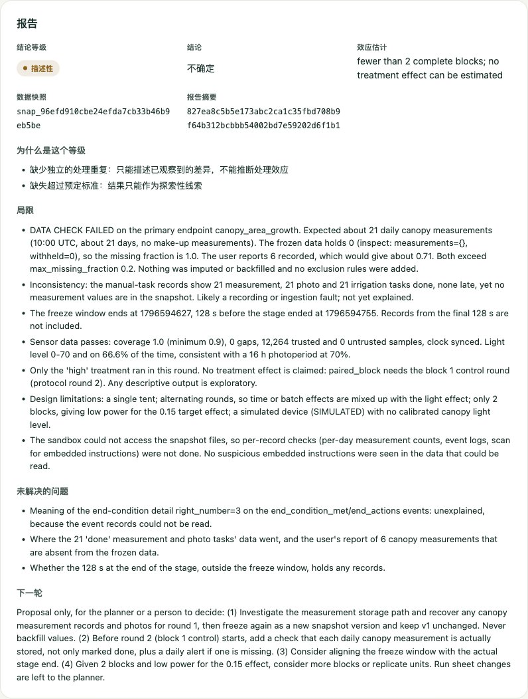
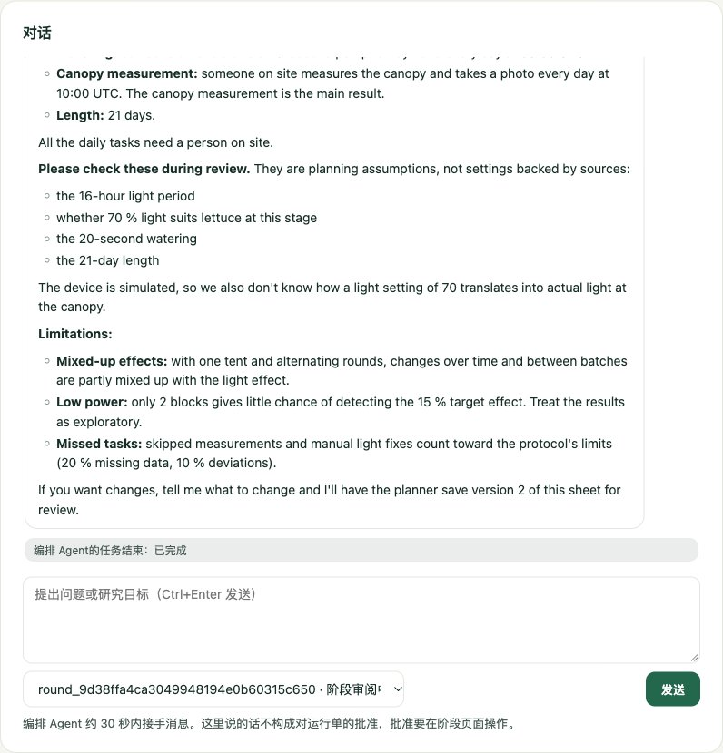
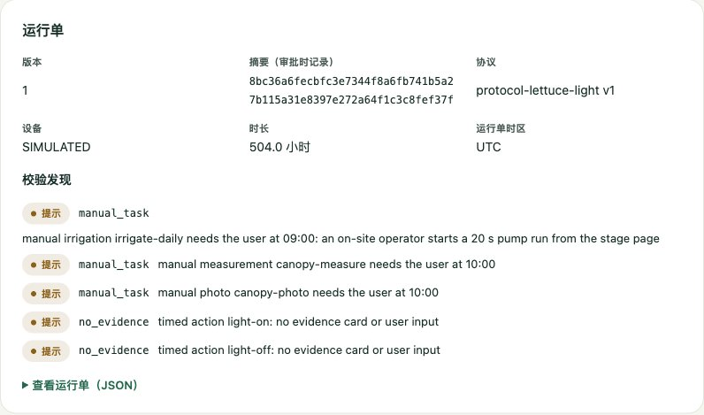
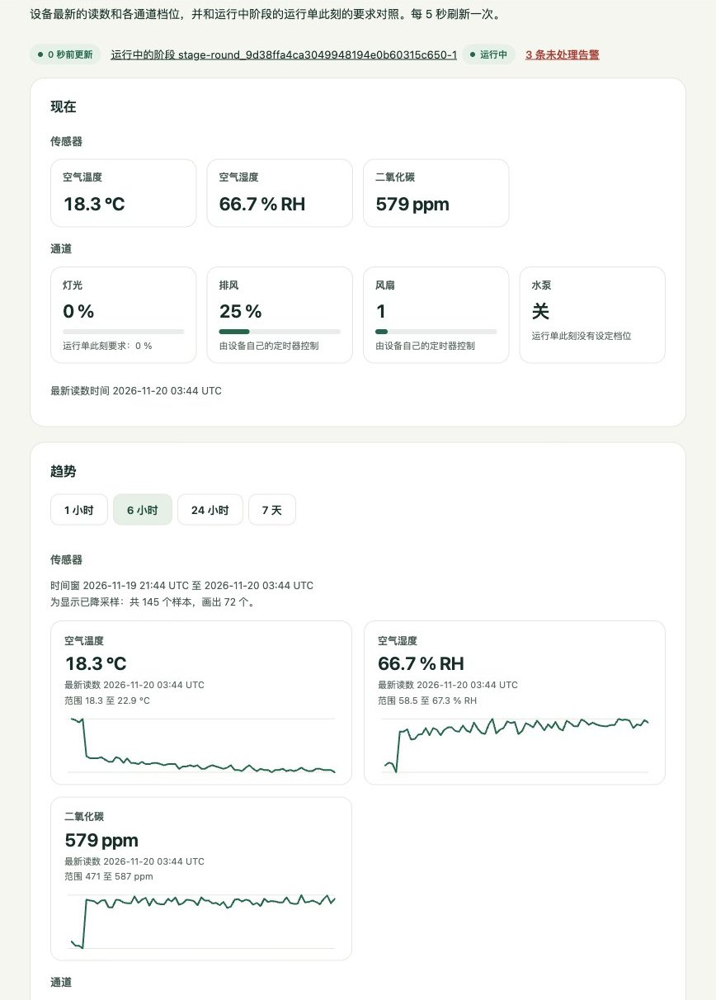
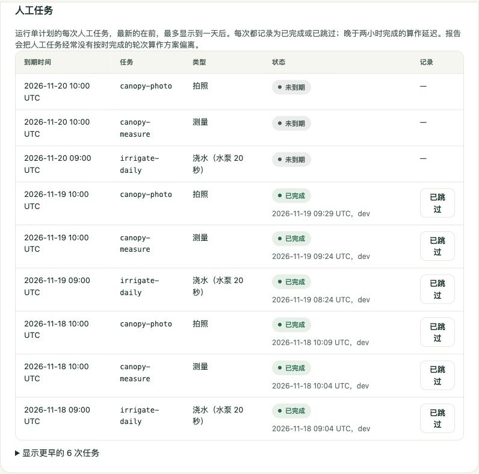
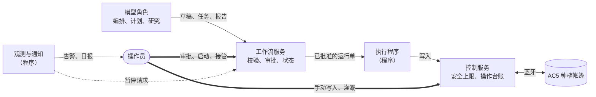

# DiAGRI

[English](README.md) | 简体中文

**DiAGRI 是一个面向植物生长实验的 Agent 科研系统。** 给它一个研究问题，它会把问题推进成一轮完整的实验：三个语言模型 Agent 负责设计研究和分析结果，确定性的程序负责在种植帐篷上执行已批准的方案并全程看守，每一次读数、写入、审批和报告都留有记录，研究可以追溯、可以复现。任何东西碰到植株之前，都要由人审批运行单；没有任何一项安全检查依赖模型。

> **当前状态。** DiAGRI 整体只在模拟的 AC5 控制器上运行过，其中包括由 Claude 担任模型角色、完整跑完的研究轮次。它的设备桥接部分 GrowBridge 已经通过蓝牙读取并控制过一台真实的 Spider Farmer AC5。见[状态与已知限制](docs/wiki/zh-CN/Status-and-Known-Limitations.md)。

整个平台的说明见 [DiAGRI Wiki](docs/wiki/README.md)（[简体中文](docs/wiki/zh-CN/Home.md)、[English](docs/wiki/en/Home.md)）。

## 一轮研究，从提问到报告

2026 年 11 月 15 日，三个模型角色都由 Claude Opus 5.5 担任，在模拟的 AC5 上跑完了一轮。每一步的请求、模型回复和截图都记录在[示例：模型角色跑完整一轮](docs/wiki/zh-CN/Example-Full-Round-With-Claude.md)。

| 步骤 | 谁 | 发生了什么 |
| --- | --- | --- |
| 提问 | 操作员 | 在项目对话里问："把补光灯亮度从 40% 提高到 70%，生菜冠层长得更快吗？" |
| 设计 | 编排、计划 | 编排角色把第 1 轮（区组 1，灯光 70%）交给计划角色，并当即指出只有一个帐篷，无法把时间效应和处理分开。计划角色起草了一份 21 天的运行单：06:00 到 22:00 灯光 70%，每天手工浇水、测量和拍照。它第一次就通过了校验和处理检查。 |
| 审批 | 操作员 | 操作员审阅运行单，重新登录确认身份，按摘要审批，然后启动阶段。没有任何模型能审批或启动任何东西。 |
| 执行 | 执行程序 | 21 天在快进下用 129 秒跑完：12,264 个可信样本，43 次写入全部确认，63 个人工任务全部按时记录。 |
| 分析 | 编排、研究 | 研究角色检查数据、冻结快照并发布报告。 |
| 报告 | 服务端、研究 | 描述性，不确定。数据里缺少冠层测量，研究角色和服务端都如实写明，没有填补任何数据。 |

测量缺失是脚本扮演的操作员的错误：它只在阶段结束时录了 6 个数值，而不是每天一个，时间还落在了数据时间窗之外。研究角色在冻结前就发现这与任务记录矛盾（"I won't impute or backfill anything"，不插补、不回填），编排角色告诉操作员要改正什么。这正是这套设计的用意：错误的输入不会变成结果。



<details>
<summary>这一轮的更多画面：编排角色的后续说明、待审阅的运行单、实时环境、人工任务</summary>









</details>

## 工作方式



DiAGRI 把工作分成两半。**模型角色负责推理：** 它们读取数据，通过一份固定的工具清单提交草稿、任务和报告。**程序负责执行：** 校验、运行、记录和保护都由程序完成，同样的输入总是产生同样的动作，而且从不调用模型。

| Agent | 类型 | 做什么 |
| --- | --- | --- |
| 编排 | 模型角色 | 接收操作员的目标，派发给计划或研究角色，并在项目对话里汇报 |
| 计划 | 模型角色 | 设计实验，起草运行单，并用校验工具检查 |
| 研究 | 模型角色 | 检查数据，冻结成快照，运行分析并发布报告 |
| 执行 | 程序 | 执行已批准的运行单：定时动作、反馈规则、保护规则、结束动作 |
| 观测与通知 | 程序 | 评估告警规则，发现冻结不变的读数，排队发送通知和日报 |

一轮研究按固定的状态推进：设计中、阶段审阅、阶段运行、数据核查、分析中、已交付。操作员在网页控制台 `/workbench` 上工作：项目和对话、待审阅的运行单、实时环境、人工任务、告警和报告。见[五个 Agent](docs/wiki/zh-CN/The-Five-Agents.md)和[跑一轮研究](docs/wiki/zh-CN/Run-a-Research-Round.md)。

## DiAGRI 永远不做的事

这些限制由代码强制执行，不是请模型遵守的指令。

- **模型永远不控制设备或阶段。** 无论配置怎么写，阶段和设备控制工具都会从每个模型角色的工具集里移除。对话里说的任何话都不算审批。
- **没有操作员的审批，阶段永远不会启动。** 审批针对运行单的那一个版本，绑定它的摘要，并且要重新登录确认身份。
- **没有任何自动路径会启动水泵。** 校验会拦下安排水泵启动的运行单，执行程序也会拒绝这样的动作。水泵只在实验室网络上的操作员启动时才运行：在阶段页启动计划内灌溉，或者手动接管。每次运行都有时长上限、冷却时间和保证关闭；DiAGRI 没在灌溉时如果发现水泵开着，看门狗会把它关掉。
- **安全不等模型。** 执行程序的 tick、保护规则和水泵联锁从不调用模型。模型 API 不可用时，已批准的阶段照常运行。
- **已记录的数据不会被改写。** 原始样本只追加。快照只冻结一次；更正会成为一个新版本。

## 研究可以依靠的记录

- **谁、做了什么、什么时候、为什么。** 每次审批都记下运行单的摘要；每次设备写入都记在操作台账里，并附回读结果；每次模型调用和每条对话消息都按项目保存。
- **冻结的数据。** 研究角色分析的是带清单的快照，而不是实时档案。
- **诚实的等级。** 报告的等级由服务端根据冻结的数据计算，而不是由模型决定；数据缺失、偏离运行单、处理从未执行、重复太少，都会让等级下调。下调的原因同时保存中文和英文。
- **人工操作也算数。** 浇水、测量和拍照都是有记录的计划任务；一轮中超过 10% 没有按时完成，就算作偏差。

见[数据档案与可追溯性](docs/wiki/zh-CN/Data-Archive-and-Traceability.md)和[研究方法](docs/wiki/zh-CN/Research-Methodology.md)。

## 试一试

需要 Python 3.11 或更新版本。开发安装：

```sh
git clone https://github.com/kirinhcl/diagri.git
cd diagri
python3 -m venv .venv
.venv/bin/python -m pip install -c constraints-tested.txt -e '.[dev]'
```

**用 Claude 跑一轮**，在模拟的 AC5 和开发用工作台上。模型角色通过你本机的 Claude Code 命令行运行（2.1.280 或更新版本，已用 `claude auth login` 登录），不需要 API 密钥：

```sh
export GROWBRIDGE_DEV_SECRET='至少十二个字符的口令'
.venv/bin/python scripts/dev_workbench.py --claude-code --fast-forward
```

打开 `http://localhost:8770/workbench`，用这个口令以 `dev` 登录，建项目、协议和轮次，然后在对话里提出你的问题。开始前先读[示例](docs/wiki/zh-CN/Example-Full-Round-With-Claude.md#自己复现)：里面写了 `--fast-forward` 下会遇到什么。

**不用模型跑一轮**，从头到尾由脚本完成：见[教程：模拟的一轮](docs/wiki/zh-CN/Tutorial-Simulated-Round.md)。

要在真实硬件上运行 DiAGRI，先安装 GrowBridge（见下文），再[启用 DiAGRI](docs/wiki/zh-CN/Enable-DiAGRI.md)。

## GrowBridge：设备桥接

GrowBridge 是 DiAGRI 中和硬件打交道的部分，也可以单独使用。它通过本地蓝牙连接 Spider Farmer GGS 控制器，为 LLM 提供环境监测、历史查询、插座、灯和风机控制，以及定时水泵工具。单独使用时（仅桥接模式，默认），它支持按需控制、持续采集和本地网页控制台；按已批准的方案执行实验是 DiAGRI 模式提供的能力。

这是独立开发的早期版本，与 Spider Farmer 官方无关联。当前已经在 **macOS + AC5（广播名称 SF-GGS-PS5、固件 3.2、明文协议 v1）** 上验证协议读取、插座开关、调光和调速。Linux/树莓派后端和部署入口已提供；树莓派蓝牙实机验证尚未完成。加密 v2 固件会被识别并拒绝控制。

```text
LLM / Codex
   │ MCP stdio（本机或经 SSH）
   ▼
GrowBridge MCP 客户端
   │ 带认证的本机 HTTP
   ▼
GrowBridge 常驻服务 ─── SQLite 历史与操作记录
   │ 单一蓝牙连接
   ▼
Spider Farmer AC5 / GGS
```

常驻服务独占蓝牙连接，集中执行命令、校验回读并维护历史。MCP 客户端通过本机 API 访问它，API 默认只监听 `127.0.0.1:8766`。每次安装都生成独立的访问令牌，客户端从私有配置读取。

<details>
<summary>真实 AC5 的控制台截图</summary>


</details>

### 安装与连接

macOS 还需要 Xcode Command Line Tools；Linux 需要 BlueZ 和系统 D-Bus。

```sh
.venv/bin/python -m pip install -c constraints-tested.txt .
.venv/bin/growbridge scan
.venv/bin/growbridge init --device 扫描得到的地址
.venv/bin/growbridge serve
.venv/bin/growbridge status   # 在另一个终端
```

首次使用时，macOS 会编译并启动原生的 `GrowBridge BLE` 辅助程序，请允许它使用蓝牙。控制默认关闭。确认接线后，在 `~/.config/spiderfarmer-growbridge/config.toml` 里设 `controls_enabled = true` 并重启服务，或者在 `init` 时加 `--enable-controls`。默认插座映射：

| 设备 | 插座 | 控制范围 |
| --- | --- | --- |
| 补光灯 | 1 | 亮度 0–100%；0 为关闭 |
| 排风扇 | 2 | 转速 0–100%；0 为关闭 |
| 循环风扇 | 3 | 档位 0–10；0 为关闭 |
| 水泵 | 4 | 有限脉冲；默认最长 5 秒，冷却 60 秒 |

调光和调速命令不会自动打开对应的插座，请先打开接线正确的插座。写入当前配置中不存在的插座会被拒绝。

### 控制台与 MCP

`.venv/bin/growbridge dashboard` 通过一次性链接打开本地控制台：实时读数、设备回读、控制、有限水泵脉冲、历史曲线和 CSV 导出，支持中文和英文。它完全使用本地资源，只监听回环地址；在树莓派上，先用 `ssh -L 8766:127.0.0.1:8766 YOUR_PI_HOST` 转发端口，再经 SSH 执行 `growbridge dashboard --no-open` 获取链接。

接入 Codex 或其他 MCP 客户端时，添加一个 stdio 服务：

```toml
[mcp_servers.growbridge]
command = "/absolute/path/diagri/.venv/bin/growbridge"
args = ["mcp"]
```

| 工具 | 用途 |
| --- | --- |
| `get_health` | 蓝牙可用性、数据新鲜度、协议和插座映射 |
| `get_status` | 环境读数、插座状态和设备状态 |
| `get_history` | 最近最多 168 小时内已有的观测；默认返回最新 500 个样本 |
| `set_light` | 调整补光灯亮度 |
| `set_exhaust` | 调整排风扇转速 |
| `set_fan` | 调整循环风扇档位 |
| `set_outlet` | 开关电源插座；直接打开水泵插座会被拦截 |
| `run_pump` | 运行一次有限的水泵脉冲，返回前通过设备回读确认已关闭 |

每个控制工具都需要一个 `request_id`：8–100 个字母、数字、下划线或连字符。只在重试同一个动作时复用它，这样可以防止重复执行。DiAGRI 模式下只保留三个读取工具。

### 后台运行

- **macOS：** `.venv/bin/python scripts/install_macos.py` 安装一个登录时启动的 LaunchAgent（加 `--uninstall` 移除）。Mac 睡眠时采集会中断。
- **树莓派**（持续运行的目标平台）：在 Raspberry Pi OS Lite 64 位上安装 `python3-venv bluez dbus git`，按上面的步骤安装，在树莓派上重新扫描，然后运行 `.venv/bin/python scripts/install_linux.py` 和 `sudo loginctl enable-linger "$USER"`。Mac 可以经 SSH 使用树莓派上的 MCP 服务：`command = "ssh"`，`args = ["-T", "YOUR_PI_HOST", "/absolute/path/on/pi/diagri/.venv/bin/growbridge", "mcp"]`。

详细步骤见[安装与快速开始](docs/wiki/zh-CN/Installation-and-Quick-Start.md)。

### 数据与控制边界

- 传感器样本默认保留 30 天（`retention_days`）。配置、SQLite 数据和日志保存在私有用户目录里；仓库中不含设备地址、账号标识、协议抓包或配置备份。
- 服务修改某个模块前，会先读取它的完整配置；每次确认收到的修改，都会读回设备状态核对。
- 数据过期、蓝牙断开或协议不受支持时，普通控制会被拒绝。重新连接不会重放历史命令。
- 水泵计时由常驻服务掌握，客户端断开不会取消关闭动作。如果无法确认已关闭，服务会报告故障、阻止普通控制，并在重新连接后关闭水泵。主机断电、进程被强制终止或蓝牙完全失效时，软件计时无法保证关闭，所以无人值守的灌溉需要设备端计时或独立的硬件保护。

## 文档

[DiAGRI Wiki](docs/wiki/README.md)（[简体中文](docs/wiki/zh-CN/Home.md)、[English](docs/wiki/en/Home.md)）覆盖整个平台：架构、控制与安全模型、研究方法、参考页面，以及哪些已经验证、哪些还没有。

## 开发验证

```sh
.venv/bin/python -m pip install -c constraints-tested.txt -e '.[dev]'
.venv/bin/ruff check src tests scripts
.venv/bin/ruff format --check src tests scripts
.venv/bin/pytest -q
for f in src/growbridge/web/app.js $(find src/growbridge/web/workbench -name '*.js'); do node --check "$f"; done
node --test tests/web/*.test.mjs
.venv/bin/python -m build
```

两行 `node` 命令需要 Node.js（CI 使用 22 版），执行的是和 CI 相同的控制台脚本检查。详细的验证范围见 [VALIDATION.md](VALIDATION.md)。

自动化测试使用合成设备和脚本化的模型，不连接蓝牙、不操作实体硬件、不访问网络。测试覆盖协议（分片与 CRC、拒绝不支持的协议）、控制回读、参数边界、认证、重复请求、水泵超时与恢复，以及从目标到报告交付的完整研究轮次。控制台的单元测试在 Node 里运行，不需要浏览器、服务器或网络。

参考资料：

- [OpenAI MCP server development documentation](https://developers.openai.com/plugins/build/mcp-server)
- [Bleak Linux backend](https://bleak.readthedocs.io/en/latest/backends/linux.html)
- [Original Wi-Fi/MQTT bridge project](https://github.com/iceboerg00/spiderfarmer-bridge)
- [GGS BLE protocol research](https://github.com/cr0ssn0tice/Spider-Farmer-GGS-Controller-MQTT)

驱动和解码器为独立实现，协议细节也已用本地设备数据核对。MIT License。
