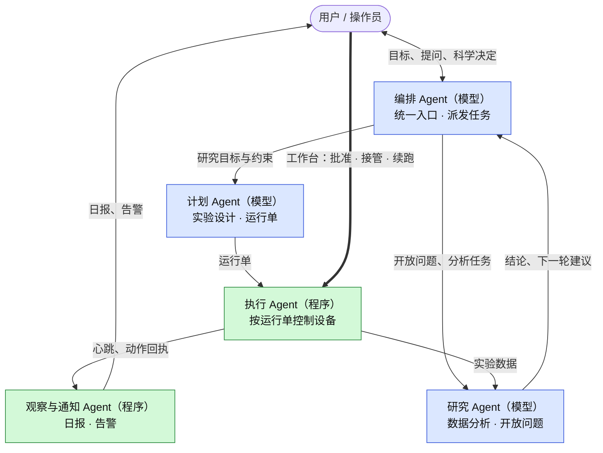

# GrowBridge Auto Research · Agent 架构设计

| 项目 | 内容 |
| --- | --- |
| 版本 | v1.5（重写表述与结构，设计内容与 v1.4 相同） |
| 适用范围 | 基于 Spider Farmer GrowBridge 的本地种植帐篷研究工作台 |
| 部署 | Mac 开发和试验；树莓派常驻控制、采集和工作流；CSC Roihu 承接批量计算 |

**怎么读这份文档。** 第一部分讲系统做什么、五个 Agent 怎么分工、一轮研究怎么走，以及几项关键的安全与科学设计。只想了解架构，读完第一部分即可。第二部分是实现细则，供开发和审查时逐条对照。附录是术语表、状态转换表和验收清单。

---

# 第一部分 · 架构概览

## 1. 系统做什么

用户提出一个研究问题，例如「提高光照后，罗勒长得更快吗？」系统把它推进成一轮完整的研究：设计实验，按用户批准的方案控制种植帐篷，持续采集数据、每天汇报，最后分析数据、交付报告并归档。一轮研究可以覆盖播种、育苗、定植、处理和收获等阶段，具体由研究协议定义。

用户在以下情况介入：

- **审批**：逐阶段批准运行单；
- **科学决策**：处理会改变研究设计或结果解释的事项；
- **异常处理**：异常暂停后决定是否续跑，必要时到现场处置；
- **现场作业**：完成运行单列出的人工作业，例如浇水（首版水泵不自动开启，见 4.5）和人工测量，以及在 AC5 上设好设备自管通道的定时（见 4.2）；
- **下一轮**：决定是否发起。

整个设计守住三条底线：

1. **模型不直接控制设备。** 大模型负责理解、设计和分析。在本系统内，能改设备设置的只有两方：按已批准方案执行的确定性程序（规则写死，同样的输入总是得到同样的动作），以及经过认证的操作员人工接管。系统之外，AC5 面板和手机 App 仍可直接改设备，系统只能通过回读发现这类改动。
2. **安全不依赖模型。** 过热保护、关泵等判定都由程序完成，模型宕机时照常工作。
3. **数据和决定都可追溯。** 原始数据只追加、不修改。每个动作都记录是谁、何时、依据什么做的。

### 1.1 先认识几个词

| 词 | 意思 |
| --- | --- |
| Agent | 承担一类职责的软件角色。有的用大模型推理，有的是纯程序。 |
| AC5 | Spider Farmer 帐篷的控制器，管灯、排风、循环风扇和 4 个插座。 |
| 通道 | AC5 上每一路可控的输出，例如灯、排风、某个插座。 |
| 主机 | 运行 GrowBridge、通过蓝牙给 AC5 发指令的那台 Mac 或树莓派。每台 AC5 只登记一台写入主机。 |
| 回读 | 从设备读回实际设置，用来确认指令是否生效、发现外部改动，或在重连后核对状态。 |
| 阶段 | 一轮研究中的一段执行期，例如育苗期、处理期。不等于作物自身的生长期。 |
| 运行单 | 一个阶段的执行清单：几点开关灯、灯多亮、排风怎么调、何时采样拍照、有哪些人工作业，还包括各通道归属、启停条件、反馈与养护规则和最长等待时间。它是用户审批的对象，任何修改都生成新版本。 |
| 工作台 | 本地网页。查看进度、审批运行单、接管设备都在这里。 |
| 操作员 | 在工作台登录、有权审批和接管的人，通常就是用户本人。 |

更多术语见附录 A。

### 1.2 现有基础

GrowBridge 是运行在主机上的程序，已经能通过蓝牙连接 AC5：采集环境数据，回读设备设置，下发带请求编号的控制指令，保存 SQLite 历史，并提供本地网页和供 AI 调用的 MCP 接口。Mac 上已验证对当前 AC5 的读写。树莓派已有部署说明和蓝牙后端，实体设备上的验证还没完成。

项目档案、实验工作流、阶段控制权、相机采集、推送和 CSC 接入，都是本文提出、尚未实现的设计。 [GrowBridge 现有能力与部署](../README.md)

### 1.3 已确定的运行边界

以下是项目负责人已经确定的约定，后文的设计都在这些边界内。

| 决策 | 约定 |
| --- | --- |
| 研究轮次 | 编排 Agent 负责推动本轮走到报告交付并归档，状态的记录和转换由工作流服务按规则执行（见第 2 节）。下一轮由用户发起。 |
| 阶段授权 | 用户逐阶段确认具体版本的运行单。阶段内允许按已批准的条件和时序自动调节。 |
| 人工接管 | 操作员在网页上发起接管，系统立即暂停该阶段的自动调节，核对完在途动作（已发出、尚未确认结果的指令）后，把控制权交给操作员。 |
| 掉线恢复 | 影响执行的掉线触发暂停。重连后回读设备并记录缺口，由用户确认续跑。 |
| 通知 | 日报和告警都推送到手机。首版就包含树莓派心跳监测（树莓派定时向外部服务报平安，停报即告警），Telegram 是优先接入的候选渠道。 |
| 远程计算 | 大计算量的任务（例如批量图像处理）自动提交到 CSC 的 Roihu 超算，但只能使用项目授权的数据、登记过的计算模板和资源额度。可恢复的计算问题由系统在授权范围内调整，例如重试传输或缩小批量。 |
| 模型 | 按角色配置本地或云端模型，以及各自能读的数据。实验状态、审批和控制（设备与阶段）都由本地服务掌管。 |

## 2. Agent 架构

标「模型」的 Agent 用大模型推理。执行 Agent 和观察与通知 Agent 的判定都由确定性程序完成，不调用模型；模型只用于解释运行情况（例如回答用户对运行的提问）和撰写日报里的文字叙述。粗箭头是用户在系统内唯一的控制路径：批准运行单、接管和续跑都只能由操作员在工作台完成，和编排 Agent 的对话不构成审批。现场兜底仍可停止控制服务后用 AC5 面板操作或断电，见第 10 节。

| Agent | 负责什么 | 用模型吗 | 不能做什么 |
| --- | --- | --- | --- |
| 编排 | 和用户对话，判断用户想做什么，把任务派给合适的 Agent，整理每轮的结论。 | 用 | 不能批准运行单，不能控制设备 |
| 计划 | 把研究问题变成研究协议和逐阶段的运行单，附上证据来源和统计校验。 | 用 | 方案要经用户在工作台批准才生效 |
| 执行 | 按已批准的运行单控制灯光、排风等设备，记录每个动作和回读结果。 | 判定不用 | 只做批准范围内的动作；首版不启动水泵，关泵只走保护规则和专门的联锁路径 |
| 观察与通知 | 独立于执行运行，监控设备和数据健康，生成日报，发出告警。 | 判定和数值不用，模型只用于解释运行情况和撰写日报叙述 | 不改设备设置，只能在告警规则触发时暂停阶段 |
| 研究 | 回答开放问题：查文献、分析数据、跑本地或 CSC 上的计算，交付结论。 | 用 | 生成的代码只能在沙箱里跑，对运行单只能提建议 |

**编排 Agent 和工作流服务的分工。** 编排 Agent 负责和用户对话，把任务派给合适的 Agent，推动整轮研究走到交付。「现在走到哪一步」由工作流服务记录，状态也由它按规则转换。它是普通程序，不是 Agent，负责计时、排队、保存状态和核对权限。Agent 之间不靠聊天记录传话，而是凭工作流登记的任务单和档案里的编号交接，就像实验室凭编号的样品单交接。所以关掉网页或模型暂时不可用时，已批准的工作照样进行。

图里没画的本地服务还有两个。GrowBridge 控制服务独占主机这一侧的蓝牙写入，AC5 面板和 App 不受它约束。项目档案保存所有数据和记录。

## 3. 一轮研究怎么走

以「提高光照后，罗勒长得更快吗？」为例。

1. **提出目标。** 用户在项目对话里提出问题。编排 Agent 建立研究任务，把目标、约束和相关证据交给计划 Agent。
2. **设计实验。** 计划 Agent 先问清会改变设计的事项。「长得更快」可以是更早达到收获大小、冠层面积增长更快，或收获鲜重更高，选哪个决定了测什么、怎么分析。然后写出研究协议和第一阶段的运行单，每个设定值都注明出处。
3. **校验与批准。** 程序检查设备能否做到，计划的每项测量是否都有传感器、相机或人工记录负责，自动调节规则之间会不会冲突（例如控湿要关排风、控温要开排风）。用户在工作台审阅这一版运行单并批准。
4. **执行与日报。** 执行 Agent 按运行单控制设备，持续采集数据。观察与通知 Agent 每天推送日报，出问题时即时告警。
5. **阶段交接。** 一个阶段结束后，下一阶段的运行单提交审阅。等待批准期间，养护规则维持基本条件，例如照原日程开关灯。
6. **分析交付。** 最后一个阶段结束后，系统核验数据完整性并冻结一份数据快照。研究 Agent 按事先登记的方法分析，交付报告并归档。
7. **下一轮。** 研究 Agent 可以提出补采数据或下一轮的建议，是否开始由用户决定。

## 4. 关键设计

这一节用白话解释几项最容易出错的设计，细则见第二部分。

### 4.1 普通控制同一时刻只归一方

**问题。** 假设操作员接管后把灯调到 50%，而自动控制的队列里还排着一条「调到 80%」的旧指令。这条指令几秒后发出，就会覆盖人工设置。

**做法。** 谁在控制，谁就持有一张带编号的通行证，叫「写入权」。自动控制持有阶段写入权，人工接管持有人工写入权，养护规则持有养护写入权。指令只在编号仍有效时下发。交出控制权时，先作废旧编号，再取消它排队的指令，确认旧指令不会再发出，才交给新的一方。保护规则和关泵联锁是例外，它们各有独立的资格，见 4.3 和 4.5。（细则见 7.1、7.3）

### 4.2 每个通道写明由谁控制

**问题。** GrowBridge 现在每改一次某个通道（例如灯），都会把它切成手动模式，从而抹掉 AC5 上为这个通道设的定时。比如原本靠 AC5 定时保证「蓝牙断了，灯也照常按 18/6 开关」，程序只要改一次灯，这个兜底就没了。而且现有回读不检查模式，这种覆盖不会被发现。

**做法。** 运行单为每个通道指定归属。**设备自管**的通道由操作员在 AC5 上设好定时，程序只读不写。**主机控制**的通道由执行 Agent 写入，回读时同时核对模式。如果光照不是本实验的处理因素，且 AC5 自身的限值足以防止过热，基础光周期优先交给 AC5 自己定时。（细则见 7.2）

### 4.3 两类兜底规则

- **保护规则**只做降低风险的动作，例如过热时调暗灯、关泵、加大排风。它单独审批，不随阶段暂停而失效。只要连接还在，默认在暂停、人工接管和待核对（见 4.4）期间都照样执行。操作员接管时确有需要，可以限时停用，但必须记录原因。
- **养护规则**在阶段暂停、阶段之间和阶段结束后维持基本条件，例如照原日程开关灯。人工接管期间停止。

两类规则都只改主机控制的通道。设备自管通道的风险由 AC5 自身的限值或独立硬件兜底，例如限时继电器、温控断路器。（细则见 7.5、7.7）

### 4.4 掉线后不一定停

满足以下任一条件，掉线才算「影响执行」，系统暂停并等用户确认续跑：

- 断开期间有该执行的定时动作或规则动作；
- 重连后读回的设备设置与运行单预期不符；
- 有已发出的指令，不确定是否生效；
- 数据缺口超过运行单允许的上限。

其余掉线记录缺口后继续。暂停期间，只要连接有效，保护规则和养护规则照常工作。

设备设置拿不准时（比如不知道最后一条指令有没有生效），系统进入**待核对**，暂停普通的设备操作。连接有效时，保护规则和关泵照常。确认之前的指令不会再发出后，养护规则也恢复（人工接管期间除外）。

退出待核对需满足其一：

- 确认旧指令已停，重新回读一致，且没有结果不明的指令；
- 操作员登记了现场核对结果。

退出后，原本在执行的阶段回到暂停状态，由用户确认续跑。（细则见 7.3、7.7、附录 B）

### 4.5 水泵首版不自动开启

水泵开着时如果蓝牙断开，程序无法保证及时关上。所以首版执行 Agent 不启动水泵。浇水由操作员在现场（连着本地网络时）通过工作台逐次触发，或者手工浇水后录入。关泵由保护规则和一条只能关泵的专用路径（下文称「关泵联锁」）负责。水泵关闭未确认时，重连后关泵联锁比普通指令优先执行。（细则见 7.6、7.8）

### 4.6 从备份恢复或换主机后，旧授权全部作废

备份里的授权是过去签发的，现场设备可能已经变了。如果旧授权仍然有效，旧主机或旧备份里的指令就可能被当成有效指令发出。所以每次从备份恢复或更换写入主机，**恢复编号**加一，之前签发的写入权、审批和会话（包括登录）全部失效。系统先重新确认安全配置，核对现场设备状态，再由用户重新批准，才能改设备设置。（细则见 7.5、11.4、12.2）

### 4.7 账户隔离

只在网页接口上把模型设成「只读」挡不住它。只要模型或它写的代码和控制程序用同一个系统账户运行，就能直接读到控制密钥，绕过网页去发设备指令。所以控制设备、管理流程、发通知、提交超算作业和运行模型，各用独立的系统账户，互相读不到对方的密钥。数据只按需只读共享，控制服务的文件其他账户一律不可读写。模型拿不到任何控制设备的功能。它写的分析代码只在隔离环境（沙箱）里运行，不能联网，也不含任何密码或密钥。（细则见第 10 节）

### 4.8 科学上的三道关

- **实验单位。** 灯光、温度这类由 AC5 控制的处理作用于整顶帐篷，一顶帐篷同一时间只能处在一个处理水平。所以只有一顶帐篷时，整顶帐篷就是一个实验单位，帐篷里的多盆植物只是同一单位内的重复观测，不能算作独立重复。做确认性比较需要多顶帐篷，或者跨多轮重复（单帐篷时每轮施加一个处理）。
- **先登记，后分析。** 确认性分析在实验启动前冻结成带哈希的脚本或结构化规格（例如固定格式的模型公式与参数表）。哈希相当于文件指纹，改动一个字符都能被发现。冻结的分析只在冻结的数据上运行一次，其余分析都标为探索。
- **如实降级。** 缺少独立重复、缺失过多，或者处理和时间分不开（例如单帐篷先做对照、后做处理，差异分不清来自处理还是季节和批次）等情况，结论降为描述性或探索性。样本量不够时写「不确定」，不写「无效应」。

（细则见 6.3、6.5、9.3）

---

# 第二部分 · 设计细则

## 5. 编排 Agent

### 5.1 统一入口与整轮推进

- 判断用户是在提出研究目标、修改设计、查询运行、处理异常，还是分析结果。
- 在同一个项目对话中交接任务，界面标出当前回应的角色。用户手动指定角色时以用户为准。
- 只有会改变研究设计、控制授权或结果解释的歧义才发问澄清。
- 草案、审批、阶段结束、异常恢复、分析完成等事件由工作流接收并推进状态。需要模型产出时，工作流创建带事件 ID 的任务，编排按该 ID 派发，同一 ID 只处理一次。超时转为待处理并通知用户。
- 模型不可用时，不依赖模型的转换照常推进，例如阶段结束和数据核验。
- 轮次结束时整理结论、局限和后续建议，交付并归档报告。
- 等待用户和等待 CSC 的任务，在界面上分别标出阻塞原因。

工作台集中展示项目对话、角色交接、阶段状态、待审运行单、设备与历史图表、日报、告警和研究产物。研究工具可以经 MCP 或工作台调用，可复用的方法可以封装成 Skill。

### 5.2 工具与权限

| 候选工具 | 用途 |
| --- | --- |
| `get_project_state`、`get_run_status` | 读取目标、协议版本、当前阶段、授权、健康状况和待处理事项。 |
| `create_research_task`、`delegate_task` | 建立或派发任务。交接内容包括目标、约束、证据引用、预期产物、预算、父任务、触发事件 ID 和关联 ID。 |
| `submit_run_for_review` | 把已通过程序校验的运行单版本提交到工作台审阅。 |
| `get_task_status`、`read_artifact` | 查询进度，按版本读取计划、日报、质检和分析产物。 |

- **审批绑定。** 工作台保存用户确认的运行单版本和内容摘要，并绑定项目、实验、阶段、设备和能力配置版本。启动前核对确认仍然有效。运行单或关键能力变化时，重新校验并重新确认，旧确认保留供审计。
- **谁能启动、续跑和停止。** 续跑和停止只接受工作台中已认证操作员的操作。启动可以由操作员执行，也可以由绑定当前有效审批的工作流身份在启动条件满足时执行。
- **模型角色没有控制工具。** 它们只能生成待人工处理的建议。对话内容（包括在对话里说「批准」）不构成审批。
- **预算。** 所有模型角色共用项目级的调用与费用预算。每份草案的自动修订次数和委派深度都有上限，超限转交用户处理。

## 6. 计划 Agent

### 6.1 交付物

计划 Agent 先读取已有的目标、作物和批次、生长空间、历史实验、设备与测量能力，再请用户确定会改变设计的事项。主要指标决定测量安排和最终分析。

| 交付物 | 必须包含的内容 |
| --- | --- |
| 研究协议 | 问题与假设；作物与批次；处理和对照；实验单位、独立重复与分配方式；随机化种子；主要终点与目标效应；测量与分析约定；全周期的阶段划分；跨轮系列的轮数与区组（如有）。 |
| 阶段运行单 | 绑定的协议与设备；各通道归属；启动和结束条件；定时动作；反馈规则；养护规则；采样和拍照；人工作业；最长等待时间及到期处理。 |
| 证据与校验记录 | 作物条件和统计方法的依据；每个设定值的来源；设备可行性；测量缺口；假设；相对上一版本的变更。 |

### 6.2 证据与设定值

- **查找顺序。** 先查本地证据库。有缺口再联网，核对原始研究和机构手册后归档。
- **证据卡。** 记录作物、品种、生长期、栽培方式、数值与单位，同时生效的光周期或 DLI、光谱、CO₂ 与温度，测量位置，来源及页码或表号。区分三类来源：手册建议、论文实验条件、本机实测。
- **光照换算。** 文献里的冠层 PPFD 等指标，要通过本机实测换算成灯具设置。换算关系注明测点高度和位置，冠层长高后复测。没有本机实测的换算标为「未校准」。
- **来源冲突。** 记录各来源的适用条件和选用理由。
- **设定值都有出处。** 运行单的每个设定值都引用证据卡或用户输入。只来自未复核联网来源的值，在审阅页高亮，由用户逐项确认。

### 6.3 统计设计

- **先确定实验单位。** 先确定处理实际施加在什么单位上，再核对独立重复、随机化、对照、批次、位置和重复测量。
- **帐篷级因子。** AC5 控制的灯光和环境作用于整顶帐篷。只有一顶帐篷时，每个处理每轮至多只有一个实验单位，即整顶帐篷；帐篷内的多盆植物是这个单位内的多次观测。确认性比较因此需要多顶帐篷，或以轮次为重复。计划 Agent 优先考虑能按盆独立施加的处理。 [生长室效应研究](https://link.springer.com/article/10.1186/s13007-015-0088-0) · [实验单位与伪重复](https://doi.org/10.2307/1942661)
- **跨轮系列。** 协议可以定义跨多轮的系列，预先登记轮数与分析方法，每轮仍由用户发起。
  - 单帐篷：每轮是一个实验单位，施加一个处理。相邻若干轮组成一个区组，每个处理在区组内各占一轮。区组内的顺序随机，并登记种子。
  - 多帐篷：每轮内随机分配帐篷，轮次作为区组。
- **补做规则。** 设备故障、污染等预先列明的非处理原因导致某轮失败时，在同一区组内补做该处理一轮，其余顺序不重新随机。是否补做必须在看到该轮结局之前判定。失败轮的数据保留并报告。补做规则随协议冻结。
- **样本量。** 由与设计匹配的程序计算样本量或可检测差异，并记录假设。单帐篷先导轮施加帐篷级处理时，只能估计株间变异，不能用来算帐篷或轮次层面的样本量。依据不足时，可以把本轮定为先导实验，写明要估计的变异和能回答的问题。
- **分配与布局。** 先按预定规则筛选幼苗，再由记录种子的程序分配处理和盆位。每次轮换盆位都保存布局版本。位置或实测 PPFD 分布作为区组或协变量写入预定分析。

### 6.4 程序校验与人工审阅

首版采用程序校验加人工审阅。

- 程序检查设备、测量、单位、动作范围、通道归属、规则冲突、人工任务和归档期限。
- 每条反馈规则至少写明：传感器与位置、单位、读数有效期、触发和恢复条件、持续时长、允许的动作，以及缺数时如何处理。
- 阶段审阅页显示上一阶段结果、本阶段变更、用户任务和已知局限。
- 阶段间等待使用已批准的养护规则，并写明最长等待时间和到期处理。

候选工具：`get_device_capabilities`、`find_prior_runs`、`lookup_crop_conditions`、`search_and_verify_sources`、`check_experimental_design`、`estimate_sample_size`、`validate_run_sheet`、`save_plan_draft`。

### 6.5 冻结与变更

- 确认性实验启动前，冻结实验单位、处理分配、主要终点、目标效应、统计方法，以及排除和缺失的处理规则。
- 确认性分析同时冻结为带哈希的可执行脚本或结构化规格，由本地服务在冻结的数据快照上运行一次。
- 质检和排除在揭示处理间比较之前定稿。
- 报告中的确认性数值只能来自这次运行的产物，其余分析都标为探索。
- 跨轮系列在系列层级冻结。系列中途各轮的报告只作描述。最后一轮的研究分析读取各轮已冻结的快照，执行一次系列确认性分析。系列提前终止时，按未达计划样本量处理。
- 改变处理、主要指标或预定分析时，保存新版本，记录原因、生效时间、当时已看过的数据，以及受影响的范围。

## 7. 执行 Agent

执行 Agent 是常驻本地的确定性程序，判定过程不调用模型。启动时核对已批准的运行单、设备能力、时钟、读数和归档状态。

### 7.1 写入权

- **唯一写入主机。** 每个 AC5 只登记一台写入主机，未登记的主机不建立蓝牙连接。写入主机上的控制服务登记唯一的控制方，以及持久化的写入权编号。
- **三种写入权。**
  - 阶段写入权：用于自动控制，绑定设备、实验、阶段、已批准运行单的摘要。
  - 人工写入权：用于人工接管，绑定已认证的操作员。
  - 养护写入权：只执行运行单列出的养护规则，作用范围限于规则列出的设备和取值，人工接管期间停止。
  - 保护规则另有独立的写入权，见 7.5。
- **两次校验。** 请求入队时和真正下发时都校验权限。控制权切换和每次普通写入的下发经过同一个检查点（相当于同一把锁），核对授权、编号、作用范围和时效，保证两者不会交错。
- **切换顺序。** 接管、阶段结束、撤销批准或异常暂停时，先持久化「旧编号不得再写」，再取消它尚未下发的动作。等待在途回执期间，继续阻止新的普通写入。
- **外部改动。** 控制服务独占的是 GrowBridge 这一侧的蓝牙写入。AC5 面板和 Spider Farmer App 不受写入权约束。部署时解除或登记 App 绑定，运行中只能通过回读发现它们的改动。

### 7.2 通道归属

现有 GrowBridge 的每次写入都会把目标通道设为手动模式（`modeType=0`），从而覆盖 AC5 自身的定时。现有回读只核对开关和档位、不核对模式，所以发现不了这种覆盖。 [现有写入实现](../src/growbridge/service.py)

- **设备自管通道。** 操作员在 AC5 上设好定时，启用前回读登记。GrowBridge 对它只读，执行 Agent 和恢复流程都不写入。
- **主机控制通道。** 由执行 Agent 写入。
- 回读同时核对通道模式和即时状态。
- 改变通道归属属于运行单变更。
- 如果断连后继续维持输出不可接受，兜底只能是插座与负载之间的独立硬件，例如限时继电器、温控断路器或液位开关。
- 光照不是本实验的处理因素，且 AC5 自身限值足以兜底过热时，基础光周期优先交给设备自管。

### 7.3 先确认旧写入停止，再回读和交接

切换控制权或从异常重启恢复时，必须先确认旧的写入方不会再发指令。确认由实际持有蓝牙写权限的传输层给出，满足其一即可：

- 旧队列已清空，且旧编号已无法再写；
- 旧进程及其 BLE 写入会话都已停止。

等待超时、删除 Python 的等待对象、只发送了停止信号，都不算确认，按「写入结果未知」处理。

确认之后，用有效会话重新回读，核对在途动作和设备状态。无法确认时保持待核对，阻止普通写入，到期提示现场处置。Mac 和树莓派的每个蓝牙后端都必须先通过这项验收，才能启用自动写入。

**Mac 辅助程序需要的改动。**

- 现状：Swift 辅助程序由系统启动服务拉起，只有在队列清空后才响应停止信号，所以可能比 Python 进程存活更久，Python 退出后它仍可能在发指令。
- 拟改：与 Python 的事件通道一断开，就清空队列并退出；进程标识持久化，便于核对它是否真的退出。
- 辅助程序里「开启后延时自动关闭」的指令路径，接入前先禁用，之后纳入写入权编号核对。

[Mac 命令文件与回执](../src/growbridge/transport.py) · [Swift 传输队列](../src/growbridge/native/BLEHelper.swift)

### 7.4 反馈规则

- 只用有效字段。逐字段核对来源、单位、质量、时效和采样连续性。整包遥测是新的，也要检查本条规则需要的字段。
- 持续时长和最短切换间隔用单调时钟计算。遇到数据缺口，连续判断中断。
- 触发和恢复阈值、最小保持时间、动作范围和优先级，随运行单一起确认。
- 设备硬限制和联锁始终有效。
- 保护规则优先于实验定时和常规反馈。同级冲突必须在审批前解决。
- 普通湿度反馈只能改动被允许作为调节量的排风。
- 保护动作影响锁定变量时，记为干预。

### 7.5 保护规则

- 由独立的安全配置定义，单独审批。
- 只允许降低风险方向的动作，例如关灯或调暗、关泵、加大排风。
- 只写主机控制通道。设备自管通道的风险由 AC5 自身限值或独立硬件兜底。需要软件保护的通道，必须在运行单中登记为主机控制。
- 阶段启动、运行单切换版本、安全配置变更这三个时点，都按当时的通道归属校验安全配置。存在冲突时，对应的启动、切换或变更不生效。
- 持有独立于阶段写入权的写入权，同样受写入主机登记和恢复编号约束。
- 只要连接有效，在暂停、接管、待核对和联锁状态下仍执行并回读。
- 人工接管时可以限时停用保护规则，必须记录原因。
- 进入新的恢复编号后，最先重新确认安全配置，之后才恢复养护写入权和阶段写入权。

### 7.6 设备接口与水泵

- 执行 Agent 复用 GrowBridge 的状态、灯、排风、循环风扇和插座接口。 [控制接口](../src/growbridge/api.py)
- 执行 Agent 按运行单触发相机采集，并接收人工测量的录入。
- 现有安装约定：1 号插座供灯，2 号供排风，3 号供循环风扇，4 号供水泵。启动时以实际设备配置和接线核验为准。设备调节档位和供电插座分别记录。
- 首版执行 Agent 不调用 `run_pump`。灌溉作为人工作业，由已认证操作员经工作台的局域网入口逐次触发，或手工浇水后录入。覆盖网络入口不提供水泵操作。
- 要启用无人值守灌溉，先验证设备自管定时或独立硬件保护。 [水泵与断连边界](../README.md#data-and-control-boundaries)

### 7.7 暂停、掉线与恢复

阶段状态和设备状态分开记录。后台可以停止调度。设备侧则根据最新回读，标记「目标已确认」「偏离」或「未知」，并附最后确认时间。

蓝牙中断、主机断电或进程终止时，设备可能保留原设置。因此运行单要为每个主机控制通道定义：允许保留的状态、最长容忍时间、连接可用时执行的保护动作、现场处置和养护规则。如果断连后继续维持输出不可接受，启用自动运行前必须按 7.2 配置独立保护，并明确由谁现场处置。 [现有断连与水泵边界](../README.md#data-and-control-boundaries)

**掉线是否影响执行。** 满足任一条件即视为影响执行：

- 中断期间有到期的定时动作，或规则要求的写入；
- 重连回读与运行单的预期不一致；
- 存在结果未知的动作；
- 数据缺口超过运行单允许的上限。

影响执行时，暂停受影响的实验调度，等待用户确认续跑；否则记录缺口后继续。

**暂停和等待期间。**

- 已批准的养护规则以养护写入权继续执行，例如按原日程开关灯。保护规则保持有效。
- 时钟不可信时，养护规则按单调时钟，从最后一次可信时间推算日程。主机控制光照的部署要配备带电池的 RTC。
- 超过最长等待时间时，执行到期处理并告警。

| 情形 | 处理 |
| --- | --- |
| 人工接管 | 暂停自动调节和养护规则，作废旧队列。核对在途动作和实际设备状态后开放人工操作。继续采集，记录人工干预。交还时以新编号回读，按运行单当前时点的目标列出差异，由用户确认重设或记为干预，再恢复自动。 |
| 蓝牙断连、关键读数过期、结果未知 | 按上面的条件判定。影响执行时暂停并告警，标记未知状态。重连后核对差异和缺口，由用户确认是否续跑。 |
| 进程重启 | 启动时阻止普通写入，撤销旧编号，并按 7.3 确认旧传输已停止，之后恢复养护写入权（人工接管期间除外）。有未完成动作或运行中断时，核对设备与持久账本，由用户确认续跑。 |
| 错过定时动作 | 光照按原日程对齐到当前时点。错过的测量和人工作业记为缺失，只补做运行单明确允许的任务。 |
| 外部改动 | 回读发现 AC5 面板、App 或设备定时造成的偏差时，记录差异并暂停受影响的阶段。 |
| 阶段结束或用户停止 | 停止该阶段的实验动作。设备可达时，执行已批准的结束或养护规则并回读。未确认则保持待核对并告警，后续阶段等这个故障处置完。 |

### 7.8 水泵关闭联锁

- 关泵恢复是一条专门的联锁路径，只能对配置的水泵插座执行关闭和回读。
- 普通控制暂停时，它也能处理未确认的关闭。重连时它优先于普通写入。它同样受写入主机登记和恢复编号约束。
- 关闭未确认时，阻止进一步的普通写入，保护规则仍可执行，并提示现场核查。
- 中断的水泵启动保留原记录，恢复流程只处理关闭。

**联锁期间其他通道能否继续。**

- 只是水泵关闭未确认，且旧传输已确认停止：灯、排风等非水泵通道的养护规则照常执行。现有实现在联锁期间拒绝所有写入，需要按此调整。
- 旧的开泵指令仍可能被发出或生效：保持联锁和未知状态，直到确认旧开泵路径已失效，且回读到水泵已关。

### 7.9 动作账本

- 控制服务先持久化动作意图，再下发蓝牙指令。
- 动作状态分为：待发送、可能已发送、已回读确认、结果未知、失败、作废。
- 发出前先记「可能已发送」，覆盖「指令已生效、回执还没落库就崩溃」的窗口。
- 重试时用同一请求编号查询原动作的状态或回执。历史回执要带时间，并和当前设备回读区分开。
- 结果未知或已终止的动作，先核对实机。确实需要重做时，按当前授权创建一个关联的新请求。
- 现有 GrowBridge 对已完成的编号返回原回执，对失败或中断的编号要求先核对。拟增加按编号读取完整回执的授权接口。 [现有回执与恢复逻辑](../src/growbridge/service.py)
- 每条动作记录关联计划值、触发证据、请求编号、写入权编号、操作者、下发与回读时间、确认值和实测读数。控制器回读用来核对设置，测点数据用来评估植物实际受到的环境。

### 7.10 工具与调用身份

- 候选工具：`start_approved_stage`、`pause_stage`、`resume_stage`、`stop_stage`、`get_stage_status`、`get_action_receipt`、`record_manual_measurement`。
- 启动、续跑和停止只接受 5.2 规定的身份。
- 暂停可以由执行规则、观察告警规则或操作员触发。
- 设备底层控制只对执行 Agent 和授权的人工控制入口开放。

## 8. 观察与通知 Agent

### 8.1 日报与告警

- 观察任务独立于执行任务运行，读取设备健康、阶段状态、数据新鲜度、动作回执和执行器心跳。
- 告警和统计由本地规则生成。日报中的数值由模板从 `compute_daily_metrics` 直接渲染，模型只写叙述，不引入新数值。模型不可用时，模板照样能生成报告。
- 相机接入前，长势部分用人工记录。接入后，日报可以展示可比照片和已有的质量标记。

| 产物 | 调度与内容 |
| --- | --- |
| 每日生长报告 | 按项目时区定时推送。包含昨日环境趋势、数据覆盖率、超限时长、实际处理偏差、保护动作与人工干预、作物观察和待办。 |
| 即时告警 | 关注影响实验或需要处理的事件，例如 AC5 失联、数据过期、环境持续超出批准范围、保护规则触发、设备回读不一致、水泵关闭未确认和等待续跑。 |
| 外部监测告警 | 独立的系统任务分别发送主机心跳和运行健康信号。主机或关键任务失联时，由外部监测点向手机发出告警。 |

### 8.2 外部监测

配置两个独立的外部检查：

- **主机心跳**：反映树莓派及其外网是否可达。
- **运行健康**：由独立的系统任务检查 GrowBridge 服务响应、执行循环最近一次评估、最近一次采集与归档落盘、最旧的未投递告警，以及最近一次异地备份的成功时间。按当前阶段的预期进度和时限判断。

运行健康发现故障时主动发送失败信号，并停发运行健康心跳作为兜底，以防失败信号丢失。检查任务本身卡住时，同样会因停发心跳而告警。告警由外部监测直接发到手机，不经过本地通知队列；主机心跳照常发送，不受影响。

- 如果使用 Healthchecks.io，两项检查都从「1 分钟周期 + 4 分钟宽限」起步。启用前确认两项都收到首个心跳，并验证一次手机测试告警。
- 计划维护时不暂停检查，而是把受影响检查的宽限期临时延长到维护截止时间，到期仍未恢复就告警。维护期间不发送失败信号，结束后恢复原宽限期。
- 外部监测另设邮件作为第二通道。
- 主机重新可达、设备回读完成、用户确认续跑，三者分别记录。

[Healthchecks.io 状态与宽限期](https://healthchecks.io/docs/) · [周期配置](https://healthchecks.io/docs/configuring_checks/)

### 8.3 投递与统计

- 同一事件归并关联告警。数据失效时标记缺口，暂停用旧读数判定环境阈值。
- 保存事件、已读状态、恢复状态和每次投递结果。
- Telegram 是首选候选渠道。日报和应用告警由本地通知服务投递，主机离线和运行健康告警由外部监测投递。机器人只向已登记的会话发送，忽略收到的消息。 [Healthchecks.io 的 Telegram 集成](https://healthchecks.io/integrations/telegram/)
- 完整报告和历史留在工作台，手机只收摘要。
- 投递以持久事件 ID 归并，记录渠道已接收、结果未知和失败。回执未知时，同一事件按指数退避重试，次数上限写在部署配置里，因此可能收到重复消息。
- 日报中的环境均值、DLI 和超限时长按时间加权计算，主动查询不改变权重。超过允许的采样缺口就截断区间，缺口单独列出。

候选工具：`get_run_health`、`list_run_events`、`compute_daily_metrics`、`save_daily_report`、`list_alerts`、`queue_notification`。人工标记告警已读和阶段审批分别授权。

## 9. 研究 Agent

### 9.1 研究过程

- 接收开放的研究问题。可以在轮中寻找证据，也可以在轮末执行预定分析。
- 提出竞争假设，拆分有依赖关系的子任务，选择文献、数据和方法，运行本地或远程计算，并根据中间结果调整路径。可以并行探索、等待远程结果、结束证据不足的分支，或提出需要补采的证据。
- 研究任务保存假设状态、计算进度、未解问题和停止原因。
- 任务启动时，从项目预算中划拨计算、模型调用、重试和时限预算，子任务从同一预算扣减。达到上限时保存部分结果并标为待处理，由用户决定是否扩大范围。

| 首版能力 | 典型交付 |
| --- | --- |
| 实验分析 | 质量检查、处理组比较、效应量与不确定性、执行偏差和敏感性分析。 |
| 照片表型量化 | 例如固定机位的冠层覆盖率曲线、分割叠图、人工核验样本和低质量帧清单。 |

- 还可以组合文献检索、时序分析、机制模拟、跨批次比较和新的统计方法。新方法先在第 10 节的沙箱中用小样本验证，再决定是否扩大。
- 检索文献、网页或远程日志的子任务，不持有沙箱提交和写入工具。
- 预先约定的确认性分析与事后探索分别报告。变更终点、排除规则或验证划分时，保留原方案和原结果，建立新的分析版本。 [探索与验证的区分](https://doi.org/10.1073/pnas.1708274114)
- 可以向编排提出补采和下一轮建议。涉及运行单变更时，由计划 Agent 评估，再走逐阶段审批。

候选工具：`freeze_dataset`、`query_evidence`、`run_local_analysis`、`submit_compute_job`、`get_compute_job`、`fetch_compute_artifacts`、`publish_research_report`。

### 9.2 预测模型与留出数据

- 积累至少两个独立批次后才启用预测模型。
- 启用时明确预测目标和提前量，与简单基线比较，按目标部署场景划分时间与独立实验批次。
- 特征只用预测时点已收到的数据，以及当时生效的校准版本。预处理和调参只用开发数据。评估后记录可推广的范围。 [分组验证](https://scikit-learn.org/stable/modules/cross_validation.html#cross-validation-iterators-for-grouped-data) · [时间序列验证](https://scikit-learn.org/stable/modules/cross_validation.html#cross-validation-of-time-series-data)
- 留出数据在开发前按批次或轮次规则登记。首选模型冻结后才开始的独立批次，这样留出结局在开发时还不存在。
- 日报和图表照常展示环境数据，但留出批次的结局标签不进入开发数据。研究 Agent 和训练作业读取日报和图像时，排除留出批次的长势与结局部分。
- 正式评估前登记模型、特征和预处理的哈希，由固定脚本在本地评估，记录每次读取留出数据的时间和次数。对同一份留出数据的第二次及以后的评估，自动标为探索。
- 首版不设独立的评估服务。 [数据泄漏与预处理](https://scikit-learn.org/stable/common_pitfalls.html#data-leakage)

### 9.3 报告核验

发布前，服务对照批准的协议和数据快照，核验处理实际施加的层级、独立重复、主要终点、分析版本、数据覆盖和干预。

以下情形降为描述性或探索性结果，并写明能回答什么问题：

- 缺少独立的处理重复；
- 处理与时间或生长期无法区分；
- 缺失超过预定标准；
- 看到结局数据后变更了终点、排除规则或分析方法；
- 实际处理偏离批准范围，超过协议预定的比例。

此外：

- 未达计划样本量时写「不确定」，不写「无效应」。
- 确认性结论存在未解的设计或质量问题时，进入待复核。
- 每项结论附证据引用、适用范围和主要不确定性。
- 预测只在同一轮的后续时段验证过时，明确标出跨轮验证的状态。

### 9.4 CSC Roihu

**提交与权限**

- 本地研究 Agent 把符合已登记模板的批量图像处理、模拟和模型训练交给独立的提交服务。服务经 FirecREST 向 Roihu 的 Slurm 队列提交。 [Roihu 入门](https://docs.csc.fi/support/tutorials/roihu/)
- 无人值守使用项目专用的机器人账户，由有权限的 CSC 项目负责人申请和配置。凭证由提交服务持有。 [FirecREST 认证](https://docs.csc.fi/computing/firecrest/connecting/#connecting-with-a-robot-account) · [CSC 机器人账户政策](https://docs.csc.fi/computing/usage-policy/#robot-accounts-on-roihu)
- 提交服务核验任务发起者与 CSC 项目成员身份的映射及权限。代理派发的子任务继承发起者和授权范围。提交、上传、查询、取回和取消时分别校验。
- 项目成员定义并登记版本化的可执行模板。服务验证参数、路径和数据快照，以结构化参数运行模板。新代码经本地验证、由项目成员登记后，才进入自动提交范围。
- 审计关联发起者、CSC 项目、模板版本、参数、输入和每次尝试。

**额度**

- CSC 配置包含允许上传的数据范围、模板、项目、CPU 或 GPU 资源、存储、时限、并发、计费额度和重试上限。
- Roihu 对计算和存储分别计费，项目余额由全体成员共享。提交服务对本服务发起的作业分别设置计算和存储上限。
- 项目余额由项目负责人核对后录入，并标注录入时间。
- 提交前同时核对三个上限：研究任务预算、本服务上限、最近录入的项目余额。
- 按保守估算预留排队、运行和重试所需的额度。核对和预留在同一步原子完成，避免两个作业抢到同一笔额度。
- 作业结束后按可核对的实际用量结算，释放多余的预留。结果未知的尝试保留预留，直到对账完成。
- 额度耗尽时保存可交付的部分结果。 [Roihu 计费规则](https://docs.csc.fi/computing/hpc-billing/)

**对账与重试**

- 每次提交前持久化唯一的尝试编号，并写进 Slurm 作业名，以便经 FirecREST 按作业名和时间窗口查询队列和历史作业。 [Slurm 历史作业查询](https://slurm.schedmd.com/sacct.html)
- 提交回执缺失时先对账，再决定是否重提。仍不确定就转为待对账并提示核对，避免重复占用额度。
- 确认失败后，在模板和预算允许的范围内自动重试传输、缩小批量或从兼容的检查点恢复。
- 如果调整可能改变科学结果（例如训练批量影响模型收敛），另建分析版本，保留原参数和结果。

**归档与隔离**

- 作业记录关联本地任务 ID、数据快照、代码和运行环境、参数、远程作业 ID、资源用量、日志和产物。
- 完成后拉回项目归档并校验，然后删除 Roihu 上的输入和中间文件。`scratch` 只用于临时计算。 [CSC 计算存储](https://docs.csc.fi/computing/disk/)
- CSC 的队列、额度或传输故障只影响关联的研究任务，执行 Agent 继续按本地运行单工作。

## 10. 账户与访问

只在 HTTP 层设只读权限，不足以隔离写入。现有令牌明文保存在私有配置中，Mac 蓝牙辅助程序会执行命令目录中的写入，控制账本是普通 SQLite 文件。同一系统用户下运行的 Agent 或研究代码都能绕过 HTTP 校验。因此按系统账户划分边界。

| 账户 | 持有与限制 |
| --- | --- |
| 控制服务 | GrowBridge 与执行 Agent。独占蓝牙、设备配置、控制令牌、控制账本和命令目录，其他账户不可读写。 |
| 工作流与工作台 | 持有状态、审批与项目档案。以服务身份调用控制服务的写入权授予与撤销入口。 |
| 观察与通知 | 持有推送凭证，只读访问所需的状态与产物。观察告警规则可以调用阶段暂停。 |
| CSC 提交 | 持有 CSC 凭证，只读访问所需的数据快照与模板。 |
| 独立探针 | 只读健康身份，只能查询运行健康所需的状态。 |
| 模型角色与研究进程 | 包括 MCP 客户端和 SSH 接入账户。只能读授权数据、提交草案和建议，具体限制见表下。 |
| 模型生成的代码 | 在沙箱中运行：无网络，只读挂载数据快照，使用独立系统用户，不含任何凭证。 |

模型角色与研究进程的限制：

- 只能经工作台接口读取授权数据，并提交草案、产物与建议；
- 不持有设备控制和阶段控制工具；
- 代码只能经 `run_local_analysis` 提交到沙箱运行，账户自身不执行代码；
- 不能读取控制配置，也不能调用浏览器会话签发入口。

其他访问规则：

- **默认只读。** 部署 Auto Research 时，LLM 和通用 MCP 客户端默认只有设备只读权限。现有写入端点必须接入同一套控制校验，才能在实验部署中对授权的人工入口或执行 Agent 启用。旧的共享令牌按只读处理或吊销。 [现有 API 认证及写入入口](../src/growbridge/api.py)
- **操作员登录。** 操作员用独立凭据登录工作台，例如通行密钥。审批、接管和续跑要求近期重新认证。
- **两个入口。**
  - 覆盖网络入口：经私有覆盖网络（例如 WireGuard 或 Tailscale）以 HTTPS 只向已登记的设备开放，不暴露到公网。
  - 局域网入口：同样认证，只向已登记的现场设备开放。
  - 服务端按入口区分可用操作，例如水泵操作只在局域网入口提供。可信主机、来源校验和 Cookie 的 Secure 属性按这两个地址配置。
- **现场兜底。** 工作台不可达时，停止控制服务，再用 AC5 面板操作或断电。
- Mac 开发阶段同样执行这些边界，未满足时不启用自动写入。
- 授权从服务端取得。模型输出中的身份和权限字段只当作输入数据。

## 11. 数据、归档与记忆

### 11.1 交接对象

| 对象 | 生产者与主要字段 |
| --- | --- |
| 研究任务 | 编排创建。含项目、研究问题、约束、负责角色、依赖、输入引用、预期产物、预算、父任务、触发事件和状态。 |
| 研究协议 | 计划生成。含处理分配、随机化种子、实验单位、指标、阶段、系列结构和分析约定。按版本保留。 |
| 阶段运行单与审批 | 计划生成运行单，后台记录校验结果，用户确认具体版本。含版本、通道归属、用户身份、审批时间、授权范围和恢复编号。 |
| 样本与动作事件 | 执行采集。关联实验、阶段、稳定记录 ID、设备或实验单位、来源、质量、时钟同步状态、请求、写入权编号与回执。人工操作使用相同关联。 |
| 图像与人工测量 | 采集或录入时关联实验、批次、植株 ID、盆位布局版本、时间、测量位置与方法。照片使用固定补光、固定曝光并放置色卡，保留机位与拍摄条件。无法统一时，按处理分层核验分割误差。 |
| 数据快照 | 分析开始前冻结本次输入。清单绑定归档数据、文件校验值、实际处理、干预、缺失及质检结果。后续补录生成新版本。 |
| 研究产物 | 关联数据、代码及其哈希、环境、参数和作业。包含指标、图表、结论、证据链、局限与下一轮建议。 |

### 11.2 时间与记录规则

- 跨角色通过项目、实验、阶段、任务和产物 ID 交接。
- 时间统一存 UTC，按项目时区显示和调度日报。
- 区分采集时间和接收时间。设备给不出采集时间时，明确标记为接收时间。
- 每条样本记录时钟同步状态。未同步期间的样本标为时间不可信，校正前不进入确认性分析。
- 为传感器记录单位、位置、校准版本和预期采样间隔。区分主动状态查询和计划采样，覆盖率按有效时长计算，而不是按条数。
- 独立实验单位与其内部的植株、图像和重复测量，用显式关系表示。
- 原始、清洗和派生数据分开保存。原始记录只追加。人工测量的更正以关联的新记录保存，保留原值。
- 归档导出 MIAPPE 兼容的元数据，包括研究、实验单位、性状、方法与单位。数据集分配持久标识和许可。

### 11.3 持续归档

- 从运行单生效起，原始数据、动作、照片和人工测量都持续写入实验归档。
- 用稳定的记录 ID 和可恢复的进度记录接续写入，数据落盘后才确认进度。补传按 ID 去重。
- 仍待归档的记录受保护，GrowBridge 的历史清理只作用于可删除的缓存数据。 [当前历史保留](../README.md#data-and-control-boundaries)
- 时钟未同步时，暂停历史清理、数据冻结和日报计算。
- 冻结分析输入前，检查数据覆盖、缺失区间和文件校验值，不完整的快照明确标注。

### 11.4 备份与恢复

- 监测写入错误、剩余空间和归档积压。部署时配置可接受的最大数据损失和恢复时间。
- 数据库和归档优先放在 SSD 上。
- 运行期间把一致的数据库备份、原始图像和归档清单保存到独立介质或主机，最近一次成功时间纳入运行健康。以同一份备份清单核对数据库版本和图像校验值，定期演练恢复。 [SQLite 在线备份](https://www.sqlite.org/backup.html)
- 从备份恢复或更换写入主机后，恢复编号加一，此前签发的写入权、审批和会话全部作废。控制账本先保持只读，按第 7 节核对现场状态，由用户重新确认后才能启用写入。

### 11.5 存储压力

按以下顺序降级：

1. 先暂停研究缓存写入、批量传输，以及运行单测量计划以外的图像任务。
2. 关键记录仍无法落盘时，暂停新的实验动作并告警。设备按运行单的养护规则处理，保护规则和设备端独立保护继续有效。

### 11.6 记忆与上下文

| 层 | 内容与用途 |
| --- | --- |
| 工作状态 | 当前任务、阶段、审批、等待原因、设备健康和未完成作业。由后台持久保存，用于恢复。 |
| 项目记忆 | 用户已确认的目标、配置、实验协议、决策、运行记录和产物。可以追到具体版本。 |
| 证据与跨轮经验 | 分开记录原始观测、模型摘要、探索发现与已复核结论，关联来源版本、反证、适用条件和替代关系。 |
| 对话上下文 | 每次模型调用加载当前请求、相关对话、必要状态和少量证据摘要。详细记录按权限和 ID 读取。 |

- 标定修正、快照更正或结论撤回时，依赖旧版本的摘要与结论标为「依赖失效」，重新核对后才能再引用。同时更新检索索引，保留原始审计记录。
- 文献、网页、历史摘要和工具结果只当作资料。即使其中写着「请执行某操作」，也不当作指令。
- 资料里引用的资源，以及由此发起的后续工具请求，由服务按权限独立校验后才放行。
- 读过联网内容的模型会话不持有沙箱提交和写入工具，防止网页里藏的指令借模型之手执行。

### 11.7 模型配置

- 角色配置包含模型提供方、模型名称、可调用工具、允许读取的数据类型和调用限制。
- 编排优先使用能稳定输出结构化交接的模型。计划与研究可选推理能力更强的模型。观察使用模板，叙述可由研究节点上的本地模型或云端模型撰写。
- 模型凭证与 CSC、设备和推送凭证由对应服务分别持有。
- 外部模型只接收项目允许的数据片段。默认原始时序、照片和档案都保存在本地。

## 12. 部署

### 12.1 节点分工

- 树莓派常驻运行控制服务、执行 Agent、工作流与工作台、通知和 CSC 提交服务。编排和计划的模型调用可以从常驻节点发起。
- 研究 Agent 在 Mac 或独立工作节点运行。节点休眠时研究任务进入待处理并按时限告警，不影响阶段执行。
- 同机部署时，各服务按第 10 节分账户运行。
- 树莓派不运行本地模型推理。
- 除控制服务外，每个服务账户都设 CPU、内存、磁盘空间和 I/O 上限。控制服务优先级最高，并为采集、控制账本和告警队列预留空间。CSC 上传和本地图像处理都遵守这些限制。

### 12.2 换主机

Mac 迁到树莓派、故障换机和版本回滚，都按以下顺序显式交接：

1. 卸载旧主机的自动启动，删除其设备配置与控制令牌，确认旧传输和辅助进程已停止。旧主机不可达时，现场断电或移除其蓝牙适配器，并记录。
2. 导出旧主机的未结动作和联锁状态，在目标主机以待核对状态导入，并保持联锁。
3. 在目标主机扫描设备，核对记录与回读，验证冷启动和断开 SSH 后服务仍可用。
4. 恢复编号加一，由用户重新确认后启用新主机的写入。

[Mac 与树莓派部署](../README.md#deploy-on-raspberry-pi)

### 12.3 落地前待定的参数

本文中的工具名和数据对象是拟议接口。首版落地前需要确定：相机与采集方式、通知账号与报告时间、心跳监测配置、覆盖网络与操作员凭据、各通道归属与独立保护硬件，以及可用的 CSC 项目与资源上限。

---

# 附录

## 附录 A · 术语表

| 术语 | 含义 |
| --- | --- |
| 研究轮次 | 从研究目标到报告交付归档的一次完整推进。需要跨轮重复的设计由协议登记为系列。 |
| 阶段 | 运行单定义的执行区段，例如育苗或处理期。作物自身的发育期称为生长期。 |
| 运行单 | 一个阶段的可执行方案，是用户审批的对象。任何修改都生成新版本。 |
| 写入权与编号 | 控制服务登记的写设备资格。每次授予都带一个新编号，旧编号作废后不能再写。分为阶段写入权（自动控制）、人工写入权（接管）和养护写入权（只执行已批准的养护规则）。保护规则另有独立的写入权。 |
| 恢复编号 | 从备份恢复或更换写入主机后加一。此前的写入权、审批和会话全部失效。 |
| 通道归属 | 每个通道由谁控制：设备自管（AC5 自己定时，GrowBridge 只读）或主机控制（执行 Agent 写入）。 |
| 保护规则 | 独立安全配置中只朝降低风险方向的动作，只写主机控制通道，例如过热时调暗主机控制的灯。不随阶段写入权撤销，但受写入主机登记和恢复编号约束。 |
| 养护规则 | 运行单中在阶段暂停、阶段之间和结束后维持基础条件的规则，例如按原日程开关灯。 |
| 暂停、停止、中止 | 暂停后可以续跑。停止结束一个阶段。中止结束整轮。三者都生成归档记录。 |
| 待核对 | 设备状态或在途动作的结果未知。阻止普通写入。连接有效时，保护规则和关泵仍可执行。旧传输确认停止后，人工接管以外的养护规则也可执行。 |
| 锁定变量 | 协议规定在各处理之间保持一致的环境变量。 |
| 留出数据 | 模型开发前登记、只用于正式评估的数据。 |

## 附录 B · 状态转换

整轮、阶段和研究任务分别建模。状态转换只由本地工作流执行。同一事件按 ID 只推进一次，过期事件丢弃。研究任务和阶段执行可以并行，例如轮中取证。

| 整轮 | 事件 | 下一状态 |
| --- | --- | --- |
| 设计中 | 协议与首个运行单通过程序校验并提交 | 阶段待审 |
| 阶段待审 | 操作员确认运行单版本 | 阶段进行中 |
| 阶段进行中 | 阶段结束，协议还有后续阶段 | 阶段待审，期间执行养护规则 |
| 阶段进行中 | 最后一个阶段结束 | 数据核验 |
| 阶段进行中 | 阶段被停止 | 由用户选择：重做本阶段或进入下一阶段（都回到阶段待审）、进入数据核验，或中止整轮 |
| 数据核验 | 覆盖与质检完成，快照冻结 | 研究分析 |
| 研究分析 | 报告发布 | 已交付归档 |
| 任一非终态 | 用户中止 | 已中止归档 |

| 阶段 | 事件 | 下一状态 |
| --- | --- | --- |
| 待审 | 操作员确认版本，启动条件满足 | 执行中，新阶段写入权 |
| 待审 | 运行单或关键能力变化 | 待审，旧确认作废并重新校验 |
| 执行中 | 影响执行的掉线、读数过期、外部改动、时钟异常或操作员暂停 | 已暂停 |
| 执行中、已暂停 | 操作员接管 | 人工接管 |
| 执行中、已暂停、人工接管 | 旧传输或关泵无法确认 | 恢复待核对 |
| 任一非终态 | 进程重启 | 恢复待核对，旧写入权撤销 |
| 任一非终态 | 恢复编号递增 | 恢复待核对，原审批作废 |
| 恢复待核对 | 满足解除条件（见表下） | 回到原状态的等待形式（见表下） |
| 已暂停 | 操作员确认续跑，回读一致 | 执行中，新阶段写入权 |
| 已暂停 | 超过最长等待时间 | 执行到期处理并告警，按运行单保持已暂停或转为已停止 |
| 人工接管 | 操作员交还，差异已重设或记为干预 | 执行中，新阶段写入权 |
| 执行中 | 运行单新版本获批 | 执行中，切换到新版本与新阶段写入权，并记录生效时间。审阅期间旧版本继续还是暂停，由用户选择。 |
| 执行中 | 结束条件满足 | 已结束 |
| 任一非终态 | 操作员停止或撤销批准 | 已停止 |

**解除恢复待核对。** 满足其一即可：

- 传输层确认旧写入已停止，回读一致，且没有结果未知的动作；
- 操作员登记了现场核对结果。

解除后的去向：

- 原为执行中或已暂停：转为已暂停，等用户确认续跑；
- 原为人工接管：发新的人工写入权，保持人工接管；
- 原为待审：仍为待审；
- 若恢复编号已递增：先重新确认安全配置，再一律回到待审重新审批。

| 研究任务 | 事件 | 下一状态 |
| --- | --- | --- |
| 进行中 | 提交远程作业 | 远程排队，再依次进入计算中、产物回收，回到进行中 |
| 远程排队、计算中 | 提交或回执不确定，对账无果 | 待对账。用户核对后重提，或放弃并结束，记录原因。 |
| 任一非终态 | 预算、时限或重试达到上限，或模型与研究节点超时不可用 | 待处理。用户扩大范围后回到进行中，或结束并保存部分结果。 |
| 进行中 | 确认性结论存在未解问题 | 待复核。用户复核后发布，或降为探索后发布。 |
| 进行中 | 交付产物 | 完成 |

- **审批与启动。** 工作流在启动时再次校验运行单版本、当前设备能力和恢复编号。保存状态与登记后续任务应一并落库。启动、推进和终止都核对当前阶段、运行单版本与状态。
- **时间与中断。** 按批准的日历计划和阶段条件区分时间窗口。暂停期间仍记录实际经过的时间和可用读数。进程恢复后先核对待处理的硬件动作，发生中断时按第 7 节处理。时钟未同步或检测到异常跳变时，暂停实验日历触发，养护规则按单调时钟推算，校准后按运行单处理错过的时段。
- **分析与通知。** 分析按快照和任务版本重试，日报按项目和报告日期识别，告警按事件归并。推送失败保留可重试状态，工作台可查原文。外部模型、推送或 CSC 中断时，本地采集和已批准的执行规则仍由本地服务处理，待恢复的研究作业和通知单独排队。
- **收尾。** 运行单定义正常结束、暂停、养护和停止后的动作。报告交付前确认数据、事件、分析产物和未解事项都可读取。结论不足以区分假设时，可以按证据不足交付并归档。跨轮系列的确认性分析只在系列最后一轮的研究分析中执行，见 6.5。

## 附录 C · 验收清单

**本地工作流与模拟执行**

- 从研究目标走到阶段审批。
- 权限：旧审批被拒绝；重复启动只生效一次；两个阶段争用时只有一方获权；旧只读令牌及其换取的会话无法写入；模型身份调用阶段工具、对话中的「批准」都被拒绝。
- 逐条走通附录 B 的转换，包括接管交还、退出恢复待核对、最长等待到期和运行单中途变更。
- 写入停止：模拟接管时有排队与在途指令、Python 写入命令文件后崩溃但 Swift 仍待发送、设备已接收但回执未落盘。确认旧传输未停时保持待核对。
- 规则：字段缺失；规则冲突；时钟跳变时养护按单调时钟推算；错过定时后光照对齐；联锁期间保护规则仍能调暗主机控制的灯，且非水泵通道的养护继续；安全配置与通道归属冲突时阶段无法启动。
- 科学：确认性脚本哈希不符时拒绝运行；协议变更生成新版本；单帐篷系列的处理与区组可估计。

**账户隔离**

- 以模型、MCP、研究和 SSH 账户分别尝试读取控制配置、令牌、账本和命令目录，调用会话签发入口，以及从沙箱访问网络，均应失败。
- 手机经覆盖网络完成一次接管与续跑。

**Mac 真机与树莓派迁移**

- 核对单一写入主机。
- 写入后回读通道模式，确认设备自管通道未被改动，且设备自管灯光通道的 AC5 过热限值已配置并会生效。
- 验证水泵操作只能经局域网入口触发。
- 先验证树莓派冷启动、读数和重连，再逐项测试灯与风机，并在 Bleak/BlueZ 后端验证旧写入停止的确认。
- 模拟输出仍通电时的蓝牙中断、主机断电和进程退出：不影响执行的短暂掉线自动继续；影响执行时暂停，且养护规则继续；检查设备待核对、保护规则和用户确认续跑。
- 模拟旧主机不可达时的换机、未结水泵动作的导入、恢复编号使旧审批失效，以及 App 或面板改动被检测到并暂停阶段。

**观察与推送**

- 验证首次心跳、日报时区与时间加权、蓝牙失联、服务失联、心跳中断、主动失败信号、维护期宽限到期告警和邮件第二通道。
- 模拟主机在线、服务有响应，但采集、投递或异地备份卡住，确认外部监测仍发出手机告警。

**归档与本地研究**

- 模拟超过 30 天的历史清理、时钟未同步、归档中途重启、磁盘满及研究负载饱和。检查已归档数据可恢复，存储压力按 11.5 的顺序降级。
- 用同帐篷多株与多日测量，验证报告不会增加独立重复数，并检查结论可复算。
- 尝试经通用工具读取留出批次的结局、使用预测时点之后的信息，以及评估后复用原留出数据。验证系统拦截读取与未来特征，并把复评标为探索。

**CSC 后端**

- 用小型模板作业验证成员权限、输入校验和结果回收。
- 测试并发预留计算与存储额度、自动调整、提交已接受但回执丢失时按作业名对账、额度耗尽，以及取回后清理远端文件。

**端到端**

以一个开放问题贯穿全轮，例如「提高光照后，冠层增长是否加快？若没有，原因是什么？」系统应能追溯计划与实际光照，核对环境、人工干预和图像质量，比较竞争解释，运行所需分析，并交付可复算的结论或下一轮需要采集的证据。用户仍可在阶段边界、异常恢复和下一轮启动时做决定。
