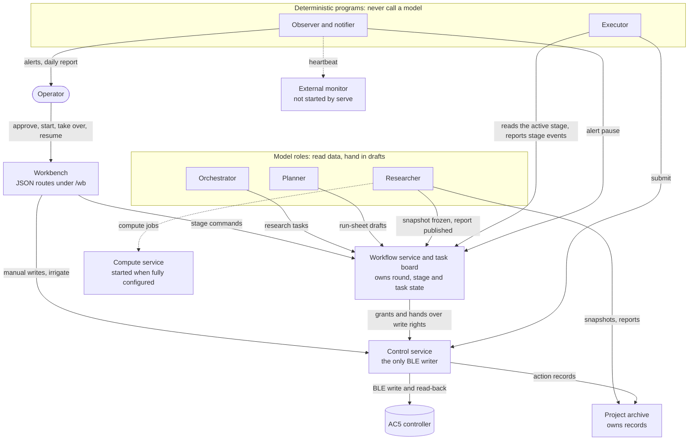

# Architecture overview

[简体中文](../zh-CN/Architecture.md)

This page is for anyone who wants a map of DiAGRI before reading the code or the other design pages. It shows the parts, which part owns which state, how the parts talk to each other, and how one research round moves through them.

> **Status.** Everything here has been tested on the simulated AC5 only, and `growbridge serve` does not yet start or reach every part shown. Each section says which. The full list is in [Status and known limitations](Status-and-Known-Limitations.md).

## The parts

Solid arrows are paths that run inside the daemon. The two dashed arrows are optional. The compute arrow leads to a part that exists in the code and its tests but is not started by `growbridge serve`: [`cli.py`](../../../src/growbridge/cli.py) calls `build_runtime` without a compute backend, so `Runtime.compute` is `None`. The heartbeat arrow runs only when both heartbeat URLs are set in the environment; otherwise `Runtime.monitor` is `None` and the runtime raises the standing warning `monitor_unconfigured`.

The workbench is the operator's HTTP interface: JSON routes under `/wb` in [`workbench/api.py`](../../../src/growbridge/workbench/api.py). The operator console, the page at `/workbench` under `src/growbridge/web/workbench/`, calls these routes and nothing else. The page in `src/growbridge/web/` at `/` is the bridge dashboard and never calls `/wb`.

Two rules give the diagram its shape.

**No model role can reach the device or a stage.** A model can be wrong, and it can be misled by text it reads. So the three model roles only get tools that read data and file drafts. Each role's tool list is fixed in `ROLE_TOOLS`, and every stage or device tool name is refused through `CONTROL_TOOLS`, whatever the configuration says ([`agents/tools.py`](../../../src/growbridge/agents/tools.py)). See [The five agents](The-Five-Agents.md).

**Every write to the device goes through one checkpoint.** The executor and the operator both write through the control service, which checks the write right, records the intent, sends, and reads back. See [Control and safety model](Control-and-Safety-Model.md).

## Who owns what

Each kind of state has one owner. Every other part reads it through the owner, or asks the owner to change it.

The reason is recovery. If two parts could both change a stage's state, a crash between their two updates would leave them disagreeing about whether the stage is paused. With one owner there is one answer, and it is saved in one transaction.

| State | Owner | In code | Database file |
| --- | --- | --- | --- |
| Projects, protocols, rounds, stages, approvals, stage history | workflow service | `WorkflowService`, `WorkflowStore` | `workflow.sqlite3` |
| Research tasks | the workflow service's task board | `TaskBoard` | `workflow.sqlite3` |
| Operators and their sessions | workbench | `Operators` | `workflow.sqlite3` |
| Write host, recovery number, write rights, action ledger, safety configuration, interlock flag | control service | `ControlService`, `Ledger` | `control.sqlite3` |
| Samples, action records, measurements, evidence cards, snapshots, artifacts | project archive | `Archive` | `archive.sqlite3` and the `archive/` folder |
| Alerts, notification outbox, daily reports | observer and notifier | `AlertBook`, `Outbox`, `ReportStore` | `observer.sqlite3` |
| Model-call budget, dispatch claims, confirmatory runs, holdout registry | the model-role runtime | `CallBudget`, `Dispatcher`, `ConfirmatoryRunner`, `HoldoutRegistry` | `agents.sqlite3` |
| Compute attempts and quota | compute service | `ComputeService` | `compute.sqlite3` |

An example of ownership at work. The executor reads the device back and finds that someone changed the light on the AC5 panel. It does not pause the stage. It reports an `EXTERNAL_CHANGE` stage event. The workflow service decides that a `running` stage becomes `paused`, and asks the control service to revoke the stage write right. Three owners, each changing only its own state.

## How the parts talk

The services in the control loop know each other only as protocols, never as classes. The protocols are in [`ports.py`](../../../src/growbridge/ports.py):

| Protocol | Implemented by | Used by | What crosses it |
| --- | --- | --- | --- |
| `StagePort` | `WorkflowService` | executor, observer | `active_stage()` returns a `StageRuntime`; `report()` takes a `StageEvent` |
| `ControlPort` | `ControlService` | workflow service, executor, workbench | rights (`grant`, `handover`), writes (`submit`, `irrigate`, `pump_off`), reads (`read_state`, `differences`, `readings`) |
| `WriteTransport` | the BLE transports | control service, through the bridge | `send`, and `halt()` for old-write-stop confirmation |
| `RecordSink` | `Archive` | control service | `append_action`, `append_sample` |

The data that crosses these protocols is defined in two files: `ports.py` (`Actor`, `ActionRequest`, `StageRuntime`, `StageEvent`, `Difference`) and [`archive/models.py`](../../../src/growbridge/archive/models.py) (`RunSheet`, `ActionRecord`, `WriteRight`, `SafetyConfig` and the rest). A refusal is always `Denied(code)` with a machine-readable code. The codes are listed in [Denial codes and stage events](Denial-Codes-and-Events.md).

Why protocols: the executor is built with a `ControlPort` and a `StagePort` and nothing else, so it has no way to send a BLE command or change a stage except through them. The same protocols let the tests swap a service for a simulated one.

Two parts sit at the edge and are handed the service objects themselves: the workbench routes and the tool handlers of the model roles. They call public methods of `WorkflowService`, `ControlService`, `Archive` and `TaskBoard`. They still cannot skip a check, because the checks are inside those methods.

Identity never comes from the caller's data. An `Actor` is built by the server from an operator session or a role token (`workbench/api.py`), or fixed in code for a model role (`actor_for` in [`agents/handlers_common.py`](../../../src/growbridge/agents/handlers_common.py)). A field such as `role` or `approved` in a tool input fails validation.

All of this is wired in one function, `build_runtime` in [`runtime.py`](../../../src/growbridge/runtime.py).

## One process, one database file per owner

`growbridge serve` with `auto_research = true` runs everything in one process and one event loop (`_serve_auto_research` in `cli.py`):

- **The tick**, once a second (`TICK_SECONDS`). `Runtime.tick` runs nine steps in a fixed order: `archive`, `executor`, `recovery`, `observer`, `outbox`, `tasks`, `report`, `backup`, `health`. Each step is guarded: a step that fails raises an alert and the later steps still run. The tick never calls a model.
- **The model-role loop**, every 30 seconds (`AGENT_SECONDS`), only when `roles` are configured and a model client can be built. It runs each open research task once. A failure here becomes a task that needs attention and an alert. It never fails a tick.
- **The HTTP listeners**: the main one on loopback, plus the on-site one when `lan_bind` and `lan_port` are set.

One process keeps the single checkpoint simple. The control service puts hand-overs and writes in order with one in-process lock, and a `daemon.lock` file keeps a second daemon off the same data directory.

Under `data_dir` there are six SQLite files, one per owner in the table above (`DATABASES` in `runtime.py`), next to the bridge-only daemon's sample history `growbridge.sqlite3`. Each service is given its own `Database` object and no other, so the ownership rule is visible in the wiring and not only a convention.

The architecture document goes further and gives each service its own system account (sections 4.7 and 10). The code does not do that: it is one process under one account. The separation that exists in code is the protocols, the server-side identities, the per-owner files, and the sandbox for model-written analysis code.

## One research round through the parts

1. An operator identity creates the project, saves the research protocol and creates the round (`create_project`, `save_protocol`, `create_round`). The round is `designing`. The operator then sets the project's call budget and states the goal, which becomes the first orchestrator task. *Through `/wb` routes, tested with an in-process HTTP client. `simulate` calls the services directly and states no goal.*
2. The orchestrator hands a task to the planner. The planner validates a run sheet and files it with `save_plan_draft`, which calls `submit_run_sheet`. The stage is `pending_review` and the round `stage_review`. *The model part runs in tests only; `simulate` files the run sheet with a direct call.*
3. The operator approves and starts the stage in the workbench (`approve`, `start_stage`). The workflow service asks the control service for a stage write right and a care write right. The stage is `running` and the round `stage_running`.
4. Every second the executor reads the active stage, evaluates the run sheet and submits writes to the control service, which checks, records, sends and reads back. Action records and samples go to the archive. The observer raises alerts, and the runtime renders the daily report.
5. When the run sheet's duration is over, the executor reports `END_CONDITION_MET`, carries out the end actions and reports `END_ACTIONS`. The stage is `ended`. The round returns to `stage_review` if the protocol has more stages, and otherwise moves to `data_verification`.
6. The researcher freezes the stage's data with `freeze_dataset`. If the snapshot is complete and verifies, the round moves to `analysis`. *Tests only.*
7. The researcher publishes the report with `publish_research_report`. A final report moves the round to `delivered`. *Tests only.*

**What has run only in tests.** Through `/wb` an operator does step 1 and steps 3 to 5, and can stop a stage, choose what follows, or abort the round. The model roles do steps 2, 6 and 7 once a budget is set and a goal is stated. No real model has ever done so: [`test_e2e_http_round.py`](../../../tests/e2e/test_e2e_http_round.py) takes a whole round through the routes with a scripted model and an in-process HTTP client. `growbridge simulate` (`simulate_stage` in `runtime.py`) runs steps 1 to 5 by calling the services directly. No CLI command starts a round.

The states, and who may trigger each transition, are on [Workflow and state machines](Workflow-and-State-Machines.md).

## Where the design is written down

The [architecture document](../../diagri-agent-architecture.zh-CN.md) (in Chinese) holds the full reasoning: sections 1 to 4 for the overview, 5 to 10 for the details, Appendix B for the state tables. This wiki describes the code as it is. Where the two differ, the page says so.

## See also

- [The five agents](The-Five-Agents.md)
- [Control and safety model](Control-and-Safety-Model.md)
- [Workflow and state machines](Workflow-and-State-Machines.md)
- [Data, archive and traceability](Data-Archive-and-Traceability.md)
- [Code structure and extension points](Code-Structure-and-Extension-Points.md)
- [Status and known limitations](Status-and-Known-Limitations.md)
- [Glossary](Glossary.md)
