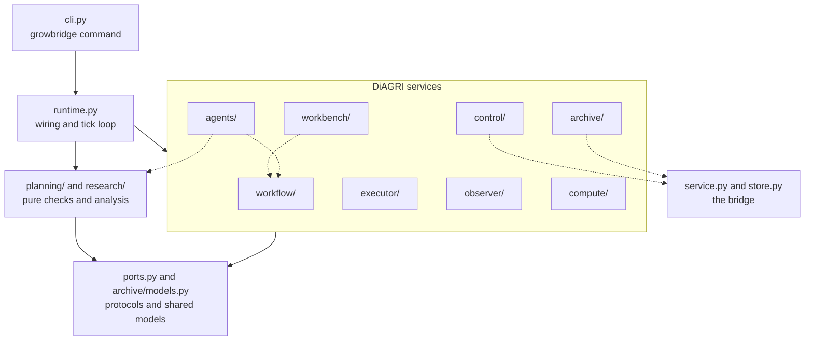

# Code structure and extension points

[简体中文](../zh-CN/Code-Structure-and-Extension-Points.md)

This page is for contributors who are about to change the code. It maps `src/growbridge/`, explains the rule that keeps the services apart, and gives the file, the protocol and the tests for each common extension.

## Two layers

The package has two layers. The **bridge**, GrowBridge, is the original daemon: top-level modules that own the BLE link, the sample history, the loopback HTTP API, the dashboard and the MCP tools. The **rest of DiAGRI** is a set of sub-packages, one per service, that [`runtime.py`](../../../src/growbridge/runtime.py) assembles when `auto_research` is on. With it off, `growbridge serve` runs the bridge alone. [Architecture overview](Architecture.md) explains what each service is responsible for at run time; this page says where the code is.

## The bridge: top-level modules

| Module | Owns |
| --- | --- |
| [`cli.py`](../../../src/growbridge/cli.py) | The `growbridge` command and its subcommands. `serve` starts either the bridge alone or the DiAGRI runtime. |
| [`config.py`](../../../src/growbridge/config.py) | `Settings` and `RoleModel`: the private configuration file, read by `load` and created by `initialize`. |
| [`protocol.py`](../../../src/growbridge/protocol.py) | The GGS v1 framing: `encode`, `Decoder`, `crc16`. |
| [`transport.py`](../../../src/growbridge/transport.py) | The BLE link: `NativeTransport` on macOS, `BleakTransport` on Linux, chosen by `make_transport`. |
| [`native/BLEHelper.swift`](../../../src/growbridge/native/BLEHelper.swift) | The helper process that `NativeTransport` starts to reach the radio on macOS. |
| [`service.py`](../../../src/growbridge/service.py) | `Bridge`: the one owner of the BLE connection. Telemetry, requests and replies, the original controls and pump timing. |
| [`store.py`](../../../src/growbridge/store.py) | `Store`: the original SQLite history of samples and operations. |
| [`api.py`](../../../src/growbridge/api.py) | `create_app`: the loopback HTTP API and the dashboard. It mounts the workbench router in DiAGRI mode. |
| [`dashboard.py`](../../../src/growbridge/dashboard.py), [`web/`](../../../src/growbridge/web) | Browser sessions for the dashboard, and its page, script and stylesheet. |
| [`mcp_server.py`](../../../src/growbridge/mcp_server.py), [`client.py`](../../../src/growbridge/client.py) | The MCP server over stdio, and the HTTP client it uses to reach the running daemon. |

## The rest of DiAGRI: one package per service

| Package | Owns |
| --- | --- |
| [`archive/`](../../../src/growbridge/archive) | The project archive (`Archive` in `store.py`): append-only records, data snapshots, export, backup, storage pressure. It also holds what every service shares: `models.py`, `db.py` (`Database`), `clock.py` (`Clock`) and `ids.py`. |
| [`workflow/`](../../../src/growbridge/workflow) | `WorkflowService`: round and stage state, approvals and history. `TaskBoard` in `tasks.py`: research tasks. `states.py`: the state enums. |
| [`control/`](../../../src/growbridge/control) | `ControlService`: the single checkpoint for BLE writes. Write rights in `rights.py`, the action ledger and host registration in `ledger.py`, channel mapping and read-back in `device.py`. |
| [`executor/`](../../../src/growbridge/executor) | `ExecutorEngine`: the deterministic tick that carries out the approved run sheet. Rule evaluation in `rules.py`, clock trust and link outages in `outage.py`. |
| [`observer/`](../../../src/growbridge/observer) | `Observer`: alert rules and the alert book, the notification outbox and channels, daily metrics and reports, run health and heartbeat. |
| [`planning/`](../../../src/growbridge/planning) | Pure functions: experimental-design checks in `design.py`, run-sheet validation in `validate.py`. |
| [`research/`](../../../src/growbridge/research) | The analysis library: statistics, the confirmatory gate, `HoldoutRegistry`, report publishing and the code sandbox. |
| [`agents/`](../../../src/growbridge/agents) | The three model roles: prompts in `roles.py`, the tool registry in `tools.py`, tool handlers in `handlers*.py`, the agent loop, `Dispatcher`, `CallBudget` and the model client in `llm.py`. |
| [`compute/`](../../../src/growbridge/compute) | `ComputeService`: quota checks and job tracking. The `ComputeBackend` protocol. `FirecrestBackend`, whose remote operations are not implemented. |
| [`workbench/`](../../../src/growbridge/workbench) | The operator's HTTP routes under `/wb`: sessions, stage control, manual writes and reads in `api.py`; starting and steering a round in `rounds.py`. Operator credentials, sessions and the entry decision in `auth.py`. |
| [`sim/`](../../../src/growbridge/sim) | Simulators and fixtures, used by the tests and by `growbridge simulate`. |

Four top-level modules hold the services together:

| Module | Owns |
| --- | --- |
| [`ports.py`](../../../src/growbridge/ports.py) | The contracts: the protocols `ControlPort`, `StagePort`, `WriteTransport`, `SampleSource` and `RecordSink`, and the values that cross them, such as `Actor`, `Denied`, `ActionRequest` and `StageEvent`. |
| [`runtime.py`](../../../src/growbridge/runtime.py) | `build_runtime` creates one SQLite file per owner and wires the services. `Runtime.tick` is the once-a-second loop. `simulate_stage` is the simulated run. |
| [`runtime_agents.py`](../../../src/growbridge/runtime_agents.py) | Builds the role tools and the `Dispatcher` on the runtime's services. Nothing here is reachable from `Runtime.tick`. |
| [`runtime_backup.py`](../../../src/growbridge/runtime_backup.py) | `Backups`: scheduled online backups of the databases. |

## The dependency rule

A service imports the protocols in `ports.py` and the models in `archive/models.py`. It does not import another service's class. `runtime.py`, with `runtime_agents.py` and `runtime_backup.py`, is where the concrete classes are named and each service is handed its collaborators. This is what lets a test give the workflow service a `FakeControl`, or the executor a `FakeClock`, without starting anything else. The reasons behind the split are on [Design decisions](Design-Decisions.md).



Solid arrows are imports the rule allows. Dotted arrows are the departures listed below.

Besides the two contract modules, every package may import the shared infrastructure: `archive/clock.py`, `archive/db.py`, `archive/ids.py`, `workflow/states.py` (which imports nothing from the package) and `config.py`.

Checked with grep on the working tree, `executor/`, `observer/`, `compute/`, `planning/`, `research/` and `workflow/` follow the rule exactly. The other packages depart from it in these places:

| Where | What it imports | Why it is there |
| --- | --- | --- |
| [`workbench/api.py`](../../../src/growbridge/workbench/api.py), [`workbench/rounds.py`](../../../src/growbridge/workbench/rounds.py) | `WorkflowService`, `TaskBoard`, `Archive`, `AlertBook`, and `require_operator` from `workflow/permissions.py` | The workbench is handed the real services and names their classes in its type annotations. `rounds.py` types the call budget with a protocol of its own, so `workbench/` imports nothing from `agents/`. |
| [`agents/dispatch.py`](../../../src/growbridge/agents/dispatch.py) | `TaskBoard` | The dispatcher's task board parameter is typed with the class. |
| [`control/service.py`](../../../src/growbridge/control/service.py), [`control/device.py`](../../../src/growbridge/control/device.py) | `Bridge`, `BridgeError` from `service.py` | The control service wraps the bridge. No other DiAGRI package imports it. |
| [`archive/source.py`](../../../src/growbridge/archive/source.py) | `Store` from `store.py` | The adapter that reads the bridge's sample history into the archive. |
| `agents/handlers_*.py` | Functions and result types from `planning/` and `research/`, and the `archive/snapshot.py` module | The tool handlers call the pure checks and the analysis library directly. |

The tool handlers also receive the real services through `Deps` in [`agents/handlers_common.py`](../../../src/growbridge/agents/handlers_common.py), whose fields are typed `Any`. A grep on imports therefore does not show everything they use. To check a package yourself:

```sh
grep -rnE '^[[:space:]]*(from|import) +growbridge\.' src/growbridge/executor
```

## Extension points

Each entry names the file to change, the contract to satisfy and the tests to add. Tests follow the no-network rule in [Development setup, testing and CI](Development-Setup-Testing-and-CI.md).

### A new notification channel

- **File.** [`observer/channels.py`](../../../src/growbridge/observer/channels.py).
- **Contract.** The `NotifyChannel` protocol: `async def send(self, text: str) -> Outcome`, where the outcome is `accepted`, `unknown` (the request may have arrived) or `failed` (it certainly did not). Secrets and endpoints come from environment variables only.
- **Wiring.** `default_channels` in `runtime.py` returns the channels by name. The outbox stores that name with each notification and retries anything not accepted.
- **Tests.** Follow [`tests/observer/test_observer_channels.py`](../../../tests/observer/test_observer_channels.py): an `httpx.MockTransport` for every response and network error, and the outcome each one maps to.

No channel has been tried against a real service. See [Status and known limitations](Status-and-Known-Limitations.md).

### A new compute backend

- **File.** [`compute/backend.py`](../../../src/growbridge/compute/backend.py) holds the contract. Put the adapter next to [`compute/firecrest.py`](../../../src/growbridge/compute/firecrest.py).
- **Contract.** The `ComputeBackend` protocol: `submit`, `find_by_name`, `status`, `fetch`, `cleanup`, `cancel` and `balance`. `submit` receives the job name `gb-<attempt_id>`, and `find_by_name` must find the job again by that name, so that a lost receipt is reconciled and not resubmitted. Raise `SubmitRejected` when the job was certainly not accepted and `BackendError` when the outcome is uncertain.
- **Wiring.** `build_runtime` takes a `compute_backend` argument. `serve` does not pass one, so `Runtime.compute` is `None` in the running daemon and the researcher's compute tools are refused. A new backend also needs this wiring, together with the job templates and members that `_compute` in `runtime.py` leaves empty.
- **Tests.** [`tests/compute/`](../../../tests/compute) drives `ComputeService` with `FakeBackend`. Test the adapter's own refusals as [`tests/compute/test_compute_firecrest.py`](../../../tests/compute/test_compute_firecrest.py) does.

`FirecrestBackend` only checks that `pyfirecrest` and its environment variables are present. Every remote operation raises `NotImplementedError`, and nothing in `src/` constructs it.

### A new tool for a model role

- **Files.** Add the name to `ROLE_TOOLS` in [`agents/tools.py`](../../../src/growbridge/agents/tools.py) and build the `Tool` in the role's handler module, for example [`agents/handlers_researcher.py`](../../../src/growbridge/agents/handlers_researcher.py). `build_role_tools` raises an error when the two lists differ.
- **Contract.** The input model subclasses `ToolInput`, which forbids unknown fields, so a field such as `role` or `approved` fails validation. The handler acts as `actor_for(role)` and never takes an identity from its input. Set `writes`, `sandbox` and `reads_web` truthfully: the agent loop hides write and sandbox tools after a web-reading tool has run.
- **Rule 1: no control.** A tool must not approve, start, pause, resume or stop a stage, or write to the device. The names in `CONTROL_TOOLS` can never reach a model role, and a new tool must not offer the same thing under another name.
- **Rule 2: scope every id.** An id that the model supplies is a claim, not a fact. Take the caller's `task_id`, resolve it, and check that the snapshot, round or stage belongs to that task's project before anything is read or created. `own_task`, `scoped_snapshot` and `require_round` do this and refuse with `Denied("scope")`.
- **Tests.** The registry tests in [`tests/agents/test_agents_tools.py`](../../../tests/agents/test_agents_tools.py) and [`tests/dispatch/test_dispatch_toolsets.py`](../../../tests/dispatch/test_dispatch_toolsets.py), a behavior test in the role's `tests/dispatch/test_dispatch_*.py`, and scope tests modeled on [`tests/dispatch/test_dispatch_snapshot_scope.py`](../../../tests/dispatch/test_dispatch_snapshot_scope.py): an id from another project, an unknown id, a task of another role.

### A new feedback or protection rule shape

- **Files.** The models `FeedbackRule`, `ProtectionRule`, `Condition` and `RuleAction` in [`archive/models.py`](../../../src/growbridge/archive/models.py). Evaluation in [`executor/rules.py`](../../../src/growbridge/executor/rules.py). Checks before review in [`planning/validate.py`](../../../src/growbridge/planning/validate.py).
- **Contract.** `evaluate_feedback` and `evaluate_protection` are pure: they take the rule, a reading, the previous `RuleState` and `now_mono`, and return a `Decision`. Durations are measured on the monotonic timestamps only. A reading drives a rule only when `valid_reading` accepts it; otherwise the rule takes no action and its timer starts again, and a feedback rule whose `on_missing` is `pause` asks for a pause. `validate_run_sheet` returns `Finding` objects, and a blocking finding keeps the run sheet from review.
- **Also check.** The protection write right lists the exact levels of the approved rules, and `check_scope` in `control/rights.py` refuses any other value. The workflow service refuses to start a stage with `safety_conflict` when `safety_conflicts` finds a protection rule on a channel that the run sheet does not make host-controlled. A new kind of action has to pass both.
- **Tests.** [`tests/rules/`](../../../tests/rules) for evaluation, [`tests/planning/test_planning_validate.py`](../../../tests/planning/test_planning_validate.py) for validation, and [`tests/executor/`](../../../tests/executor) for the tick. Extend `humidity_rule` and `make_safety` in `sim/fixtures.py` if the new shape needs a sample.

### A sandbox for another platform

- **File.** [`research/sandbox.py`](../../../src/growbridge/research/sandbox.py).
- **Contract.** The `Sandbox` protocol: `run(script, snapshot_dir, out_dir, timeout) -> SandboxResult`. The child process has no network, a read-only view of the snapshot, write access to `out_dir` only, and an empty environment.
- **Wiring.** Two functions choose the backend: `make_sandbox` in the same file and `make_runtime_sandbox` in `runtime.py`. Both fall back to `RefusingSandbox`, which runs nothing. Keep that fallback.
- **Tests.** The macOS-only tests in [`tests/research/test_research_sandbox.py`](../../../tests/research/test_research_sandbox.py) are the behavior a new backend must reproduce under its own skip condition: no network, no write outside `out_dir`, no credentials from the parent, a timeout that stops the script.

Today only macOS has a backend (`SeatbeltSandbox`). On Linux, including a Raspberry Pi, analysis scripts are refused.

### A new BLE transport

- **File.** [`transport.py`](../../../src/growbridge/transport.py).
- **Contract.** The `WriteTransport` protocol in `ports.py`: the attribute `connected` and the methods `connect(callback)`, `send(command)`, `close()` and `halt()`. `halt` returns `True` only when the old write path is confirmed unable to write again. A timeout or an error returns `False`. After `halt`, `send` must refuse.
- **Wiring.** `make_transport` picks the class by platform. `Bridge` and `build_runtime` accept any `transport_factory`, which is how the tests pass `SimulatedTransport`.
- **Tests.** [`tests/transport/test_transport_bleak_halt.py`](../../../tests/transport/test_transport_bleak_halt.py) is the pattern: one test for each way `halt` can fail to confirm, and one for `send` after `halt`.

The control service relies on `halt` when write rights change hands. [Control and safety model](Control-and-Safety-Model.md) explains why a timeout cannot count as confirmation.

## What the running daemon does not wire yet

These pieces exist as code and tests, and `growbridge serve` does not connect them. Each is a place where a contributor could add something.

1. **A page or a command for the research goal.** The entry point exists as workbench routes in [`workbench/rounds.py`](../../../src/growbridge/workbench/rounds.py). They call `create_project`, `save_protocol` and `create_round` on `WorkflowService`, `CallBudget.set`, and `TaskBoard.create` for the first orchestrator task. There is no web page and no CLI command on top of them, and several reads still have no route; [Run a research round](Run-a-Research-Round.md) lists them. A new route goes into `rounds.py` or `api.py` behind the workbench's `operator` or `fresh` dependency. Its tests in [`tests/workbench/`](../../../tests/workbench/) show that a role token, a missing session, a foreign origin and a session of the other entry are refused.
2. **A compute backend.** See above: `serve` passes no `compute_backend`.
3. **The heartbeat.** `build_runtime` takes `heartbeats`, a pair of `Heartbeat` objects. `serve` passes none, so `Runtime.monitor` is `None`, and nothing in `src/` constructs `HeartbeatChannel`.
4. **A search backend.** `role_tools` in `runtime_agents.py` passes `search=None`, so the planner's two web tools, `lookup_crop_conditions` and `search_and_verify_sources`, are refused.

[Status and known limitations](Status-and-Known-Limitations.md) keeps the full list.

## See also

- [Architecture overview](Architecture.md)
- [Design decisions](Design-Decisions.md)
- [Control and safety model](Control-and-Safety-Model.md)
- [The five agents](The-Five-Agents.md)
- [Development setup, testing and CI](Development-Setup-Testing-and-CI.md)
- [Glossary](Glossary.md)
