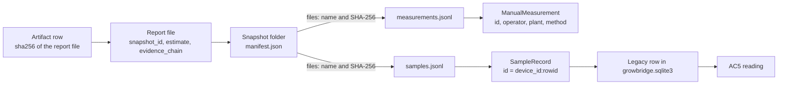

# Data, archive and traceability

[简体中文](../zh-CN/Data-Archive-and-Traceability.md)

This page is for anyone who has to trust, check or back up the data. It explains what DiAGRI records, where each record is kept, why raw records are never changed, and how a number in a report is traced back to the device reading behind it.

All of this has run on the simulated AC5 only. No real experiment has been archived with this code; see [Status and known limitations](Status-and-Known-Limitations.md). The design background is in sections 11.1 to 11.5 of the [architecture document](../../diagri-agent-architecture.zh-CN.md). This page describes what the code does today, and the last section lists where the two differ.

## What is recorded, and by whom

The record types are frozen models in [`archive/models.py`](../../../src/growbridge/archive/models.py). They are stored by the project archive, the `Archive` class in [`archive/store.py`](../../../src/growbridge/archive/store.py).

| Record | Model | Written by | Identifier |
| --- | --- | --- | --- |
| Sample | `SampleRecord` | The runtime's ingestion step, `Runtime._ingest` in [`runtime.py`](../../../src/growbridge/runtime.py), on every tick | `<device_id>:<rowid>` |
| Action | `ActionRecord` | The control service, through `RecordSink.append_action`. One row per state change | `request_id` |
| Manual measurement | `ManualMeasurement` | An operator, with `POST /wb/measurements` in [`workbench/api.py`](../../../src/growbridge/workbench/api.py) | `id` |
| Intervention | a table row, no model | The workflow service. `InterventionMirror` copies each one into the archive once | `intv_...` |
| Data snapshot | `Snapshot` | The researcher's `freeze_dataset` tool | `snap_...`, plus a version per experiment |
| Artifact | `Artifact` | `publish_research_report` in [`research/report.py`](../../../src/growbridge/research/report.py) | `artifact_...` |
| Evidence card | `EvidenceCard` | `Archive.add_evidence` | `id` |

Three points are easy to miss:

- **A sample belongs to an experiment only if it arrived after the stage started.** For every sample, ingestion asks which stage was running when the sample was received. A sample from before the start is stored without an experiment.
- **The action ledger exists twice.** The control service keeps the working copy in its own database. The archive receives a copy of every state, so the history `pending`, `maybe_sent`, `confirmed` of one write can be read later.
- **Evidence cards and images are not wired up.** No command, workbench route or model tool calls `add_evidence` in the current code; only tests do. The planner and the researcher can read cards (`validate_run_sheet`, `query_evidence`). There is no image record at all.

## Where the data is kept

Everything is under `data_dir`. Each SQLite file has one owner, and other services reach the data only through that owner's methods. The file names come from `DATABASES` in [`runtime.py`](../../../src/growbridge/runtime.py). The reason for the split is record 7 in [Design decisions](Design-Decisions.md).

| File or folder | Owner | Contents |
| --- | --- | --- |
| `growbridge.sqlite3` | The base daemon, `Store` in [`store.py`](../../../src/growbridge/store.py) | Legacy `samples` (receive time and reading) and `operations` |
| `control.sqlite3` | Control service | Write host, write rights, action ledger, safety configuration, control events |
| `workflow.sqlite3` | Workflow service, `TaskBoard`, `Operators` | Projects, research protocols, rounds, run sheets, stages, approvals, research tasks, operator accounts and sessions |
| `archive.sqlite3` | Project archive | Samples, actions, measurements, evidence, artifacts, interventions, the snapshot index and invalidations |
| `observer.sqlite3` | Observer and notifier | Alerts, the notification outbox, daily reports |
| `compute.sqlite3` | Compute service | Job attempts, budgets and balances |
| `agents.sqlite3` | Support for the model roles | Call budget, dispatch claims, frozen analysis scripts and confirmatory runs, the holdout registry |
| `archive/snapshots/<snapshot_id>/` | Project archive | The files of one data snapshot |
| `analysis/` | `ConfirmatoryRunner` | One folder per confirmatory run |
| `agent_work/` | Tools of the model roles | Exploratory runs under `local/`, report files under `reports/` |

## Why raw records are only appended

A result can be trusted only if it can be computed again from the same inputs. If a raw row could be edited, an old report would stop matching its data and nobody would notice. So raw records are added and never changed, and everything derived from them (snapshots, daily metrics, reports) can be rebuilt.

How [`archive/store.py`](../../../src/growbridge/archive/store.py) keeps the rule:

- **No update, no delete.** `Archive` has no method that changes or removes a record. `_insert_once` treats a repeat with identical content as nothing new, and raises an error when the same id arrives with different content.
- **A changed action is a new row.** Each state of a write is appended. Nothing is overwritten.
- **A correction is a new record.** A corrected manual measurement is a second `ManualMeasurement` whose `corrects` field names the first. `measurements()` returns the current values by default and all rows with `include_corrected=True`.
- **A correction flags what depended on the old value.** `mark_dependents_invalid` writes a row in `invalidations` for every snapshot that contains the corrected record and for every artifact built on those snapshots. `publish_research_report` refuses an invalidated snapshot.

Example: an operator records a canopy area of 12.5 for plant `p3` and later sees that it should have been 15.2. They post a second measurement with `corrects` set to the id of the first. Both rows stay in the archive. A snapshot frozen before the correction is flagged, no report can be published from it, and the researcher freezes a new version.

One limit: the rule lives in the `Archive` class. The database has no triggers, so it does not protect against a program that opens the file directly.

## How samples reach the archive

The base daemon writes every reading to its own table, as it did before the rest of DiAGRI existed. The archive copies the rows from there. The BLE path stays as it was, and the copy can stop and resume at any point. The code is [`archive/source.py`](../../../src/growbridge/archive/source.py) and `Archive.ingest`.

- **Cursor.** `LegacySampleSource.read_after` returns the rows whose `rowid` is above the archive's cursor. `ingest` stores a batch (500 rows, up to 10 batches per tick) and the new cursor in one transaction, so after a crash either both are there or neither. A replay adds nothing twice, because the record id is `<device_id>:<rowid>`.
- **Time.** The legacy table only has the receive time. `captured_at` is therefore empty and the archive orders samples by `received_at`. The legacy table also has no quality flag and does not tell planned sampling from a status query, so every ingested sample is `ok` and `planned`.
- **Clock-unsynced samples.** The source notes when it first sees the clock unsynced and when it next sees it synced. Rows received in between get `clock_synced = false`. They are archived, but they do not count as trusted data (next section). A period that starts and ends while the process is down, or between two observations, is not seen.
- **Protected history.** Once the runtime has started, `Store.prune` deletes a legacy row only if it is older than `retention_days` and already archived. It deletes nothing while the clock is unsynced, and never the newest row.
- **`SourceRewound`.** The legacy table does not use `AUTOINCREMENT`. If it were emptied, SQLite would hand out row ids below the cursor again, and new rows could not be told from archived ones. When the newest `rowid` is below the cursor, the source raises `SourceRewound`. The runtime turns it into the alert `source_rewound` and the rest of the tick goes on. Keeping the newest row when pruning is what prevents this in normal operation.

## How a data snapshot is frozen and verified

An analysis must run on data that cannot move under it. `freeze()` in [`archive/snapshot.py`](../../../src/growbridge/archive/snapshot.py) writes the inputs of one analysis into a folder and records a fingerprint of every file.

1. **Refuse an untrusted clock.** While the clock is unsynced, `freeze()` raises `Denied("clock_unsynced")`.
2. **Take the window from the run sheet.** When the researcher calls `freeze_dataset`, the window runs from the stage's start to start plus `duration_seconds`, and the sampling interval and the largest allowed gap come from the run sheet. The model cannot supply them ([`agents/handlers_researcher.py`](../../../src/growbridge/agents/handlers_researcher.py)).
3. **Split the samples.** A sample is trusted when it is `clock_synced`, its quality is `ok` and its source is `planned`. Trusted samples go to `samples.jsonl`. All others go to `samples_untrusted.jsonl`: they are kept for inspection and count for nothing.
4. **Write the other files.** `actions.jsonl`, `measurements.jsonl` and `interventions.jsonl` hold the records of the window. Every line is one JSON object with sorted keys.
5. **Measure coverage by time, not by rows.** Two neighbouring trusted samples no further apart than the allowed gap cover the time between them. After a longer silence the earlier sample is credited one sampling interval and the rest is listed as a gap. A snapshot is `complete` when coverage is at least 0.9 (`DEFAULT_MIN_COVERAGE`).
6. **Write the manifest.** `manifest.json` holds the id, experiment, version, window, coverage, `complete`, the gaps, `min_coverage`, `measurements_excluded`, and `files`: the SHA-256 of each file, computed by `file_digest`. The archive stores a `Snapshot` row with the same list and with `manifest_sha256`, the digest of the manifest file itself.

Freezing again never changes an existing snapshot. It writes a new folder with the next version number.

Coverage example, checked with `coverage_of`: a one-hour window, a sample every 60 seconds, an allowed gap of 120 seconds, and no samples between minute 25 and minute 35. The silence is credited 60 seconds, the gap is 540 seconds, coverage is 3060 / 3600 = 0.85, and the snapshot is marked incomplete.

`verify()` returns true only when three things hold: the manifest file still has the digest stored in the archive, the file list in the manifest equals the stored list, and every file still has its listed digest. `run_local_analysis`, `publish_research_report` and `export_miappe` all verify first. `ConfirmatoryRunner` is stricter: it also requires `complete` and refuses a folder with a missing or an extra file.

When a holdout is registered, its outcome measurements are left out of `measurements.jsonl`, and the manifest counts them in `measurements_excluded`. See [Research methodology](Research-Methodology.md).

## Export formats

| What | Format | Produced by |
| --- | --- | --- |
| Data snapshot | A folder of JSON Lines files and `manifest.json` | `freeze()` |
| Research report | `research_report_<artifact_id>.json` | `publish_research_report` |
| MIAPPE-compatible metadata | `miappe.json` | `export_miappe` in [`archive/export.py`](../../../src/growbridge/archive/export.py) |
| Legacy readings | CSV, at most 168 hours | `GET /history/export.csv` in [`api.py`](../../../src/growbridge/api.py) |

`export_miappe` builds its metadata from the snapshot's own files, not from the live database, so it describes exactly the data an analysis used. It needs a licence and a persistent identifier, and it refuses a snapshot that fails verification. The file lists the study (protocol id and version, question, hypothesis, seed, primary endpoint), the experimental units with their treatments, the observed variables, the coverage and gaps, and the data files with their digests. Sensor variables are exported without a unit. No command or route calls `export_miappe` yet; it is a library function covered by [tests](../../../tests/archive/test_archive_export.py).

## Tracing one reported number

Two functions in [`archive/ids.py`](../../../src/growbridge/archive/ids.py) do all the fingerprinting. `file_digest` is the SHA-256 of a file's bytes; it protects snapshot files, manifests, reports, analysis scripts and backups. `content_digest` is the SHA-256 of an object written as JSON with sorted keys; it identifies the content of a protocol or a run sheet, so an approval is tied to the exact run sheet that was reviewed.

Suppose a report says the effect is 0.85. The steps back are:

1. **Report.** The `Artifact` row holds `sha256`, the `file_digest` of the report file. If the file was edited, the digests differ. The file names its `snapshot_id` and lists every snapshot it used in `evidence_chain` as `snapshot:<id>`.
2. **Snapshot.** Open `archive/snapshots/<id>/manifest.json` and run `verify()`. If it passes, the files are the ones the report was computed from.
3. **Measurements.** The effect was computed from `measurements.jsonl` of those snapshots, not from the live database ([`agents/handlers_report.py`](../../../src/growbridge/agents/handlers_report.py)). Each line has the measurement id, operator, plant, position, method and time.
4. **Samples.** Each line of `samples.jsonl` has the id `<device_id>:<rowid>`, the receive time, the clock flag and `data`, the decoded reading.
5. **Device reading.** The `rowid` is the row in the legacy `samples` table. After pruning (`retention_days`, 30 by default) the archive copy is the only one.
6. **Actions.** Each line of `actions.jsonl` has the `request_id`, the write right number, the trigger, the operator, and the planned and confirmed level, so what the tent was actually set to can be compared with the run sheet.

## Backup

The code is `Backups` in [`runtime_backup.py`](../../../src/growbridge/runtime_backup.py) and `backup()` in [`archive/backup.py`](../../../src/growbridge/archive/backup.py). The steps for an operator are in [Notifications, daily reports and backup](Notifications-Reports-and-Backup.md).

- Backups run only when `backup_dir` is set. Without it, the runtime raises the warning alert `backup_unconfigured` at startup.
- Every `backup_interval_seconds` (6 hours by default) each of the six DiAGRI databases is copied to `<backup_dir>/<name>.sqlite3`. The copy uses SQLite's online backup on a separate read-only connection, so it is one consistent state and writers are not blocked.
- A copy replaces the previous backup only after `PRAGMA integrity_check` passes. A manifest with `sha256`, `size` and `created_at` is written next to it as `<name>.sqlite3.manifest.json`.
- A failed backup leaves the previous one untouched, raises the alert `backup` and is tried again after 300 seconds. The run-health probe `offsite_backup` fails when the oldest successful backup is older than two intervals.

What the backup does **not** cover:

- Snapshot folders, report files and confirmatory run folders. A restored database still knows their digests and can tell whether a file is intact. It cannot bring the file back.
- The legacy `growbridge.sqlite3`. Samples that were already ingested are in `archive.sqlite3`; rows not yet ingested are lost.
- Images. The code stores none.
- The configuration file and `host_id`.
- A single point in time across files. The six databases are copied one after another.

After a restore, stop the daemon and run `growbridge recovery bump --reason ...`. The recovery number goes up and every earlier write right, approval and session is void. See [Control and safety model](Control-and-Safety-Model.md).

## Where the code differs from the architecture document

- Section 11.4 backs up databases, raw images and an archive manifest. The code backs up the six SQLite databases only.
- Section 11.1 describes image records. The code has none.
- Section 6.2 gives an evidence card a crop, growth period, conditions and page reference. `EvidenceCard` has a source class, citation, claim, value, unit and two flags.
- Section 11.2 records unit, position and calibration version for each sensor and separates status queries from planned sampling. `SampleRecord` has fields for source and quality, but ingestion from the legacy table cannot fill them.
- Section 11.1 says an artifact records its code hash and environment. `publish_research_report` leaves `code_sha256` and `environment` empty.

## See also

- [Research methodology](Research-Methodology.md)
- [Design decisions](Design-Decisions.md)
- [Notifications, daily reports and backup](Notifications-Reports-and-Backup.md)
- [Configuration reference](Configuration-Reference.md)
- [Status and known limitations](Status-and-Known-Limitations.md)
- [Glossary](Glossary.md)
