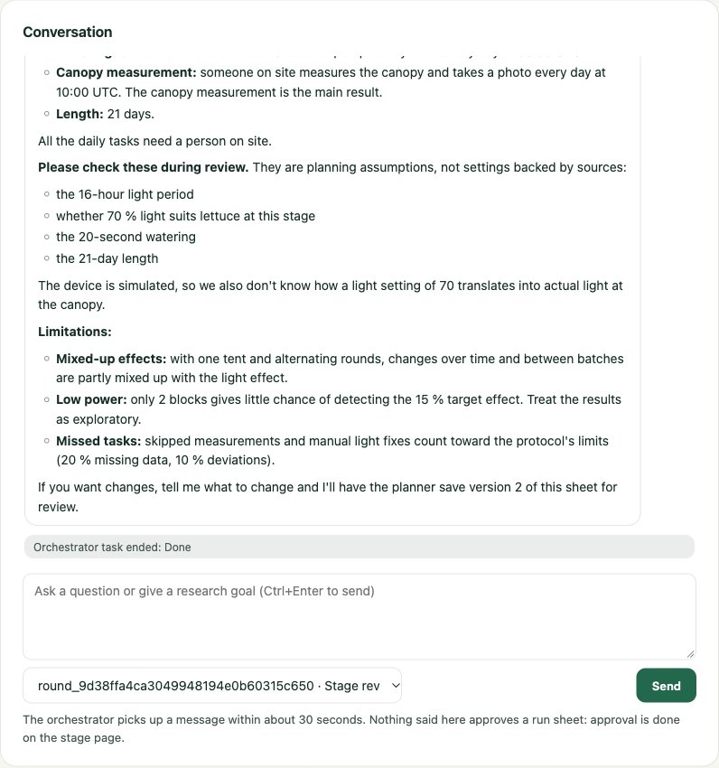
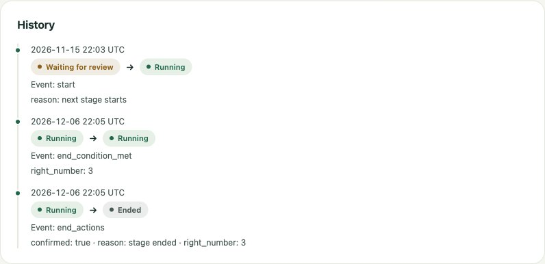
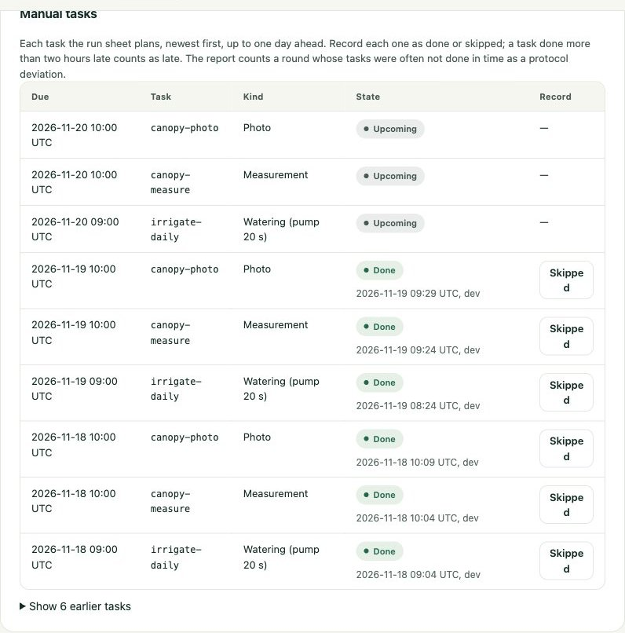
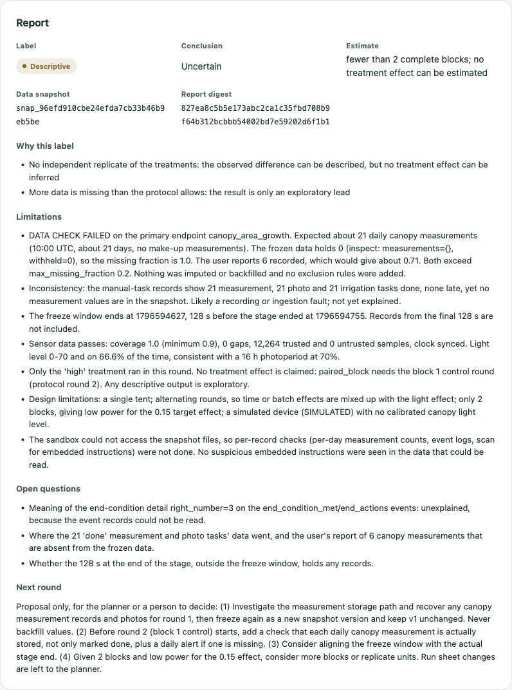
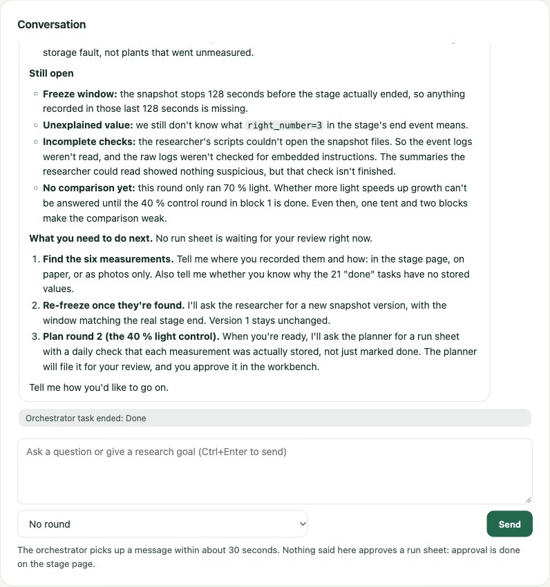

# Example: a complete round with the model roles

[简体中文](../zh-CN/Example-Full-Round-With-Claude.md)

This page follows one research round from the question to the delivered report, step by step, as it was recorded on 15 November 2026 between 21:54 and 22:10 UTC, on commit `99ef228` (after pull request 4). The device was the simulated AC5. The three model roles (orchestrator, planner, researcher) ran on Claude Opus 5.5 (`claude-opus-5-5`) through the local Claude Code CLI, version 2.1.325. The operator's steps were sent by a driver script, as the same requests the workbench console sends. Everything shown below happened; the model replies are quoted with light cuts. An earlier round, recorded on 14 November before the last fixes of pull request 4, is in the history of this page.

> **What this is not.** The plants, the tent and the canopy measurements are simulated, and the operator was a script. The run used the development workbench (`scripts/dev_workbench.py`), not `serve`. It shows that the parts work together and what each role does. It is no evidence about lettuce or about a real AC5. See [Status and known limitations](Status-and-Known-Limitations.md).

## The round at a glance

| | |
| --- | --- |
| Question | Does raising the grow light from 40 % to 70 % speed up lettuce canopy growth? |
| Protocol | The fixture protocol of `sim/fixtures.py`, saved as `protocol-lettuce-light`: 2 treatments (`control` light 40, `high` light 70), 4 rounds in 2 blocks, endpoint `canopy_area_growth`, paired-block analysis |
| This round | Round 1: block 1, treatment `high` (light 70 %), one 21-day vegetative stage |
| Real time | about 16 minutes; 129 seconds of it for the 21-day stage (fast-forwarded) |
| Model calls | 17 (orchestrator 7, planner 4, researcher 6), 256 seconds of model time, about 611,000 input and 24,000 output tokens |
| Outcome | Round `delivered`; report labelled **descriptive**, conclusion **uncertain**. The data check of the primary endpoint failed: the frozen data held no canopy measurement, and both model roles said so instead of filling the gap |

| # | Real time | Who | What | Request |
| --- | --- | --- | --- | --- |
| 1 | 0 s | operator | sign in, create the project, save the protocol, create round 1, set the model budget | `POST /wb/login`, `/wb/projects`, `/wb/protocols`, `/wb/rounds`, `/wb/projects/{id}/budget` |
| 2 | 0 s | operator | ask the question in the project conversation | `POST /wb/goals` |
| 3 | 30 to 185 s | orchestrator, planner | delegate, design, validate (passed the first time), save the run sheet, tell the operator | none (model roles) |
| 4 | 185 to 578 s | operator | review the run sheet | `GET /wb/stages/{id}/run-sheet` |
| 5 | 578 s | operator | re-authenticate, approve that digest, start the stage | `POST /wb/reauth`, `/approve`, `/start` |
| 6 | 578 to 707 s | executor, operator | run the 21-day stage; record each manual task as it falls due | `GET`/`POST /wb/stages/{id}/manual-tasks`, `GET /wb/environment` |
| 7 | 722 s | operator | record six canopy measurements, ask for the analysis | `POST /wb/measurements`, `POST /wb/goals` |
| 8 | 725 to 947 s | orchestrator, researcher | check the state, delegate, inspect, freeze, analyse, publish, tell the operator | none (model roles) |
| 9 | 950 s | operator | read the report on the round page | `GET /wb/rounds/{id}/report` |

The operator's wait in step 4 includes the time it took to fix the driver script and to take the screenshots on this page.

## Reproduce it

```sh
cd ~/diagri
claude --version     # claude-opus-5-5 needs Claude Code 2.1.280 or newer; update with: claude update
claude auth status   # "loggedIn": true; otherwise sign in with: claude auth login
export GROWBRIDGE_DEV_SECRET='at least twelve characters'
unset ANTHROPIC_BASE_URL ANTHROPIC_API_KEY   # Claude Code uses its own sign-in
.venv/bin/python scripts/dev_workbench.py --claude-code --fast-forward \
  --data-dir /tmp/diagri-example --transcript /tmp/diagri-example.jsonl
```

Open `http://localhost:8770/workbench`, sign in as `dev`, and follow the steps below in the console. `--fast-forward` skips through a running stage one sampling interval at a time; outside a stage time is real. The simulated sensors follow a small tent model, so the readings change by day and night and under the light. See [Setup, testing and CI](Development-Setup-Testing-and-CI.md). Three things to know before you start:

- **A fresh data directory already holds `protocol-1`**, the protocol of the seeded `dev light stage` project. Saving the fixture protocol again under that id is refused (`protocol protocol-1 v1 exists: bump version`); give it another id, as this run did.
- **Sessions age with the fast-forward clock.** While a stage runs, about 28 steps of 300 seconds pass each real second, so an 8-hour session lasts about 3 seconds. Sign in again after the stage; the driver signed in 67 times.
- **A manual task can be recorded on time for about 1.3 real seconds** while the stage is fast-forwarded (from an hour before it is due to two hours after). Record tasks with a script, or run without `--fast-forward`.

## 1. Set up the project

The operator creates the project, saves the research protocol and creates round 1. The protocol is the fixture protocol of `sim/fixtures.py`: treatments `control` (light 40) and `high` (light 70); allocations round 1 `high`, round 2 `control`, round 3 `control`, round 4 `high` in blocks 1 and 2; endpoint `canopy_area_growth`; method `paired_block`. The round starts in `designing`. The operator also gives the project a model call budget (120 calls).

## 2. Ask the question

The operator types the question into the **Conversation** panel of the project page. The orchestrator gets it with the project context: the open rounds, each round's protocol round and allocated treatment, and the ids a new run sheet must use. It delegates to the planner and says at once what this design can and cannot show:

> I've asked the planner to design the run sheet for round 1. That round uses the 70 % treatment in tent-1, under protocol-lettuce-light v1. The planner will submit the sheet for your review. Nothing will run until the sheet is approved in the workbench. […] This design has only one tent. […] So time and batch effects can't be fully separated from the light effect.

## 3. The plan arrives

The planner reads the device capabilities, checks the protocol's design and searches the evidence cards (there are none). It drafts the run sheet and validates it with the round's id, so the treatment check runs as well. The first draft passed with no blocking finding, and `save_plan_draft` returned `"saved": true`. The stage is now `pending_review`. On 14 November the validator had blocked two drafts first, both over the pump.

> No timed action, care rule or feedback rule ever turns the pump on. A person on site starts a 20-second pump run from the stage page every day at 09:00 UTC.

The orchestrator was handed the planner's summary as a follow-up task and told the operator what to check:



## 4. Review, approve and start

The **Run sheet** section of the stage page shows exactly what would be approved, with the digest an approval records and the findings of the checks.


| Part | In this run sheet |
| --- | --- |
| Duration, sampling | 21 days (504 h); a reading every 300 s, gaps up to 900 s allowed |
| Channels | light and pump host-controlled; exhaust and fan left to the device |
| Timed actions | light 70 at 06:00, light 0 at 22:00 (UTC) |
| Manual tasks | watering at 09:00 as a planned 20 s pump run, canopy measurement at 10:00, canopy photo at 10:00 |
| End actions | light 0, pump 0 |
| Findings | 5 hints, none blocking: three manual tasks need someone on site; the two light actions cite no evidence card |

Approving asks for the operator's secret again (re-authentication) and binds the approval to the digest the operator read (`expected_digest`, here `8bc36a6f…`). A sheet changed after the review would not match. Then the operator starts the stage, and it is `running`. No model role can approve or start anything: those tools do not exist for them.

## 5. The stage runs

The executor follows the run sheet; no model is involved. The **Live environment** page shows the newest reading of every sensor and each channel's recorded level. A channel the run sheet controls also shows what the sheet wants at this moment: here the light at 70 % during the day, and the pump off with no level set.


The fast-forwarded 21 days took 129 seconds. The stage page draws the whole window: 12,266 samples, temperature, humidity and CO₂ following the 16-hour light day.


When the duration was over, the executor wrote the end actions, read them back, and ended the stage. The round moved to `data_verification`.



## 6. The manual tasks

The stage page lists each manual task the run sheet plans, newest first, with its state. The driver recorded every occurrence as done as soon as the server allowed it: 63 occurrences (21 days of watering, measurement and photo), none late.



The watering was **not** run through the pump. Under `--fast-forward` the pump's run time is counted in real seconds while the clock jumps 300 seconds a step, so a 20-second planned run would keep the simulated pump on for about 47 simulated hours. The driver recorded each watering as done by hand, with a note saying so. See the open points below.

## 7. Record the measurements and ask for the analysis

The operator records six `canopy_area_growth` values (cm²/day), one per plant: 1.42, 1.37, 1.51, 1.29, 1.46, 1.33. The driver gave them the time the stage ended, as on 14 November. Then the operator asks in the conversation for the data to be verified, frozen and reported.

Two things were wrong with this, and both were the driver's: the run sheet planned one measurement a day, 21 in all, while the driver recorded six at the end and still marked all 21 measurement tasks as done; and the stage ended 128 seconds after its planned end, so the time the driver gave the measurements lay outside the data window.

## 8. The analysis

The orchestrator first checks the round and the stage (`get_project_state`, `get_run_status`), then delegates to the researcher. The researcher works in this order:

1. `inspect_stage_data`: coverage 1.0, no gaps, 12,264 trusted samples, the light on in 66.6 % of the samples at up to 70. It found no measurement in the window and said so before freezing:
   > No canopy measurements in the window. That conflicts with two other sources: the manual-task records show 21 measurement tasks, 21 photo tasks and 21 irrigation tasks done, with 0 late, and the user says six canopy measurements were recorded. […] I won't impute or backfill anything, and I won't add exclusion rules.
2. `freeze_dataset` with the round id: snapshot `snap_96ef…` version 1, complete and verified; the round moves to `analysis`.
3. `run_local_analysis`, twice: the scripts looked for the snapshot in the working directory and in the environment and found nothing. The sandbox passes the snapshot directory as the script's first argument, and nothing told the model so.
4. `publish_research_report`: the server computes the label from the frozen data. The deviation check found none (43 actions confirmed, no intervention, no manual task late); the missing-data check found the endpoint 100 % missing. The report is final, and the round is `delivered`.

## 9. Read the report

The round page shows the published report, read from its file after the file's digest was checked against the archive. The reasons the server added are shown in the console's language.



- **Descriptive, uncertain.** Two server reasons: no independent replicate of the treatments, and more data missing than the protocol allows.
- **Limitations** begin with "DATA CHECK FAILED on the primary endpoint canopy_area_growth", name the conflict between the task records and the data, the 128 seconds outside the window, and the snapshot files the sandbox could not read.
- **The next round** is a proposal: find the measurement records and freeze again as a new snapshot version, keeping version 1 unchanged and never backfilling values; before round 2, check daily that each measurement is stored, not only marked done; consider aligning the freeze window with the actual stage end.

The orchestrator's follow-up told the operator where things stand and what to do next:



> The task records show all 21 measurement tasks and all 21 photo tasks done on time. None of their values or photos made it into the data. This looks like a recording or storage fault, not plants that went unmeasured.

## What the example shows

- **The roles stay in their lanes.** The orchestrator delegates and summarises, the planner files a draft, the researcher freezes and reports. No model approves, starts or stops anything; the operator does, on the workbench.
- **Faulty input does not become a result.** The operator's data was wrong. The researcher saw the conflict before freezing, the server labelled the report from the frozen data alone, and both roles told the operator what to fix. Nothing was filled in.
- **The additions of pull request 4 worked in a model-run round.** The planner's sheet applied the round's treatment and passed the treatment check; the 63 manual-task records were frozen and counted (no deviation); missing data counted only this round; the report notes came in both languages; the researcher used `inspect_stage_data` before freezing; and each delegated task handed its summary back to the orchestrator.

## Open points this run found

| Point | What happened | What would fix it |
| --- | --- | --- |
| A measurement taken when the stage ends lies outside the data window | The window runs from the stage start to start plus the planned duration. The executor ends a stage at the first tick after that, here 128 seconds later (one fast-forward step); without fast-forward it is about a second. A measurement given the stage's end time, or taken after it, is left out of the snapshot without a warning. | Let the window end at the stage's actual end, or accept measurements of the stage's experiment up to a set time after it, and list the measurements left out in `inspect_stage_data`. |
| A manual task marked done says nothing about stored data | All 21 measurement tasks were recorded as done while no value was in the window. | Link a measurement task's record to the measurements it produced, or warn when a done measurement task has none. |
| The analysis sandbox's inputs are not described to the model | The script gets `<snapshot_dir> <out_dir>` as arguments and runs in the empty output directory. The tool description of `run_local_analysis` does not say so, and the researcher's two scripts read nothing. | Say it in the tool description, or set an environment variable as well. |
| Fast-forward and planned irrigation do not mix | The pump waits real seconds while the clock jumps, so a 20-second run lasts about 47 simulated hours, and the request blocks for 20 seconds. | Pause the fast-forward while an irrigation runs, or let the wait follow the development clock. |
| The "Skipped" button wraps | In the manual task table the button's text breaks over two lines at this width. | Give the record column a minimum width. |

## See also

- [Run a research round](Run-a-Research-Round.md): every step with its request and states
- [The five agents](The-Five-Agents.md): what each role may and may not do
- [Research methodology](Research-Methodology.md): labels, conclusions and the treatment check
- [Tutorial: a simulated round](Tutorial-Simulated-Round.md): the scripted round without models
