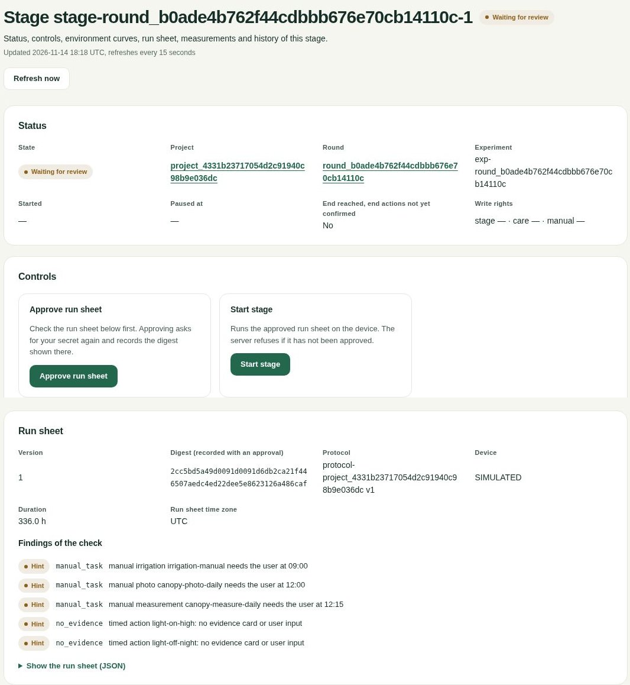
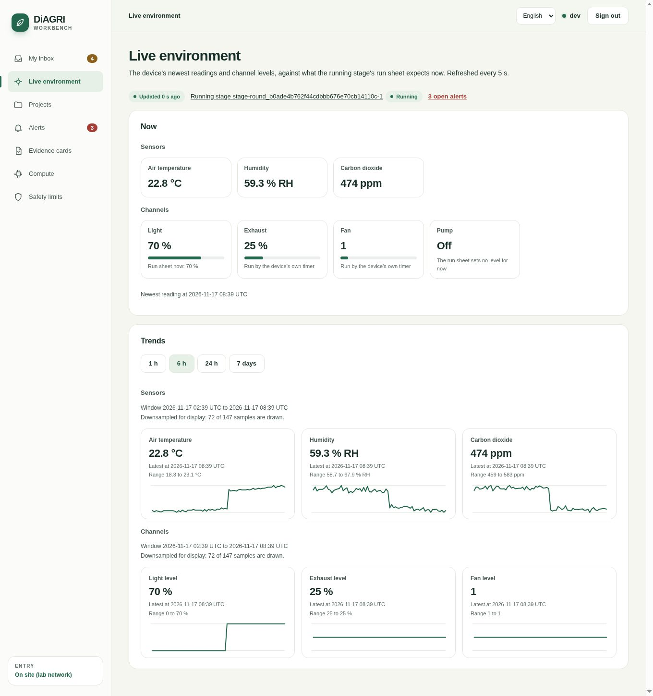
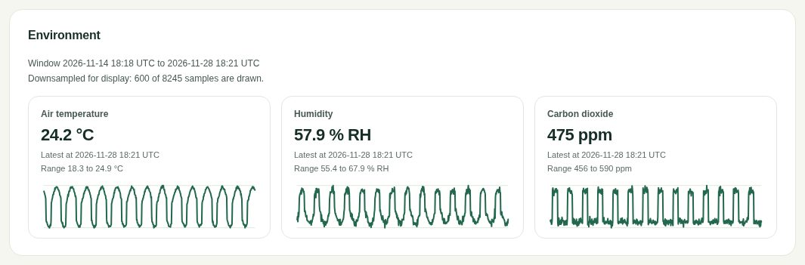

# Example: a complete round with the model roles

[简体中文](../zh-CN/Example-Full-Round-With-Claude.md)

This page follows one research round from the question to the delivered report, step by step, as it was recorded on 14 November 2026. The device was the simulated AC5. The three model roles (orchestrator, planner, researcher) ran on Claude Opus 5.5 through the local Claude Code CLI. The operator's steps were sent by a driver script, as the same requests the workbench console sends. Everything shown below happened; the model replies are quoted with light cuts.

> **What this is not.** The plants, the tent and the canopy measurements are simulated. The run used the development workbench (`scripts/dev_workbench.py`), not `serve`. It shows that the parts work together and what each role does. It is no evidence about lettuce or about a real AC5. See [Status and known limitations](Status-and-Known-Limitations.md).

## The round at a glance

| | |
| --- | --- |
| Question | Does raising the grow light from 40 % to 70 % speed up lettuce canopy growth? |
| Protocol | 2 treatments (`control` light 40, `high` light 70), 4 rounds in 2 blocks, endpoint `canopy_area_growth`, paired-block analysis |
| This round | Round 1: block 1, treatment `high` (light 70 %), one 14-day vegetative stage |
| Real time | about 10.5 minutes, 143 seconds of it for the 14-day stage (fast-forwarded) |
| Model calls | 17 (orchestrator 7, planner 6, researcher 4), about 212 seconds of model time |
| Outcome | Round `delivered`; report labelled **descriptive**, conclusion **uncertain** |

| # | Real time | Who | What | Request |
| --- | --- | --- | --- | --- |
| 1 | 0 s | operator | sign in, create the project, save the protocol, create round 1, set the model budget | `POST /wb/login`, `/wb/projects`, `/wb/protocols`, `/wb/rounds`, `/wb/projects/{id}/budget` |
| 2 | 0 s | operator | ask the question in the project conversation | `POST /wb/goals` |
| 3 | 0 to 230 s | orchestrator, planner | delegate, design, validate (twice blocked), save the run sheet, tell the operator | none (model roles) |
| 4 | 230 s | operator | review the run sheet | `GET /wb/stages/{id}/run-sheet` |
| 5 | 250 s | operator | re-authenticate, approve that digest, start the stage | `POST /wb/reauth`, `/approve`, `/start` |
| 6 | 250 to 405 s | executor | run the 14-day stage; the live environment page follows it | `GET /wb/environment` |
| 7 | 405 s | operator | record six canopy measurements | `POST /wb/measurements` |
| 8 | 405 s | operator | ask for the analysis in the conversation | `POST /wb/goals` |
| 9 | 405 to 625 s | orchestrator, researcher | check the state, delegate, inspect, freeze, publish, tell the operator | none (model roles) |
| 10 | 625 s | operator | read the report on the round page | `GET /wb/rounds/{id}/report` |

## Reproduce it

```sh
cd ~/diagri
export GROWBRIDGE_DEV_SECRET='at least twelve characters'
unset ANTHROPIC_BASE_URL ANTHROPIC_API_KEY   # Claude Code uses its own sign-in
.venv/bin/python scripts/dev_workbench.py --claude-code --fast-forward \
  --data-dir /tmp/diagri-example --transcript /tmp/diagri-example.jsonl
```

Open `http://localhost:8770/workbench`, sign in as `dev`, and follow the steps below in the console. `--fast-forward` skips through a running stage one sampling interval at a time; outside a stage time is real. The simulated sensors follow a small tent model, so the readings change by day and night and under the light. See [Setup, testing and CI](Development-Setup-Testing-and-CI.md).

## 1. Set up the project

The operator creates the project, saves the research protocol and creates round 1. The protocol is the fixture protocol of `sim/fixtures.py`: treatments `control` (light 40) and `high` (light 70); allocations round 1 `high`, round 2 `control`, round 3 `control`, round 4 `high` in blocks 1 and 2; endpoint `canopy_area_growth`; method `paired_block`. The round starts in `designing`. The operator also gives the project a model call budget (120 calls).

## 2. Ask the question

The operator types the question into the **Conversation** panel of the project page. The orchestrator gets it, with the project context: the open rounds, each round's protocol round and allocated treatment, and the ids a new run sheet must use.


The orchestrator delegates to the planner and ends its turn. It also says plainly what one round can and cannot answer:

> Under the protocol's randomisation, round 1 is block 1 with the "high" treatment (70% light) in tent-1, vegetative stage. […] This round alone can't answer the question. It's a single high-light run in one tent, with no control to compare against. […] Approving the sheet on the workbench, not in this chat, is what lets the run go ahead.

The planner reads the device capabilities, checks the protocol's design and searches the evidence cards (there are none). Then it drafts the run sheet: light host-controlled, 70 % from 06:00 to 22:00 UTC, and validates it with the round's id, so the treatment check runs as well. The validator blocked two drafts:

1. The pump was left to the device: blocked, the pump must be host-controlled.
2. A care rule pulsed the pump on every morning: blocked, no scheduled step may start the pump. The planner removed it and made watering a manual task.

The third draft passed and `save_plan_draft` returned `"saved": true`. The stage is now `pending_review`. Because the orchestrator delegated the task, it gets a follow-up task when the planner ends, and tells the operator what to check before approving: the 16-hour photoperiod has no source, watering is by hand, the daily manual tasks need someone on site, and the device is simulated.

## 3. Review the run sheet

The operator opens the stage page. The **Run sheet** section shows exactly what would be approved, with the digest an approval records and the findings of the checks.



| Part | In this run sheet |
| --- | --- |
| Duration, sampling | 14 days; a reading every 300 s, gaps up to 900 s allowed |
| Channels | light and pump host-controlled; exhaust and fan left to the device |
| Timed actions | light 70 at 06:00, light 0 at 22:00 (UTC) |
| Manual tasks | watering 09:00, canopy photo 12:00, canopy measurement 12:15 |
| End actions | light 0, pump 0 |
| Findings | 5 hints, none blocking: three manual tasks need someone on site; the two light actions cite no evidence card |

## 4. Approve and start

Approving asks for the operator's secret again (re-authentication) and binds the approval to the digest the operator read (`expected_digest`). A sheet changed after the review would not match. Then the operator starts the stage, and it is `running`. No model role can approve or start anything: those tools do not exist for them.

## 5. The stage runs

The executor follows the run sheet about once a second; no model is involved. The **Live environment** page shows the newest reading of every sensor and each channel's recorded level, refreshed every 5 seconds. During a stage, each channel the run sheet controls also shows what the sheet wants at this moment; a channel at another level would be marked **Differs from the run sheet**.



The fast-forwarded 14 days took 143 seconds. The stage page draws the whole window: 8245 samples, temperature, humidity and CO2 following the 16-hour light day.



When the duration was over, the executor wrote the end actions, read them back, and ended the stage. The round moved to `data_verification`.


## 6. Record the measurements

The canopy endpoint is measured by hand. The operator records six `canopy_area_growth` values (cm²/day), one per plant: 1.42, 1.37, 1.51, 1.29, 1.46, 1.33.

## 7. Ask for the analysis

The operator asks in the conversation for the data to be verified, frozen and reported. The orchestrator first checks the round and the stage (`get_project_state`, `get_run_status`), then delegates to the researcher.

The researcher works in this order:

1. `inspect_stage_data`: coverage 1.0, no gaps, 8242 trusted samples, 29 confirmed actions, no interventions, 6 measurements. The light was on in 66.6 % of the samples and peaked at 70: the 16-hour day at the `high` level.
2. `freeze_dataset` with the round id: snapshot `snap_93d1…` version 1, complete and verified; the round moves to `analysis`.
3. `publish_research_report`: the server computes the label and the numbers from the frozen data. Its treatment check compares the levels recorded in the snapshot with the round's treatment; here the light did run at 70, so no deviation was added. The report is final, and the round is `delivered`.

The orchestrator's follow-up tells the operator the result and what is still open:


> **Result:** under 70% light, canopy area grew 1.29–1.51 cm² per day across 6 plants, with a mean of 1.397. This only describes growth under 70% light (an exploratory finding). It can't show whether more light speeds up growth until we have the 40% control from round 2. […] **Deviation figure needs your input:** […] The data doesn't record when the hand watering (09:00), photo (12:00) and canopy measurement (12:15) were actually done.

## 8. Read the report

The round page shows the published report, read from its file after the file's digest was checked against the archive.


- **Descriptive, uncertain.** Round 1 holds only the `high` treatment, so there is no independent replicate and no effect can be estimated ("fewer than 2 complete blocks"). The report states the round's numbers and claims no effect.
- **The next round** is round 2: block 1, `control` (light 40), the same conditions, so the paired comparison can run.

## What the example shows

- **The roles stay in their lanes.** The orchestrator delegates and summarises, the planner files a draft, the researcher freezes and reports. No model approves, starts or stops anything; the operator does, on the workbench.
- **The checks steer the models.** The validator's blocking findings made the planner revise twice. The treatment check made sure the sheet set the light to the round's 70 %, and the report's check confirmed the device ran at 70.
- **Honest limits.** Both the orchestrator and the researcher said that one round cannot answer the question, and named what they could not verify.
- **A first attempt stopped correctly.** In an earlier attempt the simulator's readings never changed; the frozen-reading check paused the stage two simulated hours in, the driver asked for the analysis anyway, and the orchestrator refused: "the workflow's records show the vegetative stage hasn't ended". The simulator now varies its readings.

## Open points this run found

| Point | What happens | Where |
| --- | --- | --- |
| Missing data counts rounds not run yet | The server's reason "缺失超过预定标准" (missing data over the limit) appears although no data is missing: rounds 2 to 4 of the protocol count as missing. | [`agents/handlers_report.py`](../../../src/growbridge/agents/handlers_report.py) `_missing_fraction` |
| Manual tasks leave no record | Nothing records when the daily watering, photo and measurement were done, so the deviation fraction cannot cover them. Both model roles pointed this out. | run sheet `manual_tasks` |
| No scheduled watering | The pump must be host-controlled, and no scheduled step may switch it on, so a run sheet cannot water automatically; watering becomes a manual task. | [`planning/validate.py`](../../../src/growbridge/planning/validate.py) |
| Server notes only in Chinese | The reasons the server adds to a report are written in Chinese whatever the operator's language. | [`research/analysis.py`](../../../src/growbridge/research/analysis.py) |

## See also

- [Run a research round](Run-a-Research-Round.md): every step with its request and states
- [The five agents](The-Five-Agents.md): what each role may and may not do
- [Research methodology](Research-Methodology.md): labels, conclusions and the treatment check
- [Tutorial: a simulated round](Tutorial-Simulated-Round.md): the scripted round without models
