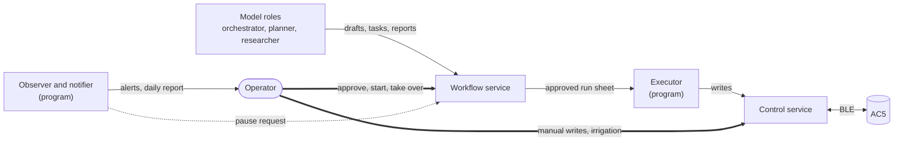

# Overview

[简体中文](../zh-CN/Overview.md)

This page is for anyone meeting the project for the first time. It says what DiAGRI is, where GrowBridge fits in it, what the two modes do, what the system never does, and where to read next.

## What DiAGRI is

DiAGRI is an AI agent platform for plant-growth research. It takes a research question through one complete experiment: design the experiment, run the approved plan on growing hardware, record every reading and every write, analyze the result and deliver a report. Model roles do the designing and the analysis. Deterministic programs do the execution and the observation. An operator approves each run sheet before the executor writes anything.

Today the platform drives one kind of hardware: a grow tent with a Spider Farmer AC5 controller.

## Where GrowBridge fits

GrowBridge is DiAGRI's device bridge, and a small part of the whole. It is a Python daemon that runs on a Mac or a Raspberry Pi next to the AC5 and holds the single Bluetooth (BLE) connection to it. Through that connection it reads the sensors and the device state, writes settings on request, confirms each write by reading the device back, and keeps a local history in SQLite.

The rest of DiAGRI is built on top of that connection: the workflow service, the control service that checks every write, the archive, the five agents and the research methods. [Architecture overview](Architecture.md) shows the parts.

Everything ships as one Python package. The package is `spiderfarmer-growbridge`, and the import name and the command are `growbridge` ([`pyproject.toml`](../../../pyproject.toml), [`cli.py`](../../../src/growbridge/cli.py)); the other parts of DiAGRI are sub-packages of it. The names come from the bridge, which was written first. The project is independent and has no affiliation with Spider Farmer.

## Two modes

One configuration field selects the mode: `auto_research` in [`config.py`](../../../src/growbridge/config.py). It is `false` unless you set it, and the daemon then runs GrowBridge alone: this wiki calls that bridge-only mode. Set it to `true` and the daemon runs the whole of DiAGRI: DiAGRI mode.

| | Bridge-only mode (default) | DiAGRI mode (`auto_research = true`) |
| --- | --- | --- |
| Purpose | Watch a tent and adjust it by hand or from an MCP client | Run an approved experiment plan and keep the records a study needs |
| Who writes to the AC5 | You, through the dashboard, the local HTTP API or the MCP tools, once `controls_enabled = true` | The executor, following a run sheet that an operator approved; or an operator during a manual takeover |
| Interfaces | Local dashboard, HTTP API on `127.0.0.1`, eight MCP tools | The dashboard and the API become read-only, the MCP server keeps its three read tools, and the workbench routes appear under `/wb` |
| Records | Samples and operations in one SQLite file | Protocols, run sheets, approvals, the action ledger, samples, snapshots and reports, in one SQLite file per service |

In DiAGRI mode the three bridge write endpoints answer 403 ([`api.py`](../../../src/growbridge/api.py)) and the MCP server registers only `get_health`, `get_status` and `get_history` ([`mcp_server.py`](../../../src/growbridge/mcp_server.py)). Every device write then passes the control service.

Bridge-only mode is documented in the [README](../../../README.md). The rest of this wiki is about DiAGRI as a whole.

## What DiAGRI does with a research question

This is the design. Take the question "does more light make the canopy grow faster?". The planner turns it into a research protocol (hypothesis, treatments and control, experimental unit, primary endpoint, analysis plan) and a run sheet for each stage. A program validates the run sheet against what the device can do and against the safety configuration, and an operator approves that exact version. The executor then carries the run sheet out on the AC5: timed actions, feedback rules, and protection rules that only move towards lower risk. The observer and notifier agent raises alerts and produces a daily report. When the last stage ends, the data is frozen into a data snapshot, the researcher analyzes it with the method the protocol fixed in advance, and the report is archived. The research round is then `delivered`. Another round starts only when the user asks for one.

A person stays in the loop at fixed points: approving each run sheet, deciding whether to continue after a pause, doing the manual tasks such as watering and measuring, and deciding whether to run another round.

This is what the code does today. From the run sheet onwards, every step exists as a service and runs in the end-to-end tests on a simulated AC5: drafting and validating a run sheet, the approval, the execution, alerts and the daily report, the snapshot, the analysis and the report. The beginning goes through the workbench routes: an operator creates the project, the research protocol and the round, sets the model call budget and states the question, which becomes a task of the orchestrator. The console at `/workbench` has forms for it; there is no command. No real model has taken a question through a round yet: the tests use a scripted model. See [Status and known limitations](Status-and-Known-Limitations.md).

## The five agents

Three agents are model roles: a language model reads data and hands in drafts. Two are deterministic programs: the same input always produces the same action, and they never call a model.

| Agent | Kind | In code | What it does |
| --- | --- | --- | --- |
| Orchestrator | model role | role `orchestrator` | Takes the user's goal, creates research tasks and hands them to the planner or the researcher |
| Planner | model role | role `planner` | Designs the experiment: drafts the run sheets, and checks them and the design of the research protocol with the validation tools |
| Researcher | model role | role `researcher` | Freezes the data, runs the analysis and publishes the report |
| Executor | deterministic program | `ExecutorEngine` | Carries out the approved run sheet and reports stage events |
| Observer and notifier | deterministic program | `Observer` | Evaluates alert rules and queues notifications and the daily report |

The tools each model role may call are listed in `ROLE_TOOLS` in [`agents/tools.py`](../../../src/growbridge/agents/tools.py). [The five agents](The-Five-Agents.md) describes each one in detail.

## What the system never does

These limits are enforced in code. They are not conventions that a prompt asks a model to follow.

- **A model role never controls the device or a stage.** The names of the stage and device control tools are listed in `CONTROL_TOOLS` and are removed from every role's tool set, whatever the configuration says ([`agents/tools.py`](../../../src/growbridge/agents/tools.py)). A model hands in drafts, tasks and reports. Nothing said in a conversation counts as an approval.
- **A stage does not start without an operator's approval** of that version of the run sheet ([`workflow/service.py`](../../../src/growbridge/workflow/service.py)).
- **Nothing automatic starts the pump.** Validation blocks a run sheet whose action would start the pump ([`planning/validate.py`](../../../src/growbridge/planning/validate.py)), and the executor refuses such an action ([`executor/engine.py`](../../../src/growbridge/executor/engine.py)). The pump starts only when an authenticated operator, connected through the LAN entry, calls the irrigation route during a manual takeover ([`workbench/api.py`](../../../src/growbridge/workbench/api.py)). Each run is limited by `max_pump_seconds` and `pump_cooldown_seconds`.
- **Safety does not wait for a model.** The tick that runs the executor, the protection rules and the pump interlock never calls a model ([`runtime.py`](../../../src/growbridge/runtime.py)). When the model API is down, an approved stage keeps running.

One thing is outside the system's reach: the AC5 panel and the vendor app can still change the device directly. DiAGRI can only notice such a change by read-back. The pump is the exception: if it is on while DiAGRI is not irrigating, the watchdog switches it off, raises a critical alert and records an intervention against the active stage. [Control and safety model](Control-and-Safety-Model.md) explains the reasoning.

## Status

- GrowBridge on its own (bridge-only mode) has read and controlled one real AC5 from a Mac ([VALIDATION.md](../../../VALIDATION.md)). It has not been verified on a Raspberry Pi.
- DiAGRI as a whole passes its automated tests on a simulated AC5 only (2274 code tests at the last run, 2026-11-14). It has never run against a real device, real notification services or CSC.
- Several parts are deployment items or are not implemented yet, among them job submission to CSC. The operator console at `/workbench` has been checked on the simulated AC5 only.

The full list is on [Status and known limitations](Status-and-Known-Limitations.md).

## Where to go next

| If you want to | Read |
| --- | --- |
| install it and read your tent | [Installation and quick start](Installation-and-Quick-Start.md) |
| see DiAGRI run without hardware | [Tutorial: a simulated research round](Tutorial-Simulated-Round.md) |
| understand how the parts fit together | [Architecture overview](Architecture.md) |
| know why it is safe to leave running | [Control and safety model](Control-and-Safety-Model.md) |
| look up a word | [Glossary](Glossary.md) |

## See also

- [Architecture document](../../diagri-agent-architecture.zh-CN.md) (Chinese): sections 1 to 4 are the design overview this page summarizes.
- [The five agents](The-Five-Agents.md)
- [Workflow and state machines](Workflow-and-State-Machines.md)
- [FAQ](FAQ.md)
