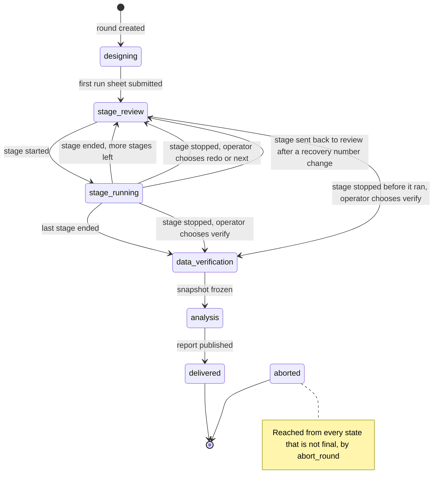
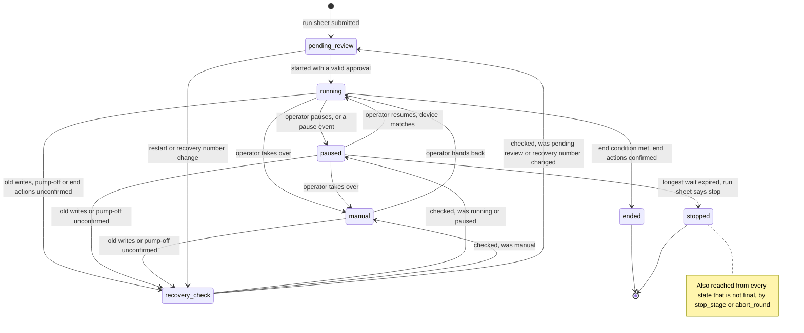
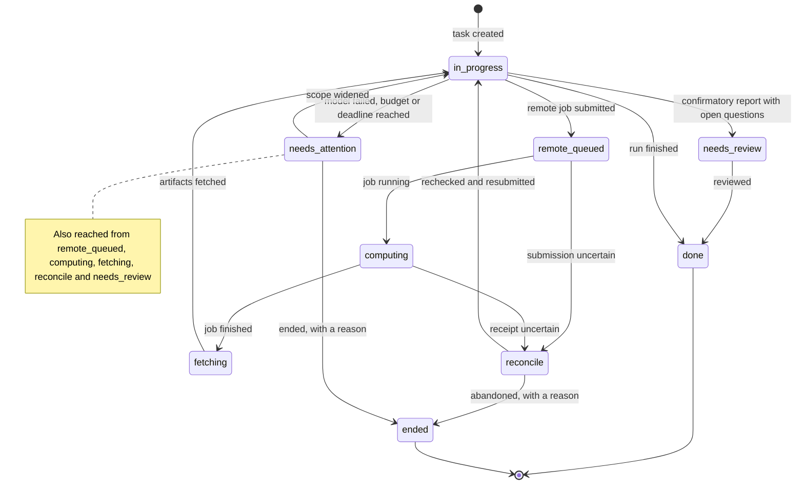

# Workflow and state machines

[简体中文](../zh-CN/Workflow-and-State-Machines.md)

This page is for anyone who needs to know why a round, a stage or a research task is in the state it is in, and what can move it. It shows the three state machines, says who may trigger each transition, and explains the rules that keep repeated and late events from doing harm.

> **Status.** The transitions below are the ones in the code and its tests, run against the simulated AC5 only. Some have no entry point in the running daemon yet; the text says which. See [Status and known limitations](Status-and-Known-Limitations.md).

## Three machines, one owner

A **round** is one pass from a goal to a report. A **stage** is one execution segment of a round, governed by one run sheet. A **research task** is one piece of work for a model role. They are modelled separately because they move for different reasons: a lost link can pause a stage while a task is still analysing last week's data.

Only the workflow service changes them: `WorkflowService` in [`workflow/service.py`](../../../src/growbridge/workflow/service.py) for rounds and stages, `TaskBoard` in [`workflow/tasks.py`](../../../src/growbridge/workflow/tasks.py) for tasks. The state names are in [`workflow/states.py`](../../../src/growbridge/workflow/states.py), and their Chinese labels are in the [Glossary](Glossary.md).

## Round

| Transition | Trigger | Who |
| --- | --- | --- |
| new → `designing` | `create_round` | operator or workflow identity |
| `designing` → `stage_review` | the first `submit_run_sheet` without blocking findings | operator, workflow identity or model role |
| `stage_review` → `stage_running` | `start_stage` succeeds | operator or workflow identity |
| `stage_running` → `stage_review` or `data_verification` | a stage reaches `ended`; the protocol's stage list decides which | executor event |
| after a stage is `stopped` | `choose_after_stop` with `redo`, `next`, `verify` or `abort` | operator |
| `stage_running` → `stage_review` | a stage leaves `recovery_check` after a recovery number change | runtime |
| `data_verification` → `analysis` | `mark_snapshot_frozen`, called by `freeze_dataset` when the snapshot is complete and verifies | researcher |
| `analysis` → `delivered` | `mark_report_published`, called by `publish_research_report` when the report is final | researcher |
| every state that is not final → `aborted` | `abort_round` | operator |

A stopped stage does not move the round by itself. It only marks the round as waiting for the operator's choice, and no run sheet can be submitted until the choice is made (`round_effect` in [`workflow/store.py`](../../../src/growbridge/workflow/store.py)). The reason: after a stop, only a person knows whether the data so far is still worth analysing.

## Stage

A restart or a recovery number change also sends `running`, `paused` and `manual` stages to `recovery_check`; the diagram shows that edge only once.

| Transition | Trigger | Who |
| --- | --- | --- |
| new → `pending_review` | `submit_run_sheet` creates the stage | operator, workflow identity or model role |
| stays `pending_review` | `approve` records an approval; a newer run sheet version voids the old one | `approve`: operator with recent re-authentication |
| `pending_review` → `running` | `start_stage`: valid approval, no safety conflict, no pump interlock, no other live stage on the device | operator or workflow identity |
| `running` → `paused` | `pause_stage` | operator or observer identity |
| `running` → `paused` | `DISCONNECT_AFFECTS`, `READINGS_STALE`, `EXTERNAL_CHANGE`, `CLOCK_ANOMALY`, `RESULT_UNKNOWN`, `RULE_PAUSE`, `ALERT_PAUSE` | executor event; `ALERT_PAUSE` comes from the observer |
| `paused` → `running` | `resume_stage`: valid approval, no interlock, no unsettled action, device matches the run sheet | operator |
| `running`, `paused` → `manual` | `takeover` | operator |
| `manual` → `running` | `handback`; the differences to the run sheet are listed and can be recorded as an intervention | operator |
| `running`, `paused`, `manual` → `recovery_check` | `TRANSPORT_UNCONFIRMED`, `PUMP_OFF_UNCONFIRMED`; from `running` also `END_ACTIONS` not confirmed | executor event |
| every state that is not final → `recovery_check` | process start, recovery number change | runtime |
| `recovery_check` → `paused`, `manual` or `pending_review` | the exit conditions hold | runtime, every tick for every stage in `recovery_check`; operator with `record_onsite_check` |
| `running` → `ended` | `END_CONDITION_MET`, then `END_ACTIONS` confirmed | executor event |
| `paused` → `stopped`, or stays `paused` | `MAX_WAIT_EXPIRED`; the run sheet's `on_expiry` decides | executor event |
| every state that is not final → `stopped` | `stop_stage`, `abort_round`; from `pending_review` also `revoke_approval` | operator |
| `running`, `paused` keep their state | `switch_run_sheet`: a new version with new write rights | operator with recent re-authentication |

Write rights move with the state. Entering `running` grants a new stage right. `paused` revokes it and keeps the care right. `manual` revokes both and grants a manual right. `recovery_check` revokes all three. `ended` revokes the stage right and keeps the care right until the next stage starts. Each change is a `Plan`: hand the old rights over first, grant the new ones, then save the state and its history row in one transaction (`_apply`, `_commit`). What a right is, is on [Control and safety model](Control-and-Safety-Model.md).

Ending takes two events on purpose. `END_CONDITION_MET` only marks the stage as `end_pending`; the executor then carries out the run sheet's end actions under the stage right it still holds. Only `END_ACTIONS` with `confirmed` true ends the stage. If the end actions cannot be confirmed, the device is in an unknown state, so the stage goes to `recovery_check` instead.

## Research task

The diagram is the table `_ALLOWED` in `workflow/tasks.py`. Every other transition is `Denied("state")`, and ending a task from `reconcile` or `needs_attention` needs a reason.

Only part of it is triggered by code today:

- `in_progress` → `done`, `needs_review` or `needs_attention`: the dispatcher, when a model run ends ([`agents/dispatch.py`](../../../src/growbridge/agents/dispatch.py)).
- `in_progress`, `remote_queued`, `computing`, `fetching` → `needs_attention`: `TaskBoard.expire`, once per deadline, called from the tick.
- The remote-job cycle and the ways out of `reconcile`, `needs_attention` and `needs_review` are allowed by the board, but nothing in `src/` calls them. The compute service keeps its own attempt phase, and there is no operator route for resolving a task yet.

## Who may trigger a transition

There are three kinds of trigger, and they differ in how much they are trusted.

- **An operator command.** The caller's `Actor` comes from a workbench session. `require_operator` in [`workflow/permissions.py`](../../../src/growbridge/workflow/permissions.py) refuses every other kind; a model role gets `model_role`. `approve` and `switch_run_sheet` also need a re-authentication within 300 seconds, and the workbench routes ask the same for resume and takeover. Reason: these are the decisions that put the device under a plan.
- **An event.** The executor and the observer report a `StageEvent` through `StagePort.report`. An event carries no identity. It is a statement of fact ("the read-back differs"), and the workflow service decides what it means for the current state. An event can pause, end or stop a stage, or hold it for checking. It can never start or resume one.
- **A model role.** It can file a run-sheet draft, which creates a stage in `pending_review`. The researcher's tools can move a round from `data_verification` to `analysis` and from `analysis` to `delivered`, after checking that the round belongs to the task's project. A model role can do nothing to a stage that has started.

Two more identities exist for services. A `workflow` identity may create projects and rounds and may start a stage that has a valid approval. An `observer` identity may call `pause_stage`. No code in `src/` uses either yet: the observer pauses through the `ALERT_PAUSE` event.

Entry points in the daemon: `/wb` has routes for `create_project`, `save_protocol` and `create_round`; for approve, start, pause, resume, stop, takeover, handback, on-site check and filing a draft; and for `choose_after_stop` and `abort_round`. `revoke_approval` and `switch_run_sheet` are service methods with tests but without a route or command. See [HTTP, workbench and MCP interfaces](API-Reference.md).

## The same event advances a state once

Events are delivered at least once. The executor may report the same fact on the next tick, a tool call may be retried, a process may restart in between. So every event has an `event_id`, and the id is stored in the same transaction as the change it caused.

- **Stage events.** `report` ignores an id it has seen. Otherwise the id is inserted into `wf_events` together with the new state. If two reports race, the second insert fails and its whole transaction rolls back. An event that does not apply to the current state is stored as `dropped`.
- **Round events.** `mark_round` advances only if the round is in the expected state, once per id. The ids are `snapshot_frozen:<round>:<snapshot>` and `report_published:<round>:<artifact>`.
- **Task events.** `TaskBoard.transition` returns the task unchanged when the id was already used. A task is created once per `trigger_event_id`.

An example from [`tests/workflow/test_workflow_events.py`](../../../tests/workflow/test_workflow_events.py): a `RULE_PAUSE` event pauses the stage. The operator resumes. The same event arrives again. The stage stays `running`, and the history holds one `rule_pause` row.

Operator commands are safe to repeat in a simpler way: starting a `running` stage, pausing a `paused` one or taking over a `manual` one returns the current state. Behind both sits a revision number on the stage row. A change computed from an older revision is refused with `Denied("state")`, so a slow caller cannot overwrite a newer state.

## Late events are dropped by right number, not by time

A late event is one that was true when it was observed and is no longer relevant. The executor sees "the light differs" and reports `EXTERNAL_CHANGE`. Before the report is handled, the operator pauses, fixes the light and resumes. If the event were applied now, it would pause a stage that was just checked.

The rule: when the executor reports about a `running` stage, it adds the stage write right it observed under as `detail.right_number`. The workflow service drops the event if that number is not the stage's current one (`_plan_event`).

Why the right number and not a timestamp:

- **It marks exactly the right boundary.** A new stage right is granted at every start, resume, handback and run-sheet switch. Those are the moments after which an older observation no longer counts.
- **The wall clock can jump.** The executor itself treats wall time as untrusted when it steps (`ClockTrust` in [`executor/outage.py`](../../../src/growbridge/executor/outage.py)). An event stamped just before a clock correction could look newer than the resume that followed it.
- **It is exact.** A pause and a resume can fall within the same second. Two integers are either equal or not.

Events without a number, such as the observer's `ALERT_PAUSE`, are judged by the state alone: a pause event only ever applies to a `running` stage.

## Recovery check: what it blocks and what it allows

`recovery_check` means: the device state, or the result of a write, is not known. The stage remembers the state it came from (`prior_state`) and loses its stage, manual and care rights.

| Blocked | Still allowed |
| --- | --- |
| Timed actions, feedback rules and end actions | Protection rules, while the link is up |
| Manual writes and irrigation | The pump-off interlock path |
| Pause, resume, takeover, handback, run-sheet switch | Care rules, once the old write path is confirmed stopped and the interlock is off (not if the stage was `manual`) |
| Starting another stage on the same device | Sampling, alerts and the daily report |
| | `stop_stage`, `abort_round`, `record_onsite_check` |

The stage leaves when one of two things is true (`_may_exit`):

- the old write path is confirmed stopped, the interlock is off, no action is unsettled after a read-back, and, if the stage was `running` or `paused`, the device matches the run sheet; or
- an operator recorded an on-site check.

The runtime tries this on every tick for every stage in `recovery_check` (`_follow_up` in [`runtime.py`](../../../src/growbridge/runtime.py)). That includes a stage that was still waiting for review when the process restarted, although it has never started and so is not the active stage.

Where the stage goes depends on where it came from: `running` or `paused` becomes `paused`; `manual` stays `manual` with a new manual right; `pending_review` stays `pending_review`. It never returns straight to `running`, because a person has to confirm the resume. If the recovery number changed in the meantime, the safety configuration must be approved again first, and the stage then goes to `pending_review` for a new approval.

## Where the code differs from Appendix B

The state tables in Appendix B of the [architecture document](../../diagri-agent-architecture.zh-CN.md) are the design. The code differs in these points:

- The round moves to `stage_running` when the stage starts, not when the run sheet is approved. Approving and starting are two calls.
- A stage ends in two events, and unconfirmed end actions lead to `recovery_check`.
- `switch_run_sheet` also works on a `paused` stage. There is no option to keep the old version running during the review.
- `revoke_approval` only applies to a stage in `pending_review`. A started stage is stopped with `stop_stage`.
- Leaving `recovery_check` also requires the pump interlock to be off.
- Longest-wait expiry changes the state but raises no alert of its own. When it stops the stage, the `stage_waiting` alert of the pause is resolved, because the stage is no longer paused.
- For research tasks, the remote-job cycle and the user's resolutions are allowed transitions without a caller.

## See also

- [Architecture overview](Architecture.md)
- [Control and safety model](Control-and-Safety-Model.md)
- [The five agents](The-Five-Agents.md)
- [Run a research round](Run-a-Research-Round.md)
- [Troubleshooting runbook](Troubleshooting-Runbook.md)
- [Denial codes and stage events](Denial-Codes-and-Events.md)
- Tests: [`tests/workflow/`](../../../tests/workflow/), [`tests/tasks/`](../../../tests/tasks/)
