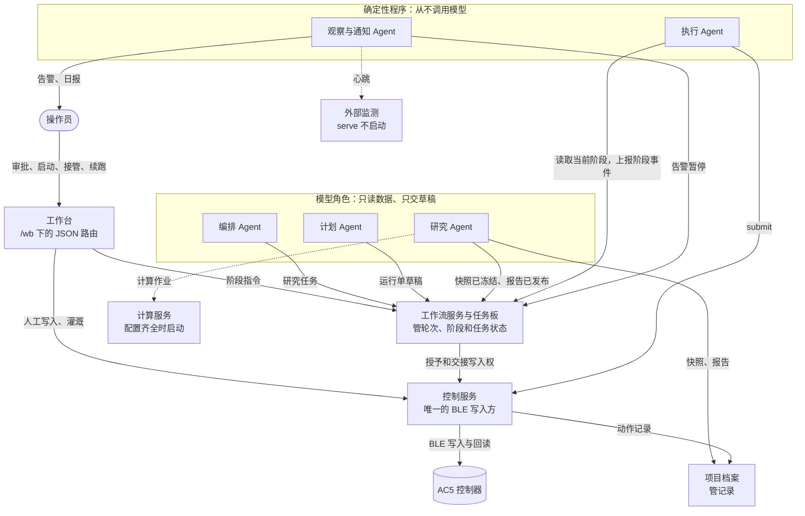

# 架构总览

[English](../en/Architecture.md)

这一页写给想在读代码或其他设计页面之前，先看清 DiAGRI 全貌的人。它讲清四件事：系统由哪些部分组成，每类状态归谁管，各部分之间怎么通信，一轮研究怎样依次经过这些部分。

> **现状。** 本页内容只在模拟的 AC5 上测试过；图中的部分，`growbridge serve` 目前也没有全部启动或接通，各节会分别说明。完整清单见[状态与已知限制](Status-and-Known-Limitations.md)。

## 组成部分

实线是守护进程里真正在跑的通路。两条虚线都是可选的。计算那条指向的部分，代码和测试里都有，但 `growbridge serve` 不会启动：[`cli.py`](../../../src/growbridge/cli.py) 调用 `build_runtime` 时没有传计算后端，所以 `Runtime.compute` 是 `None`。心跳那条只在环境变量里两个心跳 URL 都设了时才会运行；否则 `Runtime.monitor` 是 `None`，运行时会发出常驻警告 `monitor_unconfigured`。

工作台是操作员使用的 HTTP 接口，也就是 [`workbench/api.py`](../../../src/growbridge/workbench/api.py) 里 `/wb` 下的一组 JSON 路由。操作员控制台，即 `src/growbridge/web/workbench/` 里 `/workbench` 的那个页面，只调用这些路由。`src/growbridge/web/` 里 `/` 的页面是原有的桥接控制台，从不调用 `/wb`。

这张图的形状来自两条规则。

**模型角色碰不到设备，也碰不到阶段。** 模型会出错，也可能被它读到的文字带偏。所以三个模型角色只拿到读数据和交草稿的工具。每个角色的工具清单写死在 `ROLE_TOOLS` 里；凡是控制阶段或设备的工具名都列在 `CONTROL_TOOLS` 里，无论配置怎么写都会被拒绝（[`agents/tools.py`](../../../src/growbridge/agents/tools.py)）。详见[五个 Agent](The-Five-Agents.md)。

**所有设备写入都过同一个关口。** 执行 Agent 和操作员都经控制服务写设备：先核对写入权，记下意图，下发，再回读。详见[控制与安全模型](Control-and-Safety-Model.md)。

## 谁拥有什么

每一类状态只有一个所有者。其他部分要么通过所有者读取，要么请所有者去改。

这样做是为了出故障后能恢复。如果两个部分都能改阶段状态，进程恰好在两次更新之间崩溃，它们对「阶段是否已暂停」就会各执一词。只有一个所有者时，答案只有一个，而且在一个事务里落库。

| 状态 | 所有者 | 代码中 | 数据库文件 |
| --- | --- | --- | --- |
| 项目、研究协议、轮次、阶段、审批、阶段历史 | 工作流服务 | `WorkflowService`、`WorkflowStore` | `workflow.sqlite3` |
| 研究任务 | 工作流服务的任务板 | `TaskBoard` | `workflow.sqlite3` |
| 操作员及其会话 | 工作台 | `Operators` | `workflow.sqlite3` |
| 写入主机、恢复编号、写入权、动作账本、安全配置、联锁标志 | 控制服务 | `ControlService`、`Ledger` | `control.sqlite3` |
| 样本、动作记录、人工测量、证据卡、数据快照、产物 | 项目档案 | `Archive` | `archive.sqlite3` 和 `archive/` 目录 |
| 告警、通知发件箱、日报 | 观察与通知 Agent | `AlertBook`、`Outbox`、`ReportStore` | `observer.sqlite3` |
| 模型调用预算、派发登记、确认性分析的运行记录、留出数据登记 | 模型角色的运行部分 | `CallBudget`、`Dispatcher`、`ConfirmatoryRunner`、`HoldoutRegistry` | `agents.sqlite3` |
| 计算作业及额度 | 计算服务 | `ComputeService` | `compute.sqlite3` |

举个例子。执行 Agent 回读设备，发现有人在 AC5 面板上改了灯。它不会自己去暂停阶段，而是上报一个 `EXTERNAL_CHANGE` 阶段事件。工作流服务据此把 `running` 的阶段改成 `paused`，再请控制服务撤销阶段写入权。三个所有者，各自只改自己的状态。

## 各部分怎么通信

控制回路里的几个服务，彼此只认协议，不认对方的类。协议都在 [`ports.py`](../../../src/growbridge/ports.py) 里：

| 协议 | 实现方 | 使用方 | 传递的内容 |
| --- | --- | --- | --- |
| `StagePort` | `WorkflowService` | 执行 Agent、观察与通知 Agent | `active_stage()` 返回 `StageRuntime`；`report()` 接收 `StageEvent` |
| `ControlPort` | `ControlService` | 工作流服务、执行 Agent、工作台 | 写入权（`grant`、`handover`）、写入（`submit`、`irrigate`、`pump_off`）、读取（`read_state`、`differences`、`readings`） |
| `WriteTransport` | 各个 BLE 传输层 | 控制服务（经 bridge） | `send`，以及用来确认旧传输已停止的 `halt()` |
| `RecordSink` | `Archive` | 控制服务 | `append_action`、`append_sample` |

经这些协议传递的数据定义在两个文件里：`ports.py`（`Actor`、`ActionRequest`、`StageRuntime`、`StageEvent`、`Difference`）和 [`archive/models.py`](../../../src/growbridge/archive/models.py)（`RunSheet`、`ActionRecord`、`WriteRight`、`SafetyConfig` 等）。拒绝一律用 `Denied(code)` 表示，带一个机器可读的拒绝码，清单见[拒绝码与事件类型](Denial-Codes-and-Events.md)。

为什么用协议：执行 Agent 构造时只拿到一个 `ControlPort` 和一个 `StagePort`，除此之外没有任何途径去发 BLE 指令或改阶段状态。测试也靠同一套协议，把某个服务换成模拟实现。

有两个部分处在边缘，运行时直接把服务对象交给它们：工作台的路由，以及模型角色的工具处理函数。它们调用 `WorkflowService`、`ControlService`、`Archive` 和 `TaskBoard` 的公开方法。检查都写在这些方法内部，所以它们同样绕不过去。

身份从不取自调用方给的数据。`Actor` 由服务端根据操作员会话或角色令牌生成（`workbench/api.py`）；模型角色的身份则在代码里写定（[`agents/handlers_common.py`](../../../src/growbridge/agents/handlers_common.py) 的 `actor_for`）。工具输入里如果出现 `role`、`approved` 这类字段，校验直接失败。

以上装配都在一个函数里完成：[`runtime.py`](../../../src/growbridge/runtime.py) 的 `build_runtime`。

## 一个进程，每个所有者一个数据库文件

`auto_research = true` 时，`growbridge serve` 把所有东西放在一个进程、一个事件循环里运行（`cli.py` 的 `_serve_auto_research`）：

- **tick**，每秒一次（`TICK_SECONDS`）。`Runtime.tick` 按固定顺序跑九步：`archive`、`executor`、`recovery`、`observer`、`outbox`、`tasks`、`report`、`backup`、`health`。每一步单独兜底：某一步失败只会产生一条告警，后面的步骤照常执行。tick 从不调用模型。
- **模型角色循环**，每 30 秒一次（`AGENT_SECONDS`），只有配置了 `roles` 且模型客户端能建起来时才启动。它把每个未完成的研究任务各跑一次。这里出错，结果是任务转为待处理并产生一条告警，不会让 tick 失败。
- **HTTP 监听**：主监听在本机回环地址上；设置了 `lan_bind` 和 `lan_port` 时，再加一个现场监听。

放在一个进程里，「唯一关口」就容易做对：控制服务用一把进程内的锁给交接和写入排队，`daemon.lock` 文件则保证同一个数据目录上不会有第二个守护进程。

`data_dir` 下有六个 SQLite 文件，对应上表的每个所有者（`runtime.py` 的 `DATABASES`），旁边还有原有守护进程的样本历史库 `growbridge.sqlite3`。每个服务只拿到自己的 `Database` 对象，所有权因此落实在装配代码里，而不只是一条约定。

架构设计文档的要求更高：每个服务用独立的系统账户运行（4.7 节和第 10 节）。代码没有做到这一步，现在是一个账户下的一个进程。代码里已有的隔离是：协议、服务端生成的身份、按所有者分开的数据库文件，以及运行模型所写分析代码的沙箱。

## 一轮研究怎样经过各部分

1. 操作员身份创建项目、保存研究协议、创建轮次（`create_project`、`save_protocol`、`create_round`）。轮次处于 `designing`。接着操作员设置项目的调用预算并提出目标，目标成为第一个编排任务。*经 `/wb` 路由完成，用进程内的 HTTP 客户端测试过。`simulate` 直接调用服务，也不提目标。*
2. 编排 Agent 把任务交给计划 Agent。计划 Agent 校验运行单后用 `save_plan_draft` 提交，它内部调用 `submit_run_sheet`。阶段进入 `pending_review`，轮次进入 `stage_review`。*模型参与的部分只在测试里运行；`simulate` 是直接调用服务提交运行单。*
3. 操作员在工作台审批并启动阶段（`approve`、`start_stage`）。工作流服务向控制服务申请阶段写入权和养护写入权。阶段进入 `running`，轮次进入 `stage_running`。
4. 执行 Agent 每秒读取当前阶段，按运行单判定，把写入交给控制服务；控制服务核对、记录、下发、回读。动作记录和样本进入项目档案。观察与通知 Agent 发出告警，运行时生成日报。
5. 运行单规定的时长到了，执行 Agent 上报 `END_CONDITION_MET`，执行结束动作，再上报 `END_ACTIONS`。阶段进入 `ended`。协议还有后续阶段时，轮次回到 `stage_review`；否则进入 `data_verification`。
6. 研究 Agent 用 `freeze_dataset` 冻结这个阶段的数据。快照完整且校验通过时，轮次进入 `analysis`。*只在测试里运行。*
7. 研究 Agent 用 `publish_research_report` 发布报告。报告为终稿时，轮次进入 `delivered`。*只在测试里运行。*

**只在测试里跑过的部分。** 操作员经 `/wb` 完成第 1 步和第 3 到第 5 步，也可以停止阶段、选择接下来怎么办，或者中止轮次。设了预算、提了目标之后，第 2、6、7 步由模型角色来做。但真实模型从没有这样跑过：[`test_e2e_http_round.py`](../../../tests/e2e/test_e2e_http_round.py) 用脚本化的模型和进程内的 HTTP 客户端，经这些路由走完了整轮。`growbridge simulate`（`runtime.py` 的 `simulate_stage`）直接调用服务，跑的是第 1 到第 5 步。没有 CLI 命令能发起一轮研究。

各个状态，以及每个转换由谁触发，见[工作流与状态机](Workflow-and-State-Machines.md)。

## 设计写在哪里

完整的设计理由在[架构设计文档](../../diagri-agent-architecture.zh-CN.md)里：第 1 到 4 节是概览，第 5 到 10 节是细则，附录 B 是状态转换表。Wiki 描述的是代码现状；两者不一致的地方，页面上会写明。

## 另见

- [五个 Agent](The-Five-Agents.md)
- [控制与安全模型](Control-and-Safety-Model.md)
- [工作流与状态机](Workflow-and-State-Machines.md)
- [数据、档案与可追溯性](Data-Archive-and-Traceability.md)
- [代码结构与扩展点](Code-Structure-and-Extension-Points.md)
- [状态与已知限制](Status-and-Known-Limitations.md)
- [术语表](Glossary.md)
