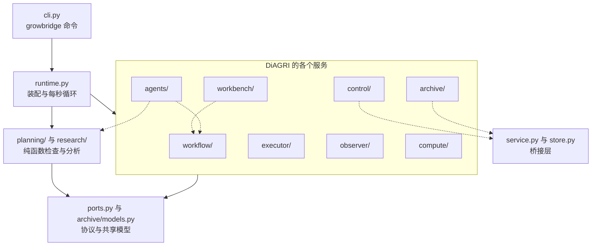

# 代码结构与扩展点

[English](../en/Code-Structure-and-Extension-Points.md)

这一页写给准备动手改代码的贡献者。它先给出 `src/growbridge/` 的地图，再说明让各个服务保持独立的那条依赖规则，最后针对几类常见的扩展，逐一指出要改的文件、要满足的协议和要补的测试。

## 两层结构

整个包分两层。**桥接层**（GrowBridge）是最初的守护进程，由顶层的几个模块组成，负责 BLE 连接、样本历史、本机回环 HTTP API、控制台和 MCP 工具。**DiAGRI 的其余部分**是一组子包，一个服务一个包，在 `auto_research` 打开时由 [`runtime.py`](../../../src/growbridge/runtime.py) 装配起来。不打开的话，`growbridge serve` 只运行桥接层。各个服务在运行时分别负责什么，见[架构总览](Architecture.md)；这一页只讲代码在哪里。

## 桥接层：顶层模块

| 模块 | 负责什么 |
| --- | --- |
| [`cli.py`](../../../src/growbridge/cli.py) | `growbridge` 命令和它的子命令。`serve` 要么只启动桥接层，要么启动 DiAGRI 的运行时。 |
| [`config.py`](../../../src/growbridge/config.py) | `Settings` 和 `RoleModel`，也就是私有配置文件。`load` 读取它，`initialize` 创建它。 |
| [`protocol.py`](../../../src/growbridge/protocol.py) | GGS v1 的分帧：`encode`、`Decoder`、`crc16`。 |
| [`transport.py`](../../../src/growbridge/transport.py) | BLE 连接：macOS 上是 `NativeTransport`，Linux 上是 `BleakTransport`，由 `make_transport` 选择。 |
| [`native/BLEHelper.swift`](../../../src/growbridge/native/BLEHelper.swift) | macOS 上由 `NativeTransport` 启动、真正操作蓝牙的辅助进程。 |
| [`service.py`](../../../src/growbridge/service.py) | `Bridge`：BLE 连接的唯一持有者。遥测、请求与应答、最初的控制命令和水泵计时都在这里。 |
| [`store.py`](../../../src/growbridge/store.py) | `Store`：最初的 SQLite 历史库，存样本和操作记录。 |
| [`api.py`](../../../src/growbridge/api.py) | `create_app`：本机回环 HTTP API 和控制台。DiAGRI 模式下，工作台的路由也挂在这里。 |
| [`dashboard.py`](../../../src/growbridge/dashboard.py)、[`web/`](../../../src/growbridge/web) | 控制台的浏览器会话，以及它的页面、脚本和样式表。 |
| [`mcp_server.py`](../../../src/growbridge/mcp_server.py)、[`client.py`](../../../src/growbridge/client.py) | 走标准输入输出的 MCP 服务器，以及它访问守护进程所用的 HTTP 客户端。 |

## DiAGRI 的其余部分：一个服务一个包

| 包 | 负责什么 |
| --- | --- |
| [`archive/`](../../../src/growbridge/archive) | 项目档案（`store.py` 里的 `Archive`）：只追加的记录、数据快照、导出、备份、存储空间不足时的降级。所有服务共用的东西也放在这里：`models.py`、`db.py`（`Database`）、`clock.py`（`Clock`）和 `ids.py`。 |
| [`workflow/`](../../../src/growbridge/workflow) | `WorkflowService`：研究轮次和阶段的状态、审批和历史。`tasks.py` 里的 `TaskBoard`：研究任务。`states.py`：各个状态枚举。 |
| [`control/`](../../../src/growbridge/control) | `ControlService`：所有 BLE 写入的唯一关口。写入权在 `rights.py`，动作账本和写入主机登记在 `ledger.py`，通道映射和回读在 `device.py`。 |
| [`executor/`](../../../src/growbridge/executor) | `ExecutorEngine`：按已批准的运行单逐拍执行的确定性程序。规则求值在 `rules.py`，时钟是否可信和连接中断的处理在 `outage.py`。 |
| [`observer/`](../../../src/growbridge/observer) | `Observer`：告警规则和告警簿、通知发件箱和通知渠道、每日指标和日报、运行健康检查与心跳。 |
| [`planning/`](../../../src/growbridge/planning) | 纯函数：`design.py` 做实验设计检查，`validate.py` 做运行单校验。 |
| [`research/`](../../../src/growbridge/research) | 分析库：统计方法、确认性分析的关口、`HoldoutRegistry`、报告发布和代码沙箱。 |
| [`agents/`](../../../src/growbridge/agents) | 三个模型角色：提示词在 `roles.py`，工具注册表在 `tools.py`，工具处理函数在 `handlers*.py`，此外还有 Agent 循环、`Dispatcher`、`CallBudget`，以及 `llm.py` 里的模型客户端。 |
| [`compute/`](../../../src/growbridge/compute) | `ComputeService`：额度检查和作业跟踪。`ComputeBackend` 协议。`FirecrestBackend`，它的远端操作尚未实现。 |
| [`workbench/`](../../../src/growbridge/workbench) | 操作员使用的 HTTP 路由，都在 `/wb` 下：会话、阶段控制、人工写入和读取在 `api.py`，发起和掌控一轮研究在 `rounds.py`。`auth.py` 里是操作员凭据、会话和入口的判定。 |
| [`sim/`](../../../src/growbridge/sim) | 模拟器和测试数据，测试和 `growbridge simulate` 都用它。 |

另有四个顶层模块把这些服务连在一起：

| 模块 | 负责什么 |
| --- | --- |
| [`ports.py`](../../../src/growbridge/ports.py) | 服务之间的契约：`ControlPort`、`StagePort`、`WriteTransport`、`SampleSource`、`RecordSink` 这几个协议，以及在它们之间传递的值，例如 `Actor`、`Denied`、`ActionRequest`、`StageEvent`。 |
| [`runtime.py`](../../../src/growbridge/runtime.py) | `build_runtime` 为每个所有者建一个 SQLite 文件，并把各个服务装配起来。`Runtime.tick` 是每秒一次的主循环。`simulate_stage` 是模拟运行。 |
| [`runtime_agents.py`](../../../src/growbridge/runtime_agents.py) | 在运行时的服务之上构造各角色的工具和 `Dispatcher`。这里的代码不会被 `Runtime.tick` 调到。 |
| [`runtime_backup.py`](../../../src/growbridge/runtime_backup.py) | `Backups`：按计划对各个数据库做在线备份。 |

## 依赖规则

一个服务只导入 `ports.py` 里的协议和 `archive/models.py` 里的模型，不导入另一个服务的类。具体的类只在 `runtime.py`（连同 `runtime_agents.py` 和 `runtime_backup.py`）里出现，由它把协作对象交给每个服务。正因为这样，测试才能给工作流服务一个 `FakeControl`，或者给执行 Agent 一个 `FakeClock`，而不用启动其他任何东西。为什么要这样拆分，见[设计决策记录](Design-Decisions.md)。



实线是规则允许的导入，虚线是下面列出的例外。

除了这两个契约模块，每个包还可以导入公共的基础设施：`archive/clock.py`、`archive/db.py`、`archive/ids.py`、`workflow/states.py`（它不导入包里的任何其他模块）和 `config.py`。

用 grep 在当前工作区核对的结果是：`executor/`、`observer/`、`compute/`、`planning/`、`research/` 和 `workflow/` 完全符合规则。其余的包在下面这些地方有例外：

| 位置 | 导入了什么 | 为什么 |
| --- | --- | --- |
| [`workbench/api.py`](../../../src/growbridge/workbench/api.py)、[`workbench/rounds.py`](../../../src/growbridge/workbench/rounds.py) | `WorkflowService`、`TaskBoard`、`Archive`、`AlertBook`，以及 `workflow/permissions.py` 里的 `require_operator` | 工作台拿到的是真实的服务对象，类型标注里直接写了它们的类。`rounds.py` 用自己定义的协议给调用预算标类型，所以 `workbench/` 不从 `agents/` 导入任何东西。 |
| [`agents/dispatch.py`](../../../src/growbridge/agents/dispatch.py) | `TaskBoard` | 调度器的任务看板参数用这个类做类型标注。 |
| [`control/service.py`](../../../src/growbridge/control/service.py)、[`control/device.py`](../../../src/growbridge/control/device.py) | `service.py` 里的 `Bridge`、`BridgeError` | 控制服务包在桥接层外面。DiAGRI 的其他包都不导入它。 |
| [`archive/source.py`](../../../src/growbridge/archive/source.py) | `store.py` 里的 `Store` | 这是把桥接层的样本历史读进项目档案的适配器。 |
| `agents/handlers_*.py` | `planning/` 和 `research/` 里的函数与结果类型，以及 `archive/snapshot.py` 模块 | 工具处理函数直接调用这些纯函数检查和分析库。 |

另外，工具处理函数是通过 [`agents/handlers_common.py`](../../../src/growbridge/agents/handlers_common.py) 里的 `Deps` 拿到真实服务的，而 `Deps` 的字段类型都是 `Any`。所以只看导入语句，看不全它们用到了什么。想自己核对某个包，可以这样查：

```sh
grep -rnE '^[[:space:]]*(from|import) +growbridge\.' src/growbridge/executor
```

## 扩展点

每一项都给出要改的文件、要满足的契约和要补的测试。测试要遵守[开发环境、测试与 CI](Development-Setup-Testing-and-CI.md)里“不联网”的规则。

### 新增通知渠道

- **文件。** [`observer/channels.py`](../../../src/growbridge/observer/channels.py)。
- **契约。** `NotifyChannel` 协议：`async def send(self, text: str) -> Outcome`。返回值是 `accepted`、`unknown`（请求可能已经送达）或 `failed`（肯定没有送达）。密钥和服务地址只能来自环境变量。
- **装配。** `runtime.py` 里的 `default_channels` 按名称返回可用的渠道。发件箱把这个名称和每条通知存在一起，没有被接受的通知会重试。
- **测试。** 照 [`tests/observer/test_observer_channels.py`](../../../tests/observer/test_observer_channels.py) 的写法：用 `httpx.MockTransport` 模拟每一种响应和网络错误，并断言各自对应的结果。

目前没有任何渠道对接过真实服务，见[状态与已知限制](Status-and-Known-Limitations.md)。

### 新增计算后端

- **文件。** 契约在 [`compute/backend.py`](../../../src/growbridge/compute/backend.py)。新的适配器放在 [`compute/firecrest.py`](../../../src/growbridge/compute/firecrest.py) 旁边。
- **契约。** `ComputeBackend` 协议：`submit`、`find_by_name`、`status`、`fetch`、`cleanup`、`cancel` 和 `balance`。`submit` 收到的作业名是 `gb-<attempt_id>`，`find_by_name` 必须能凭这个名字把作业找回来。这样回执丢失时可以对账，而不是重新提交。作业肯定没被接受时抛 `SubmitRejected`，结果不确定时抛 `BackendError`。
- **装配。** `build_runtime` 有一个 `compute_backend` 参数，但 `serve` 没有传。所以在运行中的守护进程里 `Runtime.compute` 是 `None`，研究 Agent 的计算工具会被拒绝。新增后端时要把这一段也接上，同时补上 `runtime.py` 的 `_compute` 里留空的作业模板和成员名单。
- **测试。** [`tests/compute/`](../../../tests/compute) 用 `FakeBackend` 驱动 `ComputeService`。适配器自身的拒绝逻辑，照 [`tests/compute/test_compute_firecrest.py`](../../../tests/compute/test_compute_firecrest.py) 的方式测。

`FirecrestBackend` 目前只检查 `pyfirecrest` 和所需的环境变量在不在。它的每个远端操作都抛出 `NotImplementedError`，`src/` 里也没有任何地方构造它。

### 给模型角色新增工具

- **文件。** 把工具名加进 [`agents/tools.py`](../../../src/growbridge/agents/tools.py) 的 `ROLE_TOOLS`，再到该角色的处理函数模块里构造 `Tool`，例如 [`agents/handlers_researcher.py`](../../../src/growbridge/agents/handlers_researcher.py)。两边的清单不一致时，`build_role_tools` 会报错。
- **契约。** 输入模型继承 `ToolInput`。它不接受未知字段，所以 `role`、`approved` 这类字段过不了校验。处理函数以 `actor_for(role)` 的身份行事，绝不从输入里取身份。`writes`、`sandbox`、`reads_web` 要如实填写：Agent 循环在读过网页之后，会把写入类工具和沙箱工具藏起来。
- **规则一：不给控制权。** 工具不能审批、启动、暂停、恢复或停止阶段，也不能写设备。`CONTROL_TOOLS` 里的名字永远到不了模型角色手里，新工具也不能换个名字提供同样的能力。
- **规则二：每个 ID 都要限定范围。** 模型给出的 ID 只是它的说法，不是事实。先取调用方的 `task_id` 并解析出任务，再确认快照、轮次或阶段属于这个任务所在的项目，然后才能读取或创建任何东西。`own_task`、`scoped_snapshot` 和 `require_round` 就是做这件事的，不符合时以 `Denied("scope")` 拒绝。
- **测试。** [`tests/agents/test_agents_tools.py`](../../../tests/agents/test_agents_tools.py) 和 [`tests/dispatch/test_dispatch_toolsets.py`](../../../tests/dispatch/test_dispatch_toolsets.py) 里的注册表测试；该角色的 `tests/dispatch/test_dispatch_*.py` 里补一个行为测试；再照 [`tests/dispatch/test_dispatch_snapshot_scope.py`](../../../tests/dispatch/test_dispatch_snapshot_scope.py) 补范围测试：别的项目的 ID、不存在的 ID、别的角色的任务。

### 新的反馈规则或保护规则形式

- **文件。** 模型 `FeedbackRule`、`ProtectionRule`、`Condition`、`RuleAction` 在 [`archive/models.py`](../../../src/growbridge/archive/models.py)。求值在 [`executor/rules.py`](../../../src/growbridge/executor/rules.py)。送审前的检查在 [`planning/validate.py`](../../../src/growbridge/planning/validate.py)。
- **契约。** `evaluate_feedback` 和 `evaluate_protection` 是纯函数：输入规则、一条读数、上一次的 `RuleState` 和 `now_mono`，输出一个 `Decision`。持续时间只按单调时间戳计算。读数只有通过 `valid_reading` 才能驱动规则；否则规则不产生动作，计时重新开始，而 `on_missing` 为 `pause` 的反馈规则会要求暂停。`validate_run_sheet` 返回若干 `Finding`，其中只要有阻断项，运行单就不能送审。
- **还要检查。** 保护规则的写入权里列的是已批准规则的确切档位，`control/rights.py` 的 `check_scope` 会拒绝其他任何取值。如果 `safety_conflicts` 发现某条保护规则作用的通道在运行单里不是主机控制，工作流服务会以 `safety_conflict` 拒绝启动阶段。新的动作形式要同时过这两关。
- **测试。** 求值放在 [`tests/rules/`](../../../tests/rules)，校验放在 [`tests/planning/test_planning_validate.py`](../../../tests/planning/test_planning_validate.py)，每一拍的行为放在 [`tests/executor/`](../../../tests/executor)。如果新的形式需要样例，扩充 `sim/fixtures.py` 里的 `humidity_rule` 和 `make_safety`。

### 其他平台的沙箱

- **文件。** [`research/sandbox.py`](../../../src/growbridge/research/sandbox.py)。
- **契约。** `Sandbox` 协议：`run(script, snapshot_dir, out_dir, timeout) -> SandboxResult`。子进程不能联网，对快照只读，只能写 `out_dir`，环境变量是空的。
- **装配。** 选择后端的函数有两个：同一文件里的 `make_sandbox`，和 `runtime.py` 里的 `make_runtime_sandbox`。两者在没有可用后端时都退回 `RefusingSandbox`，也就是什么都不运行。这个兜底要保留。
- **测试。** [`tests/research/test_research_sandbox.py`](../../../tests/research/test_research_sandbox.py) 里仅在 macOS 上运行的那些测试，就是新后端必须复现的行为，只是跳过条件要换成它自己的：不能联网、不能写到 `out_dir` 之外、拿不到父进程的凭据、超时后脚本被终止。

目前只有 macOS 有可用的后端（`SeatbeltSandbox`）。在 Linux 上，包括树莓派，分析脚本会被拒绝执行。

### 新的 BLE 传输

- **文件。** [`transport.py`](../../../src/growbridge/transport.py)。
- **契约。** `ports.py` 里的 `WriteTransport` 协议：属性 `connected`，方法 `connect(callback)`、`send(command)`、`close()` 和 `halt()`。只有确认旧的写入通路再也写不了，`halt` 才返回 `True`。超时或出错都返回 `False`。`halt` 之后，`send` 必须拒绝。
- **装配。** `make_transport` 按平台选择具体的类。`Bridge` 和 `build_runtime` 接受任意的 `transport_factory`，测试就是这样把 `SimulatedTransport` 传进去的。
- **测试。** 照 [`tests/transport/test_transport_bleak_halt.py`](../../../tests/transport/test_transport_bleak_halt.py) 来写：`halt` 无法确认的每一种情况各一个测试，再加一个 `halt` 之后调用 `send` 的测试。

写入权交接时，控制服务依赖 `halt` 的结果。为什么超时不能算确认，见[控制与安全模型](Control-and-Safety-Model.md)。

## 运行中的守护进程还没有接上的部分

下面几块都有代码和测试，但 `growbridge serve` 没有把它们接起来。每一块都是贡献者可以着手的地方。

1. **研究目标的网页或命令。** 入口已经有了，是 [`workbench/rounds.py`](../../../src/growbridge/workbench/rounds.py) 里的工作台路由。它们调用 `WorkflowService` 的 `create_project`、`save_protocol`、`create_round`，调用 `CallBudget.set`，并用 `TaskBoard.create` 建立第一个编排任务。这些路由之上没有网页，也没有 CLI 命令；还有几类读取没有路由，[运行一轮研究](Run-a-Research-Round.md)里列了出来。新路由加在 `rounds.py` 或 `api.py` 里，挂在工作台的 `operator` 或 `fresh` 依赖后面。它在 [`tests/workbench/`](../../../tests/workbench/) 里的测试要证明：角色令牌、没有会话、别处来的 Origin、另一个入口的会话，都会被拒绝。
2. **计算后端。** 见上文：`serve` 没有传 `compute_backend`。
3. **心跳。** `build_runtime` 的 `heartbeats` 参数接受一对 `Heartbeat` 对象。`serve` 没有传，所以 `Runtime.monitor` 是 `None`，`src/` 里也没有任何地方构造 `HeartbeatChannel`。
4. **搜索后端。** `runtime_agents.py` 的 `role_tools` 传的是 `search=None`，所以计划 Agent 的两个联网工具 `lookup_crop_conditions` 和 `search_and_verify_sources` 会被拒绝。

完整的清单在[状态与已知限制](Status-and-Known-Limitations.md)。

## 另见

- [架构总览](Architecture.md)
- [设计决策记录](Design-Decisions.md)
- [控制与安全模型](Control-and-Safety-Model.md)
- [五个 Agent](The-Five-Agents.md)
- [开发环境、测试与 CI](Development-Setup-Testing-and-CI.md)
- [术语表](Glossary.md)
