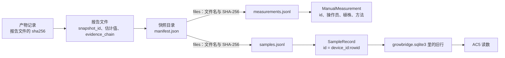

# 数据、档案与可追溯性

[English](../en/Data-Archive-and-Traceability.md)

这一页写给需要信任、核对或备份数据的人。它说明 DiAGRI 记录了什么、每类记录放在哪里、原始记录为什么从不修改，以及报告里的一个数字怎样一步步追回到设备读数。

以下内容只在模拟的 AC5 上跑过，还没有用这套代码归档过真实实验，见[状态与已知限制](Status-and-Known-Limitations.md)。设计背景在[架构设计文档](../../diagri-agent-architecture.zh-CN.md)的 11.1 到 11.5 节。本页讲的是代码现在的实际行为，两者不一致的地方列在最后一节。

## 记录了什么，由谁记录

记录类型都是不可变的模型，定义在 [`archive/models.py`](../../../src/growbridge/archive/models.py)。保存它们的是项目档案，也就是 [`archive/store.py`](../../../src/growbridge/archive/store.py) 里的 `Archive` 类。

| 记录 | 模型 | 由谁写入 | 标识 |
| --- | --- | --- | --- |
| 样本 | `SampleRecord` | 运行时的归档步骤 `Runtime._ingest`（[`runtime.py`](../../../src/growbridge/runtime.py)），每个 tick（每秒一次）执行一次 | `<device_id>:<rowid>` |
| 动作 | `ActionRecord` | 控制服务，经 `RecordSink.append_action` 写入。状态每变一次就多一行 | `request_id` |
| 人工测量 | `ManualMeasurement` | 操作员，通过 [`workbench/api.py`](../../../src/growbridge/workbench/api.py) 的 `POST /wb/measurements` | `id` |
| 干预 | 表里的一行，没有模型 | 工作流服务。`InterventionMirror` 把每条干预向档案复制一次 | `intv_...` |
| 数据快照 | `Snapshot` | 研究 Agent 的 `freeze_dataset` 工具 | `snap_...`，每个实验另有版本号 |
| 产物 | `Artifact` | [`research/report.py`](../../../src/growbridge/research/report.py) 的 `publish_research_report` | `artifact_...` |
| 证据卡 | `EvidenceCard` | `POST /wb/evidence`（操作员）或计划 Agent 的 `propose_evidence_card` 工具，都经 `Archive.add_evidence` | `evidence_...` |
| 证据来源 | `EvidenceEntry` | 同一次调用，写入表 `evidence_sources` | 卡编号 |
| 证据核实 | `EvidenceVerification` | `POST /wb/evidence/{card_id}/verify`，或操作员自己录入时，经 `Archive.verify_evidence` 写入表 `evidence_verifications` | 卡编号 |

有三点容易忽略：

- **阶段启动之后收到的样本才归属实验。** 归档时逐条判断：这条样本收到的时候，哪个阶段在运行。阶段启动之前的样本照样保存，但不挂在任何实验下。
- **动作账本有两份。** 控制服务在自己的数据库里保留工作副本。每个状态都会向档案追加一份，所以一次写入从 `pending` 到 `maybe_sent` 再到 `confirmed` 的经过，事后都查得到。
- **证据卡记着是谁加的，核实是一条独立的记录。** 来源是 `operator:<姓名>`，或 `model:planner` 加提议它的任务 ID。卡片原文永不改动。核实（谁、什么时候、备注，以及操作员对“数值已用本地测量校准”的证明）追加在自己的表里，每张卡一条，第一条保留；对已核实的卡再加证明不会改变任何东西。`Archive.evidence()` 只在这条记录存在时才把卡报告为已核实，卡里存了什么都不算，所以模型永远产生不了已核实的卡：计划 Agent 的工具把每个提议都存成未核实，并且拒绝 `local` 类别，因为只有操作员才能把本地测量记成证据。运行单的审阅对任何类别的未核实卡，包括 `local`，都给出 `unverified_source` 提示。`calibrated` 用同样的办法得出：模型提议的卡，只有操作员的核实记录证明了才为真，所以模型不能声称已校准（提议工具没有这个字段，档案也把这样的卡存成未校准）；操作员录入的卡，则是操作员录入的值。操作员录入的卡，由这位操作员当场核实。图像记录在代码里完全没有。

## 数据放在哪里

所有数据都在 `data_dir` 下。每个 SQLite 文件只有一个所有者，其他服务只能通过所有者提供的方法读写。文件名来自 [`runtime.py`](../../../src/growbridge/runtime.py) 里的 `DATABASES`。为什么这样拆分，见[设计决策记录](Design-Decisions.md)第 7 条。

| 文件或目录 | 所有者 | 内容 |
| --- | --- | --- |
| `growbridge.sqlite3` | 基础守护进程，[`store.py`](../../../src/growbridge/store.py) 的 `Store` | 旧的 `samples` 表（接收时间和读数）和 `operations` 表 |
| `control.sqlite3` | 控制服务 | 写入主机、写入权、动作账本、安全配置、控制事件 |
| `workflow.sqlite3` | 工作流服务、`TaskBoard`、`Operators` | 项目、研究协议、轮次、运行单、阶段、审批、研究任务、操作员账号和会话 |
| `archive.sqlite3` | 项目档案 | 样本、动作、测量、证据、产物、干预、读数冻结时段、快照索引和失效标记 |
| `observer.sqlite3` | 观察与通知 Agent | 告警、通知发件箱、日报 |
| `compute.sqlite3` | 计算服务 | 作业尝试、预算和额度 |
| `agents.sqlite3` | 模型角色的支撑数据 | 调用预算、派发登记、冻结的分析脚本和确认性运行、留出数据登记 |
| `archive/snapshots/<snapshot_id>/` | 项目档案 | 一份数据快照的文件 |
| `analysis/` | `ConfirmatoryRunner` | 每次确认性运行一个目录 |
| `agent_work/` | 模型角色的工具 | `local/` 下是探索性运行，`reports/` 下是报告文件 |

## 原始记录为什么只追加

一个结果要让人信得过，前提是用同样的输入能重算出来。原始行如果可以改，旧报告就会悄悄对不上数据，而且没人察觉。所以原始记录只增不改，由它派生的东西（快照、日报指标、报告）随时可以重建。

[`archive/store.py`](../../../src/growbridge/archive/store.py) 这样落实这条规则：

- **没有修改，也没有删除。** `Archive` 没有任何修改或删除记录的方法。`_insert_once` 遇到内容完全相同的重复写入就当作没有新内容；同一个 ID 带着不同内容再来，就报错。
- **动作状态变化是新的一行。** 一次写入的每个状态都追加保存，不覆盖前一个。
- **更正是一条新记录。** 更正人工测量时，新写一条 `ManualMeasurement`，用 `corrects` 字段指向原记录。`measurements()` 默认返回当前有效的值，加上 `include_corrected=True` 返回全部。
- **更正会标记依赖旧值的结果。** `mark_dependents_invalid` 为包含被更正记录的每份快照、以及基于这些快照的每个产物，在 `invalidations` 表里各写一行。`publish_research_report` 拒绝使用已失效的快照。

举例：操作员给植株 `p3` 录入冠层面积 12.5，后来发现应该是 15.2。他再提交一条测量，`corrects` 填第一条的 ID。两条记录都留在档案里。更正之前冻结的快照被标记为失效，不能再用它发布报告，研究 Agent 需要重新冻结一个新版本。

有一个限制：这条规则靠 `Archive` 类来保证。数据库里没有触发器，所以拦不住绕过它直接打开文件的程序。

## 样本怎样进入档案

基础守护进程仍然把每条读数写进自己的表，和 DiAGRI 其余部分出现之前一样。档案再从那里复制。这样 BLE 链路不用改，复制过程也可以随时中断、随时续上。代码在 [`archive/source.py`](../../../src/growbridge/archive/source.py) 和 `Archive.ingest`。

- **游标。** `LegacySampleSource.read_after` 返回 `rowid` 大于档案游标的行。`ingest` 把一批数据（每批 500 行，每个 tick 最多 10 批）和新游标放在同一个事务里保存，崩溃之后要么两者都在，要么都不在。重放不会写入重复数据，因为记录 ID 就是 `<device_id>:<rowid>`。
- **时间。** 旧表只有接收时间，所以 `captured_at` 为空，档案按 `received_at` 排序。旧表也没有质量标记，不区分计划采样和主动状态查询，因此归档进来的样本全部是 `ok` 和 `planned`。
- **时钟未同步期间的样本。** 数据源会记下第一次发现时钟未同步的时刻，以及之后第一次发现恢复同步的时刻。这段时间里收到的行标为 `clock_synced = false`。这些行照常归档，但不算可信数据（见下一节）。如果一段未同步期整个发生在进程停机期间，或者落在两次观察之间，就观察不到。
- **保护尚未归档的历史。** 运行时启动之后，`Store.prune` 只删除同时满足两个条件的旧行：早于 `retention_days`，并且已经归档。时钟未同步时什么都不删，最新的一行永远不删。
- **`SourceRewound`。** 旧表没有使用 `AUTOINCREMENT`。表一旦被清空，SQLite 会重新发放比游标小的行号，新行和已归档的行就分不清了。发现最新的 `rowid` 小于游标时，数据源抛出 `SourceRewound`。运行时把它变成告警 `source_rewound`，这个 tick 里的其余步骤照常执行。清理时保留最新一行，正是为了让正常运行中不出现这种情况。

## 读数冻结时段

传感器的读数不再变化时，档案把它记在 `frozen_marks` 表里。一个时段是两行只增不改的记录：`opened` 行（传感器、读数值、第一条该读数样本的时间），时段结束时再加一条 `closed` 行（最后一条冻结样本的时间，外加一个 `reason`：传感器的读数又变了是 `value_changed`，安全配置里删掉了它的阈值是 `no_longer_listed`，安全配置里一个传感器都没列是 `nothing_checked`）。只有第一种原因表示探头恢复了；因后两种原因关闭的时段，传感器可能仍然卡着，之后的数据不能当作可信。`frozen_periods()` 把原因作为 `close_reason` 返回（时段还开着时为空，在这一列出现之前写入的行也为空）。这两行都不会被修改，同一个时段重复关闭也不会多出一行。原始样本不受影响。`open_frozen_periods()` 返回还没关闭的时段，`frozen_periods(start, end)` 返回与某个时间窗重叠的时段；还开着的时段与所有结束时间不早于它第一条样本的时间窗都重叠。`sensor_points(since)` 返回某个时间以来所有样本的传感器读数（不分实验），供查找冻结读数的检查使用；`samples` 表上加了时间索引，让这个查询保持够快。

## 数据快照怎样冻结和校验

分析必须跑在不会再变的数据上。[`archive/snapshot.py`](../../../src/growbridge/archive/snapshot.py) 的 `freeze()` 把一次分析的输入写进一个目录，并记下每个文件的指纹。

1. **时钟不可信就拒绝。** 时钟未同步时，`freeze()` 抛出 `Denied("clock_unsynced")`。
2. **时间窗取自阶段。** 研究 Agent 调用 `freeze_dataset` 时，时间窗从阶段启动时刻算起，到阶段实际结束或被停止的时刻为止（执行器在计划结束后的下一个周期才结束阶段）；阶段仍在运行时，到启动时刻加 `duration_seconds`。人工测量在这个结束时刻之后再宽限两小时（清单里的 `measurement_grace_seconds`），所以阶段结束时测的值（例如收获时的鲜重）会被保留；`inspect_stage_data` 会列出落在时间窗外的测量。采样间隔和允许的最大缺口也取自运行单。模型不能自己指定这些值（[`agents/handlers_researcher.py`](../../../src/growbridge/agents/handlers_researcher.py)）。
3. **样本分成两份。** 同时满足 `clock_synced`、质量为 `ok`、来源为 `planned` 的样本是可信样本，写入 `samples.jsonl`。其余样本写入 `samples_untrusted.jsonl`：留着备查，不参与任何计算。
4. **写入其他文件。** `actions.jsonl`、`measurements.jsonl` 和 `interventions.jsonl` 保存时间窗内的相应记录。`frozen_periods.jsonl` 列出与时间窗有重叠的、传感器读数一直不变的时段（还没关闭的时段，`last_at`、`closed_at` 和 `close_reason` 为空）。研究 Agent 用 `freeze_dataset` 冻结时，还会写入 `manual_tasks.jsonl`（运行单在时间窗内计划的人工任务）和 `task_records.jsonl`（操作员对这些任务的记录：已完成或已跳过，只追加，以最新的为准）。每行是一个键已排序的 JSON 对象。
5. **覆盖率按时长算，不按条数算。** 相邻两条可信样本的间隔不超过允许的缺口时，中间这段时间算作已覆盖。间隔更长时，前一条样本只记一个采样间隔，其余部分列为缺口。覆盖率不低于 0.9（`DEFAULT_MIN_COVERAGE`）的快照才标为 `complete`。
6. **写清单。** `manifest.json` 包含 ID、实验、版本、时间窗、`measurement_grace_seconds`、覆盖率、`complete`、缺口、`min_coverage`、`measurements_excluded`、`manual_tasks_judged_at`（快照含人工任务时），以及 `files`：每个文件由 `file_digest` 算出的 SHA-256。档案里保存一条 `Snapshot` 记录，带同样的文件列表，另有 `manifest_sha256`，也就是清单文件本身的摘要。

重新冻结不会改动已有的快照，而是新建一个目录，版本号加一。

覆盖率的例子（用 `coverage_of` 核对过）：时间窗一小时，每 60 秒一条样本，允许的缺口 120 秒，第 25 分钟到第 35 分钟之间没有样本。这段空白只记 60 秒，缺口是 540 秒，覆盖率是 3060 / 3600 = 0.85，快照标为不完整。

`verify()` 只有在三件事都成立时才返回真：清单文件的摘要和档案里存的一致；清单里的文件列表和档案里存的一致；每个文件的摘要和清单里列的一致。`run_local_analysis` 和 `publish_research_report` 都先校验再使用。`ConfirmatoryRunner` 更严格：还要求快照是 `complete`，目录里多一个文件或少一个文件都拒绝。

登记了留出数据之后，留出批次的结局测量不会写进 `measurements.jsonl`，被排除的条数记在清单的 `measurements_excluded` 里。见[科研方法](Research-Methodology.md)。

## 导出格式

| 内容 | 格式 | 由谁生成 |
| --- | --- | --- |
| 数据快照 | 一个目录，内含若干 JSON Lines 文件和 `manifest.json` | `freeze()` |
| 研究报告 | `research_report_<artifact_id>.json` | `publish_research_report` |
| 训练数据集 | CSV 文件和 `croissant.json` | `growbridge export-dataset`（[`dataset/command.py`](../../../src/growbridge/dataset/command.py)） |
| 旧表里的读数 | CSV，最多 168 小时 | [`api.py`](../../../src/growbridge/api.py) 的 `GET /history/export.csv` |

`growbridge export-dataset` 把冻结的快照导出为模型训练用的数据集：只读取快照自己的文件和数据库，除假名密钥外不向数据目录写任何东西；校验不通过的快照拒绝导出；数据目录的结构比已安装的 growbridge 旧时也拒绝导出，而不是替你升级：先用新版本启动一次守护进程，再导出。见 [`dataset/command.py`](../../../src/growbridge/dataset/command.py)。

## 追溯一个报告数字

所有指纹都由 [`archive/ids.py`](../../../src/growbridge/archive/ids.py) 里的两个函数计算。`file_digest` 是文件字节的 SHA-256，用来保护快照文件、清单、报告、分析脚本和备份。`content_digest` 是把对象写成键已排序的 JSON 之后算出的 SHA-256，用来标识研究协议或运行单的内容，所以一次审批对应的就是当时审阅的那一版运行单。

假设报告里写着效应是 0.85，往回追的步骤是：

1. **报告。** `Artifact` 记录里的 `sha256` 是报告文件的 `file_digest`。文件被改过，摘要就对不上。报告文件里有 `snapshot_id`，`evidence_chain` 里还以 `snapshot:<id>` 的形式列出它用到的每一份快照。
2. **快照。** 打开 `archive/snapshots/<id>/manifest.json`，执行 `verify()`。通过就说明这些文件正是计算报告时用的那一份。
3. **测量。** 效应是用这些快照的 `measurements.jsonl` 算出来的，不是用在线数据库（[`agents/handlers_report.py`](../../../src/growbridge/agents/handlers_report.py)）。每行有测量 ID、操作员、植株、位置、方法和时间。
4. **样本。** `samples.jsonl` 的每行有 ID `<device_id>:<rowid>`、接收时间、时钟标记，以及 `data`，即解码后的设备读数。
5. **设备读数。** `rowid` 就是旧 `samples` 表里的行号。旧行被清理之后（`retention_days`，默认 30 天），档案里的副本就是唯一的一份。
6. **动作。** `actions.jsonl` 的每行有 `request_id`、写入权编号、触发依据、操作员、计划值和确认值，可以拿来对照运行单，看帐篷实际被设成了什么。

## 备份

代码是 [`runtime_backup.py`](../../../src/growbridge/runtime_backup.py) 的 `Backups` 和 [`archive/backup.py`](../../../src/growbridge/archive/backup.py) 的 `backup()`。操作步骤见[通知、日报与备份](Notifications-Reports-and-Backup.md)。

- 只有配置了 `backup_dir` 才会备份。没有配置时，运行时在启动时发出警告级告警 `backup_unconfigured`。
- 每隔 `backup_interval_seconds`（默认 6 小时），把 DiAGRI 的六个数据库各复制到 `<backup_dir>/<name>.sqlite3`。复制用的是 SQLite 在线备份，走一条独立的只读连接，所以得到的是同一时刻的一致状态，也不会阻塞写入。
- 副本通过 `PRAGMA integrity_check` 之后，才替换上一份备份。旁边同时写一个清单 `<name>.sqlite3.manifest.json`，内容是 `sha256`、`size` 和 `created_at`。
- 备份失败时，上一份备份保持不动，发出告警 `backup`，300 秒后重试。最早的那次成功备份如果超过两个备份间隔，运行健康探针 `offsite_backup` 判为失败。

备份**不包括**：

- 快照目录、报告文件和确认性运行目录。恢复出来的数据库仍然记得它们的摘要，能判断文件是否完好，但找不回文件本身。
- 旧的 `growbridge.sqlite3`。已经归档的样本在 `archive.sqlite3` 里；还没归档的行会丢失。
- 图像。代码里根本没有保存图像。
- 配置文件和 `host_id`。
- 跨文件的同一时刻。六个数据库是一个接一个复制的。

从备份恢复之后，先停掉守护进程，再执行 `growbridge recovery bump --reason ...`。恢复编号加一，此前的写入权、审批和会话全部失效。见[控制与安全模型](Control-and-Safety-Model.md)。

## 代码与架构文档不一致的地方

- 11.4 节要求备份数据库、原始图像和归档清单。代码只备份六个 SQLite 数据库。
- 11.1 节描述了图像记录。代码里没有。
- 6.2 节的证据卡包含作物、生长期、条件和页码等内容。`EvidenceCard` 只有来源类别、引用、论断、数值、单位和两个标记。
- 11.2 节要求为每个传感器记录单位、位置和校准版本，并区分主动状态查询和计划采样。`SampleRecord` 有来源和质量字段，但从旧表归档时填不上。
- 11.1 节说产物要记录代码哈希和运行环境。`publish_research_report` 没有填 `code_sha256` 和 `environment`。

## 另见

- [科研方法](Research-Methodology.md)
- [设计决策记录](Design-Decisions.md)
- [通知、日报与备份](Notifications-Reports-and-Backup.md)
- [配置参考](Configuration-Reference.md)
- [状态与已知限制](Status-and-Known-Limitations.md)
- [术语表](Glossary.md)
