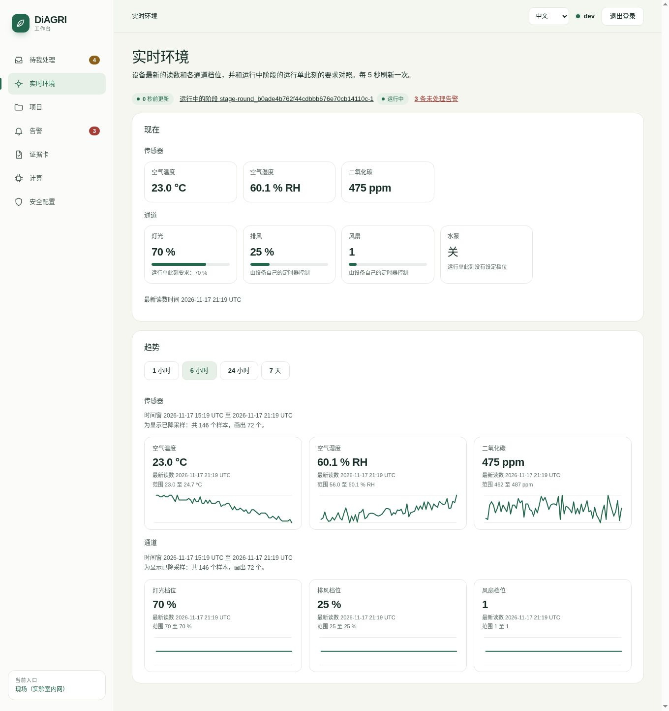
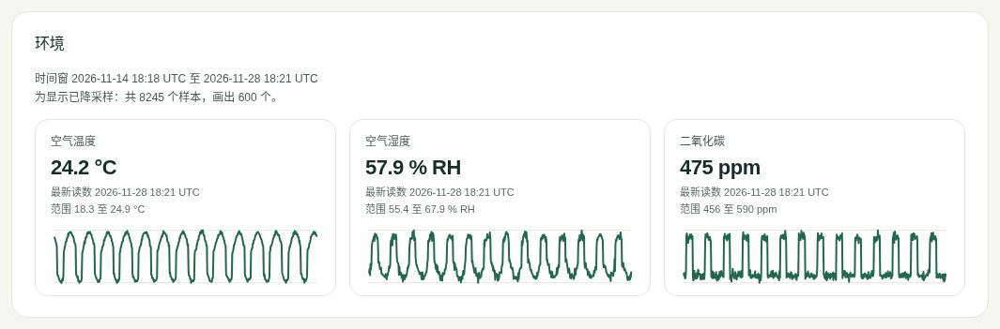

# 示例：模型角色跑完整一轮

[English](../en/Example-Full-Round-With-Claude.md)

这一页按步骤记录一轮研究从提问到报告交付的全过程，记录时间是 2026 年 11 月 14 日。设备是模拟的 AC5；三个模型角色（编排、计划、研究）由 Claude Opus 5.5 担任，通过本机的 Claude Code 命令行运行。操作员的步骤由一个驱动脚本发出，发的就是工作台控制台会发的那些请求。下面写到的内容都真实发生过；模型的回复做了少量删节。

> **它不说明什么。** 植株、帐篷和冠层测量都是模拟的。这次用的是开发用工作台（`scripts/dev_workbench.py`），不是 `serve`。它说明各部分能配合起来、每个角色各做了什么，但不能作为生菜或真实 AC5 的证据。见[状态与已知限制](Status-and-Known-Limitations.md)。

## 一轮概览

| | |
| --- | --- |
| 问题 | 把补光灯亮度从 40% 提高到 70%，生菜冠层长得更快吗？ |
| 协议 | 2 个处理（`control` 灯光 40，`high` 灯光 70），4 轮、2 个区组，终点指标 `canopy_area_growth`，配对区组分析 |
| 本轮 | 第 1 轮：区组 1，处理 `high`（灯光 70%），一个 14 天的营养生长阶段 |
| 真实用时 | 约 10.5 分钟，其中 14 天的阶段（快进）用了 143 秒 |
| 模型调用 | 17 次（编排 7、计划 6、研究 4），模型用时约 212 秒 |
| 结果 | 轮次 `delivered`（已交付）；报告等级**描述性**，结论**不确定** |

| # | 真实时间 | 谁 | 做什么 | 请求 |
| --- | --- | --- | --- | --- |
| 1 | 0 秒 | 操作员 | 登录，建项目，保存协议，建第 1 轮，设模型预算 | `POST /wb/login`、`/wb/projects`、`/wb/protocols`、`/wb/rounds`、`/wb/projects/{id}/budget` |
| 2 | 0 秒 | 操作员 | 在项目对话里提问 | `POST /wb/goals` |
| 3 | 0 到 230 秒 | 编排、计划 | 派发，设计，校验（两次被拦），保存运行单，告诉操作员 | 无（模型角色） |
| 4 | 230 秒 | 操作员 | 审阅运行单 | `GET /wb/stages/{id}/run-sheet` |
| 5 | 250 秒 | 操作员 | 重新认证，按摘要审批，启动阶段 | `POST /wb/reauth`、`/approve`、`/start` |
| 6 | 250 到 405 秒 | 执行 | 跑完 14 天的阶段；实时环境页全程可看 | `GET /wb/environment` |
| 7 | 405 秒 | 操作员 | 录入 6 条冠层测量 | `POST /wb/measurements` |
| 8 | 405 秒 | 操作员 | 在对话里请求分析 | `POST /wb/goals` |
| 9 | 405 到 625 秒 | 编排、研究 | 核对状态，派发，检查数据，冻结，发布，告诉操作员 | 无（模型角色） |
| 10 | 625 秒 | 操作员 | 在轮次页阅读报告 | `GET /wb/rounds/{id}/report` |

## 自己复现

```sh
cd ~/diagri
export GROWBRIDGE_DEV_SECRET='至少十二个字符的口令'
unset ANTHROPIC_BASE_URL ANTHROPIC_API_KEY   # Claude Code 用它自己的登录
.venv/bin/python scripts/dev_workbench.py --claude-code --fast-forward \
  --data-dir /tmp/diagri-example --transcript /tmp/diagri-example.jsonl
```

打开 `http://localhost:8770/workbench`，以 `dev` 登录，然后在控制台里按下面的步骤操作。`--fast-forward` 会在阶段运行时按采样间隔逐步快进，阶段以外按真实时间走。模拟传感器套用了一个小帐篷模型，读数会随昼夜和灯光变化。见[开发环境、测试与 CI](Development-Setup-Testing-and-CI.md)。

## 1. 建立项目

操作员建项目、保存研究协议、建第 1 轮。协议用的是 `sim/fixtures.py` 里的示例协议：处理 `control`（灯光 40）和 `high`（灯光 70）；分配为第 1 轮 `high`、第 2 轮 `control`、第 3 轮 `control`、第 4 轮 `high`，分属区组 1 和 2；终点指标 `canopy_area_growth`；分析方法 `paired_block`。轮次一开始处于 `designing`（设计中）。操作员还给项目设了模型调用预算（120 次）。

## 2. 提出问题

操作员在项目页的**对话**区输入问题。编排 Agent 收到问题，同时收到项目上下文：未结束的轮次、每轮对应的协议轮次和分配的处理，以及新运行单必须使用的编号。


编排 Agent 把任务派给计划 Agent，随即结束这一轮。它也说清楚了一轮能回答什么、不能回答什么：

> Under the protocol's randomisation, round 1 is block 1 with the "high" treatment (70% light) in tent-1, vegetative stage. […] This round alone can't answer the question. It's a single high-light run in one tent, with no control to compare against. […] Approving the sheet on the workbench, not in this chat, is what lets the run go ahead.

（大意：按协议的随机分配，第 1 轮是区组 1、`high` 处理（70% 灯光）。单靠这一轮回答不了问题，因为没有对照。只有在工作台上审批运行单，运行才能开始，在对话里说"批准"不算。）

计划 Agent 读取设备能力，检查协议的实验设计，查证据卡（库里没有）。然后起草运行单：灯光由主机控制，UTC 06:00 到 22:00 为 70%。校验时带上轮次编号，所以处理检查也一起跑了。校验器拦下了两版草稿：

1. 水泵交给设备自管：被拦，水泵必须由主机控制。
2. 用养护规则每天早上开一下水泵：被拦，任何定时步骤都不能启动水泵。计划 Agent 删掉这条规则，把浇水改成人工任务。

第三版通过，`save_plan_draft` 返回 `"saved": true`，阶段进入 `pending_review`（待审批）。这个任务是编排 Agent 派出去的，所以计划 Agent 结束后编排 Agent 会收到一个后续任务，并告诉操作员审批前要核对什么：16 小时光周期没有来源依据，浇水靠人工，每天的人工任务需要有人在场，设备是模拟的。

## 3. 审阅运行单

操作员打开阶段页。**运行单**一节显示的正是将被审批的内容，包括审批时记录的摘要和各项检查的结果。


| 部分 | 这份运行单的内容 |
| --- | --- |
| 时长、采样 | 14 天；每 300 秒一个读数，允许最长 900 秒的缺口 |
| 通道 | 灯光和水泵由主机控制；排风和风扇由设备自管 |
| 定时动作 | 06:00 灯光 70，22:00 灯光 0（UTC） |
| 人工任务 | 09:00 浇水，12:00 冠层拍照，12:15 冠层测量 |
| 结束动作 | 灯光 0，水泵 0 |
| 校验结果 | 5 条提示，都不阻断：3 项人工任务需要有人在场；两条灯光动作没有引用证据卡 |

## 4. 审批并启动

审批时要再次输入操作员口令（重新认证），审批还会绑定操作员看到的那个摘要（`expected_digest`），审阅之后被改过的运行单对不上。然后操作员启动阶段，状态变为 `running`（执行中）。模型角色没有任何审批或启动的工具，这些事它们做不了。

## 5. 阶段执行

执行 Agent 大约每秒按运行单评估一次，不涉及模型。**实时环境**页显示每个传感器的最新读数和每个通道记录的档位，每 5 秒刷新。阶段运行期间，运行单控制的通道还会显示运行单此刻要求的档位；档位不一致的通道会标出**与运行单不符**。



快进的 14 天用了 143 秒。阶段页画出了整个时间窗：8245 个样本，温度、湿度和 CO₂ 都跟着 16 小时的光照日变化。



时长到了以后，执行 Agent 写入结束动作并回读确认，然后结束阶段。轮次进入 `data_verification`（数据核验）。


## 6. 录入测量

冠层终点指标靠人工测量。操作员为 6 株各录入一条 `canopy_area_growth`（cm²/天）：1.42、1.37、1.51、1.29、1.46、1.33。

## 7. 请求分析

操作员在对话里请求核验、冻结数据并出报告。编排 Agent 先核对轮次和阶段的状态（`get_project_state`、`get_run_status`），再派给研究 Agent。

研究 Agent 的顺序是：

1. `inspect_stage_data`：覆盖率 1.0，没有缺口，8242 个可信样本，29 个动作全部确认，没有人工干预，6 条测量。灯光在 66.6% 的样本里是开的，最高 70，正是 16 小时光照日、`high` 档位。
2. `freeze_dataset`，带上轮次编号：快照 `snap_93d1…` 第 1 版，完整且校验通过；轮次进入 `analysis`（分析）。
3. `publish_research_report`：等级和数值由服务器根据冻结的数据算出。处理检查会把快照里记录的档位和本轮分配的处理比对；这次灯光确实是 70，所以没有记偏离。报告是终稿，轮次进入 `delivered`。

编排 Agent 的后续任务把结果和还没解决的问题告诉操作员：


> **Result:** under 70% light, canopy area grew 1.29–1.51 cm² per day across 6 plants, with a mean of 1.397. This only describes growth under 70% light (an exploratory finding). It can't show whether more light speeds up growth until we have the 40% control from round 2. […] **Deviation figure needs your input:** […] The data doesn't record when the hand watering (09:00), photo (12:00) and canopy measurement (12:15) were actually done.

（大意：70% 灯光下 6 株的冠层面积每天增长 1.29 到 1.51 cm²，平均 1.397。这只描述了 70% 下的生长，在拿到第 2 轮 40% 对照之前，无法说明更强的光是否让生长更快。偏离比例需要你补充：数据里没有记录浇水、拍照和测量实际是什么时候做的。）

## 8. 阅读报告

轮次页显示已发布的报告。报告文件的摘要先和档案里的记录比对，一致后才读出。


- **描述性，不确定。** 第 1 轮只有 `high` 一个处理，没有独立重复，无法估计效应（"fewer than 2 complete blocks"）。报告只列出本轮的数据，不声称任何效应。
- **下一轮**是第 2 轮：区组 1、`control`（灯光 40），条件不变，这样配对比较才能进行。

## 这个示例说明了什么

- **各角色守住自己的边界。** 编排负责派发和总结，计划负责提交草稿，研究负责冻结和出报告。没有哪个模型审批、启动或停止过任何东西，这些都由操作员在工作台上完成。
- **程序检查在引导模型。** 校验器的阻断结果让计划 Agent 改了两次稿。处理检查保证运行单把灯光设成了本轮的 70%，报告的检查又确认了设备实际运行在 70。
- **如实说明局限。** 编排和研究两个 Agent 都说明了一轮回答不了这个问题，也都指出了自己没法核实的地方。
- **第一次尝试被正确拦下。** 在更早的一次尝试里，模拟器的读数一直不变，冻结读数检查在模拟时间两小时后暂停了阶段。驱动脚本照样请求分析，编排 Agent 拒绝了："the workflow's records show the vegetative stage hasn't ended"（工作流记录显示营养生长阶段还没有结束）。现在模拟器的读数会变化了。

## 这次运行发现的问题

| 问题 | 现象 | 位置 |
| --- | --- | --- |
| 尚未运行的轮次被算作缺失 | 没有任何数据缺失，报告里却出现服务器写的"缺失超过预定标准"：协议的第 2 到 4 轮被算成了缺失。 | [`agents/handlers_report.py`](../../../src/growbridge/agents/handlers_report.py) 的 `_missing_fraction` |
| 人工任务没有完成记录 | 每天的浇水、拍照和测量什么时候做的，没有任何记录，偏离比例覆盖不到它们。两个模型角色都指出了这一点。 | 运行单的 `manual_tasks` |
| 无法定时浇水 | 水泵必须由主机控制，而任何定时步骤都不能开水泵，所以运行单没法自动浇水，只能改成人工任务。 | [`planning/validate.py`](../../../src/growbridge/planning/validate.py) |
| 服务器的说明只有中文 | 不管操作员用什么语言，服务器写进报告的原因都是中文。 | [`research/analysis.py`](../../../src/growbridge/research/analysis.py) |

## 另见

- [运行一轮研究](Run-a-Research-Round.md)：每一步的请求和状态
- [五个 Agent](The-Five-Agents.md)：每个角色能做和不能做的事
- [科研方法](Research-Methodology.md)：结论等级、结论和处理检查
- [教程：在模拟器上跑通一轮研究](Tutorial-Simulated-Round.md)：不用模型、脚本驱动的一轮
