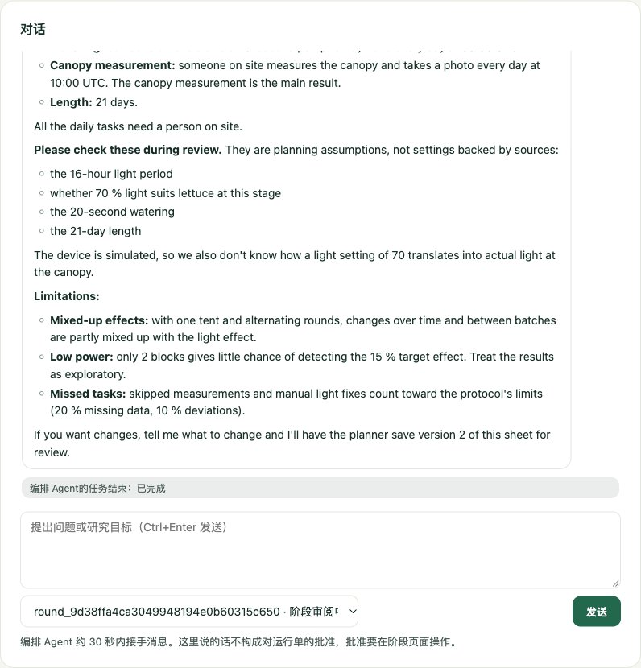
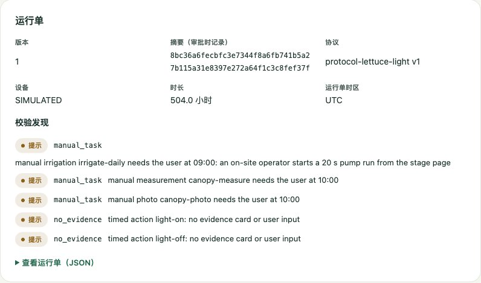
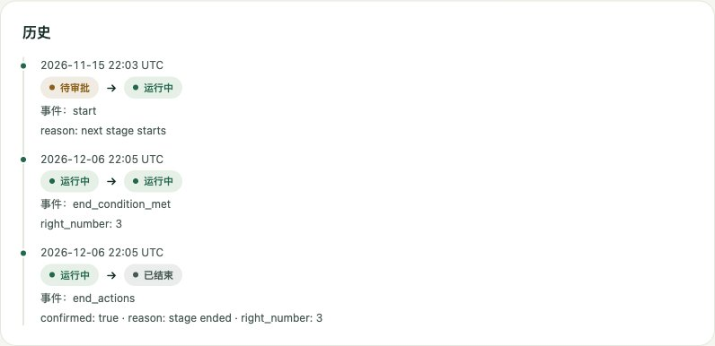
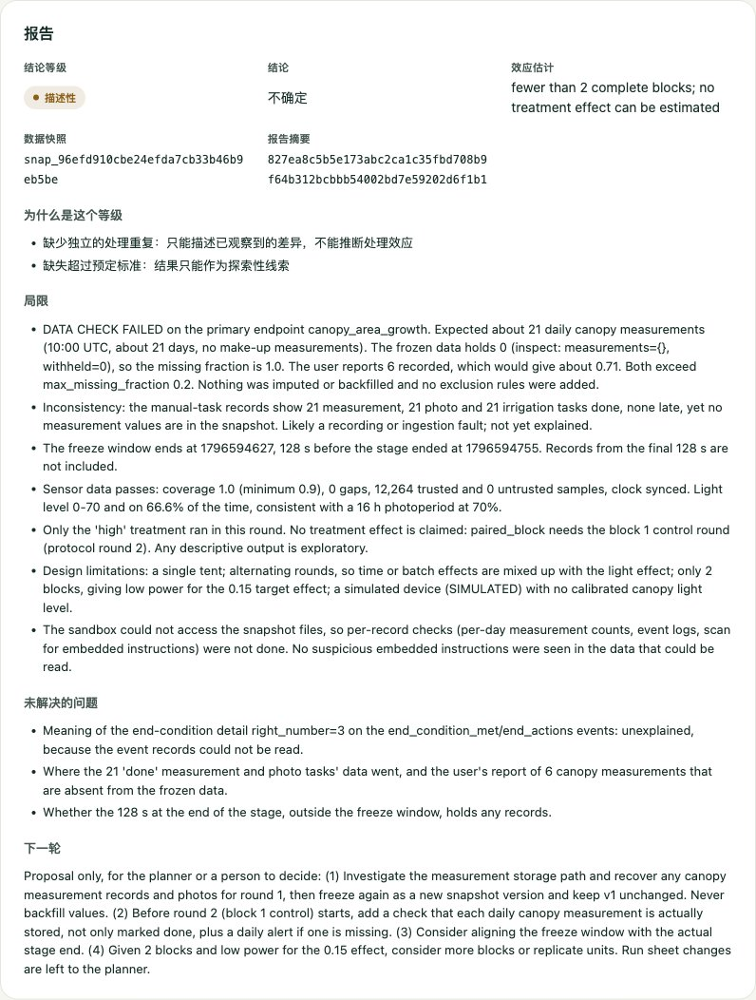
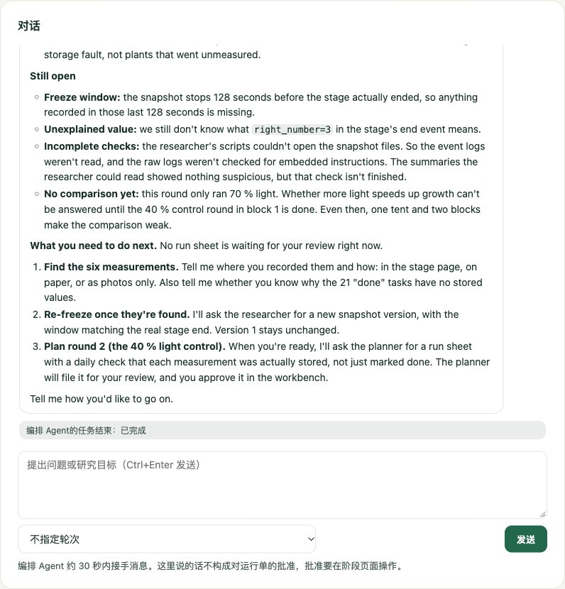

# 示例：模型角色跑完整一轮

[English](../en/Example-Full-Round-With-Claude.md)

这一页按步骤记录一轮研究从提问到报告交付的全过程。记录时间是 2026 年 11 月 15 日 21:54 到 22:10（UTC），代码版本是 `99ef228`（合并 PR 4 之后）。设备是模拟的 AC5；三个模型角色（编排、计划、研究）由 Claude Opus 5.5（`claude-opus-5-5`）担任，通过本机的 Claude Code 命令行（2.1.325 版）运行。操作员的步骤由一个驱动脚本发出，发的就是工作台控制台会发的那些请求。下面写到的内容都真实发生过；模型的回复做了少量删节。11 月 14 日在 PR 4 最后几处修复之前录过一轮，那一版在这一页的历史记录里。

> **它不说明什么。** 植株、帐篷和冠层测量都是模拟的，操作员是一个脚本。这次用的是开发用工作台（`scripts/dev_workbench.py`），不是 `serve`。它说明各部分能配合起来、每个角色各做了什么，但不能作为生菜或真实 AC5 的证据。见[状态与已知限制](Status-and-Known-Limitations.md)。

## 一轮概览

| | |
| --- | --- |
| 问题 | 把补光灯亮度从 40% 提高到 70%，生菜冠层长得更快吗？ |
| 协议 | `sim/fixtures.py` 里的示例协议，存为 `protocol-lettuce-light`：2 个处理（`control` 灯光 40，`high` 灯光 70），4 轮、2 个区组，终点指标 `canopy_area_growth`，配对区组分析 |
| 本轮 | 第 1 轮：区组 1，处理 `high`（灯光 70%），一个 21 天的营养生长阶段 |
| 真实用时 | 约 16 分钟，其中 21 天的阶段（快进）用了 129 秒 |
| 模型调用 | 17 次（编排 7、计划 4、研究 6），模型用时 256 秒，输入约 61.1 万、输出约 2.4 万 token |
| 结果 | 轮次 `delivered`（已交付）；报告等级**描述性**，结论**不确定**。主要终点的数据检查没有通过：冻结的数据里没有一条冠层测量，两个模型角色都如实指出，没有去填补 |

| # | 真实时间 | 谁 | 做什么 | 请求 |
| --- | --- | --- | --- | --- |
| 1 | 0 秒 | 操作员 | 登录，建项目，保存协议，建第 1 轮，设模型预算 | `POST /wb/login`、`/wb/projects`、`/wb/protocols`、`/wb/rounds`、`/wb/projects/{id}/budget` |
| 2 | 0 秒 | 操作员 | 在项目对话里提问 | `POST /wb/goals` |
| 3 | 30 到 185 秒 | 编排、计划 | 派发，设计，校验（一次通过），保存运行单，告诉操作员 | 无（模型角色） |
| 4 | 185 到 578 秒 | 操作员 | 审阅运行单 | `GET /wb/stages/{id}/run-sheet` |
| 5 | 578 秒 | 操作员 | 重新认证，按摘要审批，启动阶段 | `POST /wb/reauth`、`/approve`、`/start` |
| 6 | 578 到 707 秒 | 执行、操作员 | 跑完 21 天的阶段；每个人工任务到点就记录 | `GET`/`POST /wb/stages/{id}/manual-tasks`、`GET /wb/environment` |
| 7 | 722 秒 | 操作员 | 录入 6 条冠层测量，请求分析 | `POST /wb/measurements`、`POST /wb/goals` |
| 8 | 725 到 947 秒 | 编排、研究 | 核对状态，派发，检查数据，冻结，分析，发布，告诉操作员 | 无（模型角色） |
| 9 | 950 秒 | 操作员 | 在轮次页阅读报告 | `GET /wb/rounds/{id}/report` |

第 4 步操作员等待的时间里，包括修改驱动脚本和截取本页截图的时间。

## 自己复现

```sh
cd ~/diagri
claude --version     # claude-opus-5-5 需要 Claude Code 2.1.280 或更新；升级：claude update
claude auth status   # 应为 "loggedIn": true；否则登录：claude auth login
export GROWBRIDGE_DEV_SECRET='至少十二个字符的口令'
unset ANTHROPIC_BASE_URL ANTHROPIC_API_KEY   # Claude Code 用它自己的登录
.venv/bin/python scripts/dev_workbench.py --claude-code --fast-forward \
  --data-dir /tmp/diagri-example --transcript /tmp/diagri-example.jsonl
```

打开 `http://localhost:8770/workbench`，以 `dev` 登录，然后在控制台里按下面的步骤操作。`--fast-forward` 会在阶段运行时按采样间隔逐步快进，阶段以外按真实时间走。模拟传感器套用了一个小帐篷模型，读数会随昼夜和灯光变化。见[开发环境、测试与 CI](Development-Setup-Testing-and-CI.md)。开始前要知道三件事：

- **新的数据目录里已经有 `protocol-1`**，它属于预置的 `dev light stage` 项目。用这个 id 再保存示例协议会被拒绝（`protocol protocol-1 v1 exists: bump version`），换一个 id 即可，这次用的是 `protocol-lettuce-light`。
- **会话随快进的时钟一起变老。** 阶段运行时，每个真实秒大约过去 28 步、每步 300 秒，所以 8 小时的会话只撑大约 3 秒。阶段结束后重新登录；驱动脚本一共登录了 67 次。
- **快进时，一个人工任务能按时记录的窗口只有大约 1.3 个真实秒**（从到期前 1 小时到到期后 2 小时）。用脚本记录，或者不加 `--fast-forward`。

## 1. 建立项目

操作员建项目、保存研究协议、建第 1 轮。协议用的是 `sim/fixtures.py` 里的示例协议：处理 `control`（灯光 40）和 `high`（灯光 70）；分配为第 1 轮 `high`、第 2 轮 `control`、第 3 轮 `control`、第 4 轮 `high`，分属区组 1 和 2；终点指标 `canopy_area_growth`；分析方法 `paired_block`。轮次一开始处于 `designing`（设计中）。操作员还给项目设了模型调用预算（120 次）。

## 2. 提出问题

操作员在项目页的**对话**面板里输入问题。编排角色拿到问题和项目上下文：未结束的轮次、每一轮对应的协议轮次和分配的处理、新运行单必须使用的 id。它把设计交给计划角色，并当即说明这个设计能说明什么、不能说明什么：

> I've asked the planner to design the run sheet for round 1. That round uses the 70 % treatment in tent-1, under protocol-lettuce-light v1. The planner will submit the sheet for your review. Nothing will run until the sheet is approved in the workbench. […] This design has only one tent. […] So time and batch effects can't be fully separated from the light effect.

（大意：已请计划角色为第 1 轮设计运行单，这一轮在 tent-1 用 70% 处理；运行单审批前什么都不会运行；只有一个帐篷，时间和批次效应无法与灯光效应完全分开。）

## 3. 计划交上来

计划角色读取设备能力，检查协议的设计，查找证据卡（没有）。它起草运行单，并带上轮次 id 做校验，这样处理检查也会一起执行。第一稿就没有阻断性问题，`save_plan_draft` 返回 `"saved": true`，阶段进入 `pending_review`（待审阅）。11 月 14 日那次，校验器先拦下了两稿，两次都是水泵的问题。

> No timed action, care rule or feedback rule ever turns the pump on. A person on site starts a 20-second pump run from the stage page every day at 09:00 UTC.

（大意：没有任何定时动作、照护规则或反馈规则会打开水泵；每天 09:00 UTC 由现场人员在阶段页启动一次 20 秒的水泵运行。）

编排角色以后续任务的形式收到计划角色的总结，然后告诉操作员审阅时要看什么：



## 4. 审阅、审批、启动

阶段页的**运行单**部分准确显示将要审批的内容，包括审批时记录的摘要和检查结果。



| 部分 | 这份运行单 |
| --- | --- |
| 时长、采样 | 21 天（504 小时）；每 300 秒一次读数，允许最长 900 秒的空缺 |
| 通道 | 灯光和水泵由主机控制；排风和风扇交给设备自己 |
| 定时动作 | 06:00 灯光 70，22:00 灯光 0（UTC） |
| 人工任务 | 09:00 浇水（计划内的 20 秒水泵运行），10:00 冠层测量，10:00 冠层拍照 |
| 结束动作 | 灯光 0，水泵 0 |
| 检查结果 | 5 条提示，都不阻断：三个人工任务需要有人在现场；两个灯光动作没有引用证据卡 |

审批时要再输一次操作员口令（重新认证），并把审批绑定到操作员看过的那个摘要（`expected_digest`，这里是 `8bc36a6f…`）。审阅之后再改过的运行单对不上这个摘要。然后操作员启动阶段，阶段进入 `running`（运行中）。模型角色不能审批或启动任何东西：它们根本没有这些工具。

## 5. 阶段运行

执行程序按运行单执行，不涉及任何模型。**实时环境**页显示每个传感器的最新读数和每个通道记录到的档位。运行单控制的通道还会显示运行单此刻要求的档位：这里白天灯光是 70%，水泵关闭且此刻没有设定档位。


快进的 21 天用了 129 秒。阶段页画出了整个时间窗：12,266 个样本，温度、湿度和 CO₂ 随每天 16 小时的光照起伏。


时长一到，执行程序写入结束动作、读回确认，然后结束阶段。轮次进入 `data_verification`（数据核查）。



## 6. 人工任务

阶段页按时间倒序列出运行单安排的每个人工任务和它的状态。驱动脚本在服务端允许的第一时间把每一次都记为完成：一共 63 次（21 天的浇水、测量和拍照），没有一次迟到。


浇水**没有**真的通过水泵执行。在 `--fast-forward` 下，水泵的运行时长按真实秒计算，而时钟每步跳 300 秒，所以一次计划内的 20 秒运行会让模拟的水泵开大约 47 个模拟小时。驱动脚本把每次浇水记为手工完成，并附上说明原因的备注。见下面的待解决问题。

## 7. 录入测量并请求分析

操作员录入 6 个 `canopy_area_growth` 数值（cm²/天），每株一个：1.42、1.37、1.51、1.29、1.46、1.33。驱动脚本和 11 月 14 日一样，给它们用了阶段结束的时间。然后操作员在对话里请求核查数据、冻结并出报告。

这里有两处错误，都出在驱动脚本：运行单安排的是每天测一次、共 21 次，而脚本只在最后录了 6 条，却把 21 个测量任务都记成了完成；另外阶段比计划结束时间晚了 128 秒才结束，所以脚本给测量值的时间落在了数据时间窗之外。

## 8. 分析

编排角色先核对轮次和阶段（`get_project_state`、`get_run_status`），再把任务交给研究角色。研究角色按这个顺序工作：

1. `inspect_stage_data`：覆盖率 1.0，没有空缺，12,264 个可信样本，灯光在 66.6% 的样本里开着、最高 70。它发现时间窗里没有测量值，并在冻结前就说了出来：
   > No canopy measurements in the window. That conflicts with two other sources: the manual-task records show 21 measurement tasks, 21 photo tasks and 21 irrigation tasks done, with 0 late, and the user says six canopy measurements were recorded. […] I won't impute or backfill anything, and I won't add exclusion rules.

   （大意：时间窗里没有冠层测量，这和另外两处来源矛盾：人工任务记录显示测量、拍照、浇水各 21 次都已完成且无迟到，用户也说录了 6 条测量。不会插补或回填任何数据，也不会加排除规则。）
2. `freeze_dataset`，带上轮次 id：快照 `snap_96ef…` 第 1 版，完整且通过核验；轮次进入 `analysis`（分析中）。
3. `run_local_analysis` 调用了两次：脚本在工作目录和环境变量里找快照，什么也没找到。沙箱其实把快照目录作为脚本的第一个参数传进去，但没有任何地方告诉模型这一点。
4. `publish_research_report`：服务端根据冻结的数据算出报告等级。偏差检查没有发现偏差（43 个动作全部确认，没有干预，人工任务无一迟到）；缺失检查发现终点数据 100% 缺失。报告为最终版，轮次进入 `delivered`（已交付）。

## 9. 阅读报告

轮次页显示已发布的报告：先用档案里的摘要核对报告文件，再从文件读取。服务端加上的原因按控制台的语言显示。



- **描述性，不确定。** 服务端给了两条原因：处理没有独立重复；缺失超过协议允许的标准。
- **局限**的第一条是 "DATA CHECK FAILED on the primary endpoint canopy_area_growth"（主要终点数据检查不通过），接着写明任务记录和数据之间的矛盾、时间窗之外的 128 秒，以及沙箱读不到快照文件。
- **下一轮**只是建议：先找到测量记录，再冻结成新的快照版本，第 1 版保持不变，绝不回填数值；第 2 轮开始前，每天检查每条测量是否真的存进了数据，而不只是标成完成；考虑让冻结时间窗与阶段的实际结束时间对齐。

编排角色的后续说明告诉操作员现在的情况和下一步该做什么：



> The task records show all 21 measurement tasks and all 21 photo tasks done on time. None of their values or photos made it into the data. This looks like a recording or storage fault, not plants that went unmeasured.

（大意：任务记录显示 21 次测量和 21 次拍照都按时完成，但数值和照片都没有进入数据。这看起来是记录或存储环节的故障，而不是植株没被测量。）

## 这个示例说明了什么

- **每个角色守在自己的位置上。** 编排角色派发和总结，计划角色提交草稿，研究角色冻结数据并出报告。没有任何模型审批、启动或停止任何东西；这些都由操作员在工作台上完成。
- **有问题的输入不会变成结果。** 操作员的数据是错的。研究角色在冻结前就发现了矛盾，服务端只根据冻结的数据给报告定级，两个角色都告诉操作员要改正什么。没有填补任何数据。
- **PR 4 新增的功能在模型跑的一轮里都起了作用。** 计划角色的运行单执行了本轮的处理并通过了处理检查；63 条人工任务记录被冻结并计入统计（没有偏差）；缺失数据只统计了这一轮；报告备注是中英双语的；研究角色在冻结前用了 `inspect_stage_data`；每个派发出去的任务结束后都把总结交回给编排角色。

## 这次运行发现的待解决问题

| 问题 | 发生了什么 | 怎样修复 |
| --- | --- | --- |
| 阶段结束时录入的测量落在数据时间窗之外 | 时间窗从阶段开始到"开始加计划时长"为止。执行程序在那之后的第一个 tick 才结束阶段，这次晚了 128 秒（快进的一步）；不快进时大约晚 1 秒。用阶段结束时间、或之后的时间录入的测量会被排除在快照之外，而且没有任何提示。 | 让时间窗在阶段的实际结束时间结束，或者接受阶段结束后一段时间内的该实验测量，并在 `inspect_stage_data` 里列出被排除的测量。 |
| 标为完成的人工任务不能说明数据已存 | 21 个测量任务都记成了完成，时间窗里却没有一个数值。 | 把测量任务的记录和它产生的测量关联起来，或者在已完成的测量任务没有对应测量时给出提醒。 |
| 分析沙箱的输入方式没有告诉模型 | 脚本以 `<snapshot_dir> <out_dir>` 两个参数调用，工作目录是空的输出目录。`run_local_analysis` 的工具说明没有写这一点，研究角色的两个脚本什么都没读到。 | 在工具说明里写明，或者同时设置一个环境变量。 |
| 快进和计划内灌溉无法配合 | 水泵按真实秒等待而时钟在跳，所以 20 秒的运行会持续约 47 个模拟小时，而且请求本身会阻塞 20 秒。 | 灌溉进行时暂停快进，或者让等待跟随开发时钟。 |
| "跳过"按钮的文字换行 | 在这个宽度下，人工任务表里按钮的文字被断成两行。 | 给记录这一列设一个最小宽度。 |

## 另见

- [跑一轮研究](Run-a-Research-Round.md)：每一步的请求和状态
- [五个 Agent](The-Five-Agents.md)：每个角色能做什么、不能做什么
- [研究方法](Research-Methodology.md)：等级、结论和处理检查
- [教程：模拟的一轮](Tutorial-Simulated-Round.md)：不用模型、用脚本跑的一轮
