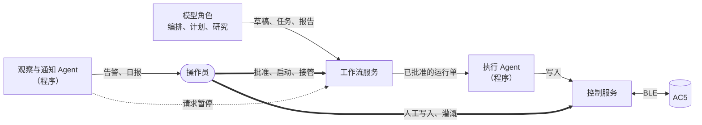

# 项目概览

[English](../en/Overview.md)

这一页写给第一次接触本项目的人，说明 DiAGRI 是什么、GrowBridge 在其中的位置、两种模式各做什么、系统绝不会做什么，以及接下来该读哪一页。

## DiAGRI 是什么

DiAGRI 是一个面向植物生长研究的 AI Agent 平台。它把一个研究问题推进成一轮完整的实验：设计实验，在种植设备上执行已批准的方案，记录每一次读数和写入，分析结果并交付报告。设计和分析由模型角色完成，执行和观察由确定性程序完成。执行 Agent 写入任何东西之前，运行单都要先经操作员批准。

目前平台只驱动一种硬件：装有 Spider Farmer AC5 控制器的种植帐篷。

## GrowBridge 在其中的位置

GrowBridge 是 DiAGRI 的设备桥接部分，只占整体的一小块。它是一个 Python 常驻程序，运行在种植帐篷旁边的 Mac 或树莓派上，独占与 AC5 的那一条蓝牙（BLE）连接。通过这条连接，它读取传感器和设备状态，按请求写入设置，每次写入后回读设备加以确认，并把历史数据保存在本地的 SQLite 里。

DiAGRI 的其余部分都建立在这条连接之上：工作流服务、检查每一次写入的控制服务、项目档案、五个 Agent 和科研方法。各部分的关系见[架构总览](Architecture.md)。

整个项目作为一个 Python 软件包发布。软件包名是 `spiderfarmer-growbridge`，导入名和命令是 `growbridge`（见 [`pyproject.toml`](../../../pyproject.toml) 和 [`cli.py`](../../../src/growbridge/cli.py)），DiAGRI 的其他部分是它下面的子包。这些名字来自最先写成的桥接部分。这是一个独立项目，与 Spider Farmer 官方没有关联。

## 两种模式

用哪种模式由一个配置项决定：[`config.py`](../../../src/growbridge/config.py) 里的 `auto_research`。不设置时它是 `false`，程序只运行 GrowBridge，本 Wiki 称之为仅桥接模式。设为 `true` 后，程序运行整个 DiAGRI，称为 DiAGRI 模式。

| | 仅桥接模式（默认） | DiAGRI 模式（`auto_research = true`） |
| --- | --- | --- |
| 用途 | 查看帐篷状态，由人或 MCP 客户端按需调节 | 执行已批准的实验方案，并留下一项研究需要的全部记录 |
| 谁写设备 | 你本人，通过控制台、本地 HTTP 接口或 MCP 工具（需要 `controls_enabled = true`） | 执行 Agent，按操作员批准的运行单写入；或者人工接管期间的操作员 |
| 接口 | 本地控制台、监听 `127.0.0.1` 的 HTTP 接口、八个 MCP 工具 | 控制台和接口变为只读，MCP 只保留三个读取工具，另外多出 `/wb` 下的工作台路由 |
| 记录 | 样本和操作记录，存在一个 SQLite 文件里 | 研究协议、运行单、审批、动作账本、样本、数据快照和报告，每个服务各用一个 SQLite 文件 |

在 DiAGRI 模式下，桥接部分的三个写入接口一律返回 403（见 [`api.py`](../../../src/growbridge/api.py)），MCP 服务只注册 `get_health`、`get_status` 和 `get_history`（见 [`mcp_server.py`](../../../src/growbridge/mcp_server.py)）。这时所有对设备的写入都要经过控制服务。

仅桥接模式的用法见 [README](../../../README.zh-CN.md)。本 Wiki 的其余内容讲的是 DiAGRI 整体。

## DiAGRI 怎么处理一个研究问题

设计上是这样的。以「提高光照后，冠层长得更快吗？」为例。计划 Agent 把问题写成研究协议（假设、处理和对照、实验单位、主要终点、分析约定），并为每个阶段写一份运行单。程序先校验运行单：设备做不做得到，和安全配置有没有冲突。操作员再批准这一个具体版本。之后由执行 Agent 在 AC5 上执行运行单，包括定时动作、反馈规则，以及只朝降低风险方向动作的保护规则。观察与通知 Agent 负责告警和日报。最后一个阶段结束后，数据冻结成一份数据快照，研究 Agent 按协议事先固定的方法分析，报告归档，这一轮研究轮次的状态变为 `delivered`。要不要做下一轮，由用户决定。

人在几个固定的环节介入：逐份批准运行单，暂停后决定是否续跑，完成浇水、测量这类人工作业，以及决定是否发起下一轮。

代码目前做到的是这样。从运行单往后的每一步都有对应的服务，也都在模拟的 AC5 上跑过端到端测试：起草和校验运行单、审批、执行、告警和日报、数据快照、分析和报告。开头这一段走工作台路由：操作员创建项目、研究协议和轮次，设置模型调用预算，然后提出问题，问题成为编排 Agent 的一个任务。`/workbench` 的控制台有对应的表单；没有命令。测试用的是脚本化的模型。真实模型也已经把问题带完过整轮：在开发用工作台上，三个角色都由 Claude 担任，见[示例：模型角色跑完整一轮](Example-Full-Round-With-Claude.md)和[状态与已知限制](Status-and-Known-Limitations.md)。

## 五个 Agent

其中三个是模型角色：由语言模型读数据、交草稿。另外两个是确定性程序：同样的输入总是得到同样的动作，从不调用模型。

| Agent | 类型 | 代码中 | 做什么 |
| --- | --- | --- | --- |
| 编排 Agent | 模型角色 | 角色 `orchestrator` | 接收用户目标，创建研究任务，交给计划 Agent 或研究 Agent |
| 计划 Agent | 模型角色 | 角色 `planner` | 设计实验：起草运行单，并用校验工具检查运行单和研究协议的设计 |
| 研究 Agent | 模型角色 | 角色 `researcher` | 冻结数据，跑分析，发布报告 |
| 执行 Agent | 确定性程序 | `ExecutorEngine` | 执行已批准的运行单，上报阶段事件 |
| 观察与通知 Agent | 确定性程序 | `Observer` | 判定告警规则，把通知和日报放进发送队列 |

每个模型角色能调用哪些工具，列在 [`agents/tools.py`](../../../src/growbridge/agents/tools.py) 的 `ROLE_TOOLS` 里。各个 Agent 的细节见[五个 Agent](The-Five-Agents.md)。

## 系统绝不会做的事

下面这些限制是写在代码里的，不是靠提示词要求模型遵守的约定。

- **模型角色不控制设备，也不控制阶段。** 阶段控制和设备控制的工具名都列在 `CONTROL_TOOLS` 里，不管配置怎么写，这些工具都会从每个角色的工具集里剔除（见 [`agents/tools.py`](../../../src/growbridge/agents/tools.py)）。模型只交草稿、任务和报告。对话里说的任何话都不算审批。
- **没有操作员的批准，阶段不会启动。** 批准针对的是运行单的某一个版本（见 [`workflow/service.py`](../../../src/growbridge/workflow/service.py)）。
- **水泵不会被自动启动。** 运行单里只要有会启动水泵的动作，校验就不通过（见 [`planning/validate.py`](../../../src/growbridge/planning/validate.py)），执行 Agent 也会拒绝这样的动作（见 [`executor/engine.py`](../../../src/growbridge/executor/engine.py)）。只有通过认证的操作员从局域网入口进来亲自启动，水泵才会运行：在人工接管期间调用灌溉路由（见 [`workbench/api.py`](../../../src/growbridge/workbench/api.py)），或者在阶段页启动计划内灌溉，且只能在该阶段自己的权限下运行（见 [`workbench/manual_tasks.py`](../../../src/growbridge/workbench/manual_tasks.py)）。每次运行受 `max_pump_seconds` 和 `pump_cooldown_seconds` 限制。
- **安全不等模型。** 驱动执行 Agent、保护规则和关泵联锁的那个 tick 从不调用模型（见 [`runtime.py`](../../../src/growbridge/runtime.py)）。模型接口不可用时，已批准的阶段照常执行。

有一件事系统管不到：AC5 面板和厂商 App 仍然可以直接改设备。DiAGRI 只能靠回读发现这类改动。水泵除外：DiAGRI 没有灌溉时水泵若开着，看门狗会把它关掉、发严重告警，并在当前阶段记一条干预（没有活动阶段时只有账本记录和告警）。关泵时还会把插座模式重置为手动，面板上设的定时器因此被清掉。设计理由见[控制与安全模型](Control-and-Safety-Model.md)。

## 当前状态

- 单独运行的 GrowBridge（仅桥接模式）在一台 Mac 上读取并控制过一台真实的 AC5（见 [VALIDATION.md](../../../VALIDATION.md)），没有在树莓派上验证过。
- DiAGRI 整体只在模拟的 AC5 上通过了自动化测试（最近一次运行是 2026-11-14，共 2274 个代码测试）。它没有连过真机，也没有用过真实的通知服务和 CSC。
- 有几部分属于部署事项或尚未实现，包括向 CSC 提交作业。`/workbench` 的操作员控制台只在模拟的 AC5 上检查过。

完整清单见[状态与已知限制](Status-and-Known-Limitations.md)。

## 接下来读什么

| 如果你想 | 请读 |
| --- | --- |
| 装好它，读到帐篷的数据 | [安装与快速开始](Installation-and-Quick-Start.md) |
| 不接硬件，先看 DiAGRI 跑起来 | [教程：在模拟器上跑通一轮研究](Tutorial-Simulated-Round.md) |
| 弄清各部分怎么配合 | [架构总览](Architecture.md) |
| 知道为什么可以放心让它一直运行 | [控制与安全模型](Control-and-Safety-Model.md) |
| 查一个词 | [术语表](Glossary.md) |

## 另见

- [架构设计文档](../../diagri-agent-architecture.zh-CN.md)：第 1 到 4 节是设计概览，本页是它的摘要。
- [五个 Agent](The-Five-Agents.md)
- [工作流与状态机](Workflow-and-State-Machines.md)
- [常见问题](FAQ.md)
