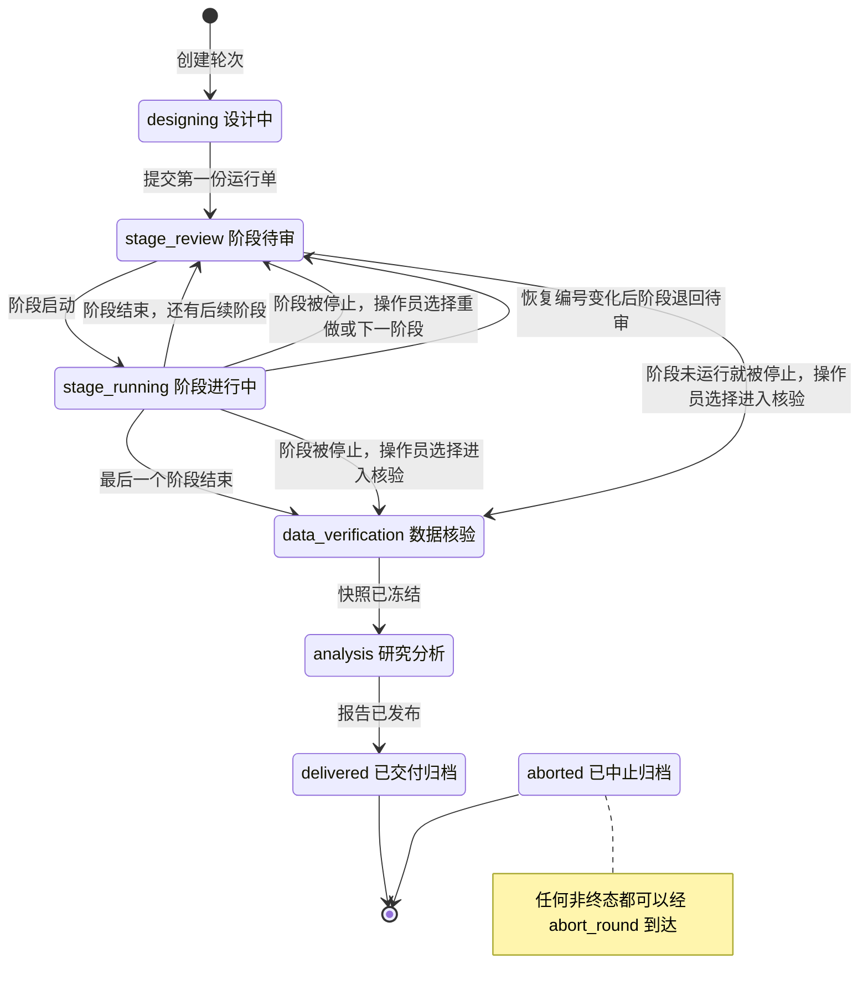
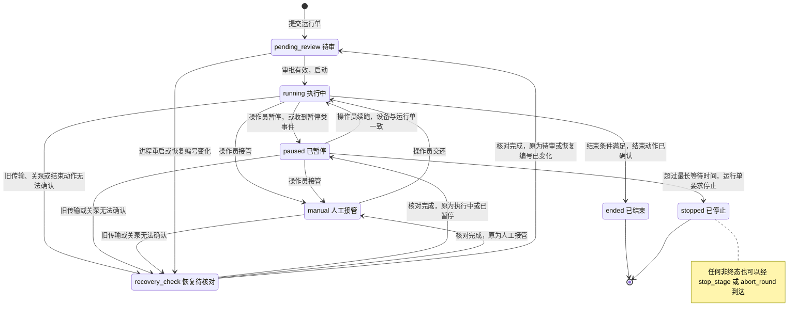
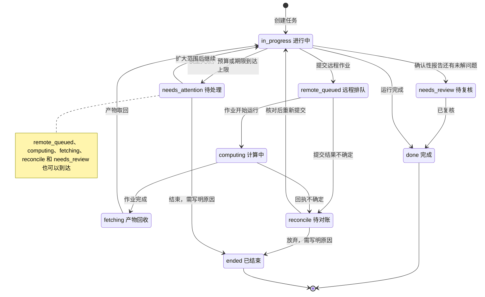

# 工作流与状态机

[English](../en/Workflow-and-State-Machines.md)

这一页写给想弄清「轮次、阶段或研究任务为什么处在现在这个状态，又有什么能推动它」的人。它给出三个状态机，说明每个转换由谁触发，并解释重复事件和迟到事件为什么不会造成破坏。

> **现状。** 下面的转换都来自代码和测试，只在模拟的 AC5 上运行过。其中一些在运行中的守护进程里还没有入口，文中会注明。见[状态与已知限制](Status-and-Known-Limitations.md)。

## 三个状态机，一个所有者

**轮次**是从目标到报告的一次完整推进。**阶段**是轮次里的一个执行区段，由一份运行单管着。**研究任务**是交给某个模型角色的一项工作。三者分开建模，因为推动它们的原因各不相同：掉线可以让阶段暂停，而这时某个任务可能还在分析上周的数据。

能改它们的只有工作流服务：轮次和阶段归 [`workflow/service.py`](../../../src/growbridge/workflow/service.py) 的 `WorkflowService`，任务归 [`workflow/tasks.py`](../../../src/growbridge/workflow/tasks.py) 的 `TaskBoard`。状态名定义在 [`workflow/states.py`](../../../src/growbridge/workflow/states.py)。

## 轮次

| 转换 | 触发 | 谁 |
| --- | --- | --- |
| 新建 → `designing` | `create_round` | 操作员或工作流身份 |
| `designing` → `stage_review` | 第一次 `submit_run_sheet`，且没有阻断性问题 | 操作员、工作流身份或模型角色 |
| `stage_review` → `stage_running` | `start_stage` 成功 | 操作员或工作流身份 |
| `stage_running` → `stage_review` 或 `data_verification` | 某个阶段进入 `ended`，去向由协议的阶段清单决定 | 执行 Agent 的事件 |
| 阶段被 `stopped` 之后 | `choose_after_stop`，可选 `redo`、`next`、`verify`、`abort` | 操作员 |
| `stage_running` → `stage_review` | 恢复编号变化后，阶段退出 `recovery_check` | 运行时 |
| `data_verification` → `analysis` | `mark_snapshot_frozen`；快照完整且校验通过时由 `freeze_dataset` 调用 | 研究 Agent |
| `analysis` → `delivered` | `mark_report_published`；报告为终稿时由 `publish_research_report` 调用 | 研究 Agent |
| 任一非终态 → `aborted` | `abort_round` | 操作员 |

阶段被停止，并不会直接推动轮次。它只是把轮次标记为「等待操作员选择」，在选择做出之前不能再提交运行单（[`workflow/store.py`](../../../src/growbridge/workflow/store.py) 的 `round_effect`）。原因是：停下来之后，已有的数据还值不值得分析，只有人能判断。

## 阶段

进程重启或恢复编号变化，同样会把 `running`、`paused` 和 `manual` 的阶段送进 `recovery_check`，图里只画了一次。

| 转换 | 触发 | 谁 |
| --- | --- | --- |
| 新建 → `pending_review` | `submit_run_sheet` 创建阶段 | 操作员、工作流身份或模型角色 |
| 保持 `pending_review` | `approve` 记下一条审批；提交更高版本的运行单会让旧审批作废 | `approve`：近期重新认证过的操作员 |
| `pending_review` → `running` | `start_stage`：审批有效，没有安全配置冲突，关泵联锁未生效，这台设备上没有其他进行中的阶段 | 操作员或工作流身份 |
| `running` → `paused` | `pause_stage` | 操作员或观察身份 |
| `running` → `paused` | `DISCONNECT_AFFECTS`、`READINGS_STALE`、`EXTERNAL_CHANGE`、`CLOCK_ANOMALY`、`RESULT_UNKNOWN`、`RULE_PAUSE`、`ALERT_PAUSE` | 执行 Agent 的事件；`ALERT_PAUSE` 来自观察与通知 Agent |
| `paused` → `running` | `resume_stage`：审批有效，联锁未生效，没有结果未定的动作，设备与运行单一致 | 操作员 |
| `running`、`paused` → `manual` | `takeover` | 操作员 |
| `manual` → `running` | `handback`；列出与运行单的差异，可以记为人工干预 | 操作员 |
| `running`、`paused`、`manual` → `recovery_check` | `TRANSPORT_UNCONFIRMED`、`PUMP_OFF_UNCONFIRMED`；从 `running` 出发还包括结束动作未确认的 `END_ACTIONS` | 执行 Agent 的事件 |
| 任一非终态 → `recovery_check` | 进程启动、恢复编号变化 | 运行时 |
| `recovery_check` → `paused`、`manual` 或 `pending_review` | 解除条件成立 | 运行时，每次 tick 对每个处于 `recovery_check` 的阶段尝试；操作员用 `record_onsite_check` |
| `running` → `ended` | 先 `END_CONDITION_MET`，再收到已确认的 `END_ACTIONS` | 执行 Agent 的事件 |
| `paused` → `stopped`，或保持 `paused` | `MAX_WAIT_EXPIRED`，去向由运行单的 `on_expiry` 决定 | 执行 Agent 的事件 |
| 任一非终态 → `stopped` | `stop_stage`、`abort_round`；处于 `pending_review` 时还可以用 `revoke_approval` | 操作员 |
| `running`、`paused` 状态不变 | `switch_run_sheet`：换成新版本运行单，写入权全部换新 | 近期重新认证过的操作员 |

写入权跟着状态走。进入 `running` 时授予新的阶段写入权。进入 `paused` 时撤销它，养护写入权保留。进入 `manual` 时两者都撤销，另授人工写入权。进入 `recovery_check` 时三者全部撤销。进入 `ended` 时撤销阶段写入权，养护写入权保留到下一个阶段启动。每一次变化都是一个 `Plan`：先交接旧写入权，再授予新的，最后把状态和历史记录放在一个事务里保存（`_apply`、`_commit`）。写入权本身的说明见[控制与安全模型](Control-and-Safety-Model.md)。

阶段结束特意分成两个事件。`END_CONDITION_MET` 只把阶段标成 `end_pending`；这时阶段写入权还在，执行 Agent 用它执行运行单里的结束动作。只有 `confirmed` 为真的 `END_ACTIONS` 才真正结束阶段。结束动作得不到确认，说明设备状态不明，阶段转入 `recovery_check`。

## 研究任务

这张图就是 `workflow/tasks.py` 里的 `_ALLOWED` 表。表外的转换一律是 `Denied("state")`；从 `reconcile` 或 `needs_attention` 结束任务时必须给出原因。

目前只有一部分转换有代码去触发：

- `in_progress` → `done`、`needs_review` 或 `needs_attention`：模型的一次运行结束时，由派发器推动（[`agents/dispatch.py`](../../../src/growbridge/agents/dispatch.py)）。
- `in_progress`、`remote_queued`、`computing`、`fetching` → `needs_attention`：`TaskBoard.expire`，每个期限只触发一次，由 tick 调用。
- 远程作业的那一圈，以及离开 `reconcile`、`needs_attention` 和 `needs_review` 的出路，任务板都允许，但 `src/` 里没有任何代码调用。计算服务只维护自己的作业阶段；操作员处置任务的路由也还没有。

## 谁可以触发转换

触发来源有三类，得到的信任程度各不相同。

- **操作员指令。** 调用方的 `Actor` 来自工作台会话。[`workflow/permissions.py`](../../../src/growbridge/workflow/permissions.py) 的 `require_operator` 拒绝其他一切身份，模型角色得到的拒绝码是 `model_role`。`approve` 和 `switch_run_sheet` 还要求 300 秒内重新认证过；工作台的续跑和接管路由也有同样的要求。原因是：正是这些决定，把设备交给了一份方案。
- **事件。** 执行 Agent 和观察与通知 Agent 通过 `StagePort.report` 上报 `StageEvent`。事件不带身份，它只陈述一个事实（例如「回读不一致」），对当前状态意味着什么，由工作流服务判断。事件可以让阶段暂停、结束、停止或转入待核对，但绝不能让阶段启动或续跑。
- **模型角色。** 它可以提交运行单草稿，由此产生一个 `pending_review` 的阶段。研究 Agent 的工具在核对轮次确实属于任务所在的项目之后，可以把轮次从 `data_verification` 推到 `analysis`，再从 `analysis` 推到 `delivered`。对已经启动的阶段，模型角色什么都做不了。

另外还有两种给服务用的身份。`workflow` 身份可以创建项目和轮次，也可以启动审批有效的阶段。`observer` 身份可以调用 `pause_stage`。`src/` 里目前没有代码使用这两种身份：观察与通知 Agent 是靠 `ALERT_PAUSE` 事件来暂停阶段的。

守护进程里的入口：`/wb` 提供了对应 `create_project`、`save_protocol`、`create_round` 的路由，提供了审批、启动、暂停、续跑、停止、接管、交还、现场核对和提交草稿的路由，也提供了对应 `choose_after_stop` 和 `abort_round` 的路由。`revoke_approval` 和 `switch_run_sheet` 是有测试的服务方法，但没有对应的路由或命令。见 [HTTP、工作台与 MCP 接口](API-Reference.md)。

## 同一个事件只推进一次

事件的投递是「至少一次」。执行 Agent 可能在下一次 tick 再报同一个事实，工具调用可能重试，中间进程还可能重启。所以每个事件都有 `event_id`，并且这个编号和它引起的状态变化写在同一个事务里。

- **阶段事件。** `report` 遇到见过的编号直接忽略。否则，编号和新状态一起写入 `wf_events`。两次上报撞在一起时，后一次的插入会失败，它的整个事务随之回滚。对当前状态不适用的事件，记为 `dropped`。
- **轮次事件。** `mark_round` 只在轮次处于预期状态时推进，每个编号只推进一次。编号的形式是 `snapshot_frozen:<轮次>:<快照>` 和 `report_published:<轮次>:<产物>`。
- **任务事件。** 编号已经用过时，`TaskBoard.transition` 原样返回任务。每个 `trigger_event_id` 只创建一个任务。

[`tests/workflow/test_workflow_events.py`](../../../tests/workflow/test_workflow_events.py) 里有个例子：一个 `RULE_PAUSE` 事件让阶段暂停，操作员续跑，同一个事件又来了一次。阶段保持 `running`，历史里只有一条 `rule_pause` 记录。

操作员指令可以放心重复，靠的是更简单的办法：启动一个已经 `running` 的阶段、暂停一个已经 `paused` 的阶段、接管一个已经 `manual` 的阶段，都只是返回当前状态。两者背后还有阶段记录上的修订号：根据旧修订算出来的变更会被 `Denied("state")` 拒绝，慢一步的调用方因此覆盖不了更新的状态。

## 过期事件按写入权编号丢弃，不按时间

过期事件是指：观察到的那一刻它是真的，但现在已经不相关了。执行 Agent 发现「灯和预期不符」，上报 `EXTERNAL_CHANGE`。这条上报还没处理，操作员已经暂停、把灯改好、又续跑了。这时再应用这个事件，就会把一个刚刚核对过的阶段再暂停一次。

规则是：执行 Agent 上报 `running` 阶段的事件时，把观察当时的阶段写入权编号放进 `detail.right_number`。这个编号和阶段当前的编号不一致，工作流服务就丢弃这个事件（`_plan_event`）。

为什么用写入权编号，而不用时间戳：

- **它划的界线正好是需要的那一条。** 每次启动、续跑、交还和切换运行单版本，都会授予新的阶段写入权。过了这些时刻，更早的观察就不再算数。
- **墙上时钟会跳。** 执行 Agent 自己在时间发生跳变时，就把墙上时钟视为不可信（[`executor/outage.py`](../../../src/growbridge/executor/outage.py) 的 `ClockTrust`）。校时之前打上时间戳的事件，可能看起来比之后的续跑还新。
- **它是精确的。** 暂停和续跑可能落在同一秒内。两个整数要么相等，要么不相等。

不带编号的事件，例如观察与通知 Agent 的 `ALERT_PAUSE`，只按状态判断：暂停类事件只对 `running` 的阶段生效。

## 恢复待核对：阻止什么，允许什么

`recovery_check` 的意思是：设备状态，或者某次写入的结果，现在不清楚。阶段会记住自己原来的状态（`prior_state`），并失去阶段写入权、人工写入权和养护写入权。

| 被阻止 | 仍然允许 |
| --- | --- |
| 定时动作、反馈规则和结束动作 | 保护规则，只要连接有效 |
| 人工写入和灌溉 | 关泵联锁路径 |
| 暂停、续跑、接管、交还、切换运行单版本 | 养护规则，前提是旧传输已确认停止、联锁已解除（原状态是 `manual` 时除外） |
| 在同一台设备上启动另一个阶段 | 采样、告警和日报 |
| | `stop_stage`、`abort_round`、`record_onsite_check` |

满足下面任意一条，阶段就可以退出（`_may_exit`）：

- 旧传输已确认停止，联锁未生效，回读之后没有结果未定的动作；原状态是 `running` 或 `paused` 时，还要求设备与运行单一致；
- 操作员登记了现场核对。

运行时每次 tick 都会对每个处于 `recovery_check` 的阶段做这个尝试（[`runtime.py`](../../../src/growbridge/runtime.py) 的 `_follow_up`）。进程重启时还在待审的阶段也在其中，尽管它从未启动过、不算当前阶段。

退出后去哪里，取决于原来的状态：`running` 或 `paused` 变成 `paused`；`manual` 保持 `manual`，并拿到新的人工写入权；`pending_review` 仍是 `pending_review`。阶段不会直接回到 `running`，因为续跑必须由人确认。如果这期间恢复编号变过，要先重新批准安全配置，然后阶段回到 `pending_review` 重新审批。

## 代码与附录 B 的差异

[架构设计文档](../../diagri-agent-architecture.zh-CN.md)附录 B 的状态转换表是设计稿。代码在这几点上不同：

- 轮次在阶段启动时进入 `stage_running`，而不是在运行单获批时。审批和启动是两次调用。
- 阶段结束分成两个事件；结束动作未确认时进入 `recovery_check`。
- `switch_run_sheet` 对 `paused` 的阶段也可用。审阅期间「旧版本继续运行」这个选项并不存在。
- `revoke_approval` 只适用于 `pending_review` 的阶段。已经启动的阶段要用 `stop_stage` 停止。
- 退出 `recovery_check` 还要求关泵联锁已经解除。
- 超过最长等待时间只改变状态，它本身不产生告警。如果它让阶段停止，暂停时的 `stage_waiting` 告警会被解除，因为阶段已经不在暂停状态。
- 研究任务里，远程作业的那一圈和用户的处置都是允许的转换，但没有调用方。

## 另见

- [架构总览](Architecture.md)
- [控制与安全模型](Control-and-Safety-Model.md)
- [Agent 一览](The-Five-Agents.md)
- [运行一轮研究](Run-a-Research-Round.md)
- [故障处理手册](Troubleshooting-Runbook.md)
- [拒绝码与事件类型](Denial-Codes-and-Events.md)
- 测试：[`tests/workflow/`](../../../tests/workflow/)、[`tests/tasks/`](../../../tests/tasks/)
